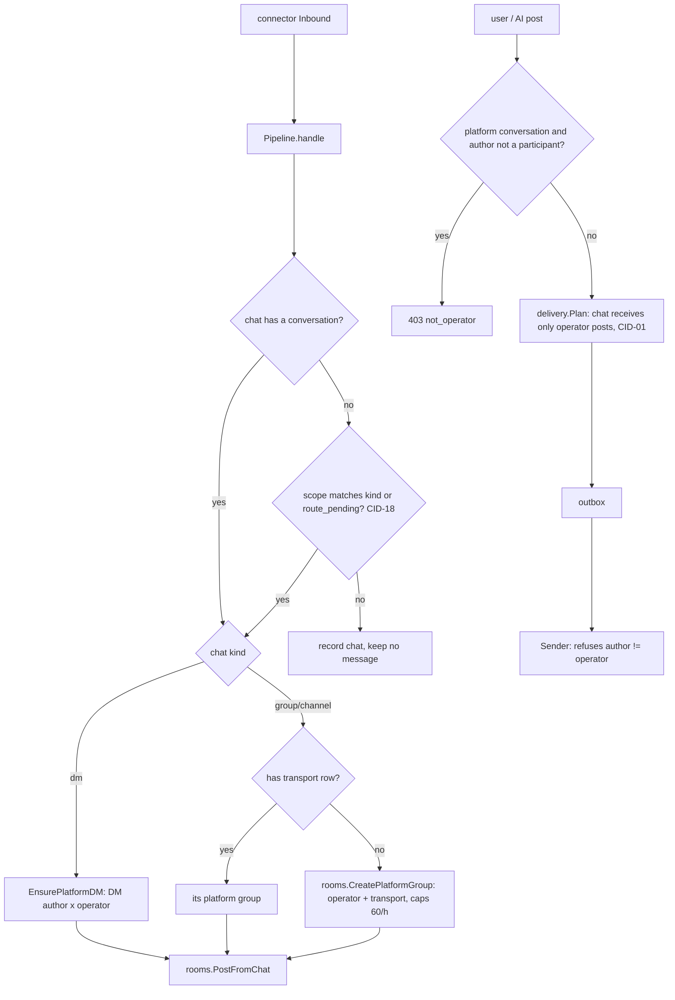

# Connection Identity Design

**Spec**: `.specs/features/connection-identity/spec.md`
**Status**: Draft
**Decision record**: AD-015 (supersedes AD-002, amends AD-011 and AD-013)

---

## Refinements of the spec

The design keeps every CID requirement. Five points refine it; each is stated here so the
Verifier checks the refined reading.

1. **CID-14: one-chat auto-groups are adopted, not orphaned.** The spec assumes every chat leaves
   its room and the next message creates the conversation. That splits the history of a group
   chat that already had its own group (one chat plus the operator, the ACC-06 shape) into two
   rooms. The upgrade instead **keeps** such a room as that chat's platform conversation (rule in
   § Upgrade). Every other chat membership is removed, as the spec says. History is kept either
   way; adoption also keeps it in one place.
2. **CID-02: "another AI" means one that can see the conversation.** An AI only sees rooms it is a
   member of, and CID-10 hides a platform conversation from every AI but its operator. A caller
   that cannot view the conversation keeps getting `404 not_found`, like any room it cannot see
   (no existence leak, same rule as ROUTE-04). `403 not_operator` goes to every caller that **can
   view** the conversation but is not its operator: the connection owner when an AI operates it,
   and users with `use` on the operator AI. The spec's independent test reads: the owner posting
   there gets 403 `not_operator`, and another AI gets 404.
3. **CID-18: the scope governs only chats without a conversation (decided 2026-10-22).** Nothing
   that flows today is silenced. A chat that has a conversation keeps receiving whatever the
   scope. A chat without one becomes a conversation only when the scope includes its kind, or
   when it is marked `route_pending` by the upgrade (every chat that was in any room before the
   upgrade and was not adopted). Deleting a platform conversation detaches its chat (its
   transport row goes with the room), and the scope decides again. The spec's CID-14 and CID-18
   were rewritten to say this.
4. **"Members" of a platform conversation.** People seen in the chat are not member rows; they are
   people reached through the chat (the GRP-02 participant list). The members API returns them
   as kind `person`, next to the operator (CID-06 wording).
5. **Copies of AI DMs sent to a user's app (NOTI-02) (decided 2026-10-22).** The copy "AI: text"
   used to leave through any linked account, on behalf of an AI that does not operate it. That
   broke the success criterion "no message leaves a connection with an author other than its
   operator". **Decision**: notify copies leave only through a connection the notified user
   operates, so their own account writes to them. Notify options list only those chats, and the
   upgrade clears a choice that no longer qualifies. NOTI-01 and NOTI-02 of the intelligences
   spec are amended to say so.

---

## Approaches considered (transport of a platform chat)

| Approach | Summary | Verdict |
| --- | --- | --- |
| **A. Keep `room_members` rows of kind `chat` as a system-managed transport binding** | The chat row stays the delivery mechanism (Plan, outbox, `ListChatRooms`, the outbox membership guard), but only the server creates it, at most one row per chat (unique partial index) and only in the chat's platform conversation. It is never shown or editable as a member. | **Chosen**: reuses the whole delivery, outbox and ROOM-01 machinery; the schema enforces CID-08 |
| B. `chats.room_id` column, no chat member rows | Cleanest model, but rewrites Plan, the outbox claim guard, inbound lookups and every query that joins chat members | Rejected: large churn, no behaviour gain |
| C. `rooms.chat_id` column | Group conversations have one chat, but a DM can carry several (one per connection the same operator runs) | Rejected: does not fit DMs |

---

## Architecture Overview

A connection (connector) has one operator (`COALESCE(operator_iid, owner_id)`). Every chat it
receives belongs to at most one conversation of that operator:

- a **DM chat** is the transport of the DM between its author (person, or verified user) and the
  operator (ACC-02, unchanged);
- a **group or channel chat** is the transport of one **platform group**: a `group` room owned by
  the connection owner, with the operator as its only intelligence member and the people seen in
  the chat as participants.

A **platform conversation** is any room that holds a transport row (`room_members.kind='chat'`).
Regular groups never hold one after the upgrade.



---

## Code Reuse Analysis

### Existing Components to Leverage

| Component | Location | How to Use |
| --- | --- | --- |
| `EnsurePlatformDM` | `internal/conversations/platform.go` | Unchanged for DM chats. Its body moves into a tx helper reused by the operator change (CID-05). Rows are reordered so that the unique index holds after every statement |
| `autoGroup` caps, `routeState`, `setDetail`/`clearDetail` | `internal/connectors/autoroute.go` | Kept for new platform groups. `CheckMember` and `CreateWithMembers` are replaced by `rooms.CreatePlatformGroup` |
| `delivery.Plan` | `internal/delivery/rules.go` | Gains the per-chat operator rule. Bridge and broadcast inputs are removed |
| `Sender.Send` operator check (`operatorID`) | `internal/connectors/sender.go:96` | Becomes a refusal for any other author. The per-member signature logic goes |
| `dmLevel` / `viewsAIOf` | `internal/access/access.go` | Same rule extended to platform groups (operator AI's owner and `use` grantees view) |
| `ListRoomChatConnectors` | `internal/store/queries/conversations.sql:93` | Finds the connection(s) and operator(s) of a room: used by the post guard, access and the Room DTO |
| `chat_people` / `ListChatPeople` | `internal/store/queries/people.sql` | The people of a platform conversation (CID-06, CID-07 already recorded by PEOP-01) |
| Gateway backlog | `internal/agents/gateway.go:465` | CID-09 holds as is. The new operator's cursor is set to the room's last seq so a swap does not replay history |
| Audit `connector.operator` | `internal/connectors/service.go:401` | One entry per operator change, with counts of moved conversations (CID-05) |
| WhatsApp `allowed` / `idleWarning` | `internal/connectors/whatsapp/connector.go:117,196` | Replaced by the exactly-one-instance rule (CID-04) |
| Migration runner with Go hooks | `internal/store/store.go:109` (AD-012) | Hook `0018_connection_identity` (raw SQL, same tx) |

### Integration Points

| System | Integration Method |
| --- | --- |
| SQLite | `0017_drop_room_chat_settings.sql` (drop `rooms.bridge_chats`, `rooms.broadcast`) and `0018_connection_identity.sql` + Go hook (data upgrade, unique index) |
| HTTP API / DTO (AD-003) | New error codes, `RoomMember` kind `person`, `Room.platform`, `Chat.conversation_id`. Retired fields and the route endpoint are removed, and `make generate` refreshes `types.gen.ts` |
| Channel (AD-004) | Wire protocol unchanged. `chat_ids` is no longer advertised but still accepted, so old CLIs keep working |
| Web | Picker, member list, composer, room settings and connector page follow the new DTOs |

---

## Components

### Outbound rule: `delivery.Plan` (CID-01, CID-03)

- **Location**: `internal/delivery/rules.go`
- **Interfaces**: `Plan(members []Member, msg Draft) Targets`. `Member` gains `Operator string`,
  the operator iid of a chat's connection. `Draft` gains `AuthorIID`. `RoomState` is removed.
- **Rule**: agents as today. A chat receives a post only when the author is an agent or a user,
  `msg.AuthorIID == m.Operator`, the transport has outbound on, and the chat is listed (when
  recipients are given). Chat-authored and system messages reach no chat: bridging is retired.
- **Feeding**: `rooms` builds members from `ListRoomMembers`, extended with
  `COALESCE(k.operator_iid, k.owner_id)` for chat rows.

### Send guard: `connectors.Sender` (CID-01, CID-03)

- For a `room` outbox entry whose message `author_iid` is not the connection's current operator,
  `Send` returns a permanent error (`ErrNotOperator`, "the author does not operate this
  connection"). This covers entries queued before the upgrade or an operator change. The outbox
  marks the entry failed without retrying.
- The operator's own messages are always unsigned (ACC-03 extended to every operator). No other
  author reaches `Send`, so `authorMember`/`SignOutbound` handling is deleted.
- Notify copies (`purpose=notify`) leave only when the chat's connection is operated by the
  notified user (refinement 5).

### Post guard: `rooms.Service.Post` (CID-02, CID-11)

- After authorization, if the room holds a transport row, the author must be an intelligence
  participant of the room: an agent/user member row (in a platform group that is the operator
  only) or a DM party. Otherwise it gets `ErrNotOperator`. A caller that only views (a
  `use` grantee) gets `ErrNotOperator` instead of `ErrForbidden` in such rooms.
- Every write path goes through `Post`: messages, files, reactions, and the DM `to` path of the
  channel. A user participant of a platform DM (the verified user's own web DM) may still post.
  Their message stays in Partyline, because Plan sends only the operator's posts.
- API: `ErrNotOperator` → `403 not_operator` (`dto.ErrorCodeNotOperator`).

### Platform groups: `rooms.CreatePlatformGroup` / `rooms.SwapPlatformGroupOperator`

- **Location**: `internal/rooms/platform.go` (new)
- `CreatePlatformGroup(ctx, ownerID, name string, operator MemberInput, chatID string) (string, error)`:
  a system call with no member checks. In one transaction it creates the group (owner = connection
  owner), the operator member row and the transport row (outbound on).
- `SwapPlatformGroupOperator(ctx, q *db.Queries, connectorID string, from, to MemberInput, now int64) ([]string, error)`:
  a tx helper. For each group room holding a transport row of the connection: delete `from`'s
  member row, insert `to`'s (default settings), and for an AI set `agent_cursors` to
  `next_seq-1`. It returns the room ids for `MembersChanged` after commit.

### Inbound routing (CID-06, CID-07, CID-08, CID-18)

- **Location**: `internal/connectors/autoroute.go`
- `route` delivers a chat that has a conversation (a transport row) there, whatever the scope. A
  DM chat still goes through `platformDM`, so it follows its operator. A chat without one gets a
  conversation only when `scopeMatches(scope, kind) || chat.route_pending`: DM chats through
  `platformDM`, group/channel chats through `autoGroup` → `CreatePlatformGroup` (60/h cap and
  serialization unchanged). Creating the conversation clears `route_pending`. Otherwise the
  chat is recorded and no message is kept.
- Removed: `autoRoute` (catch-all), `skipped`/`auto_route_skips` use, `AutoRouteUnavailable`
  and `ListChatRooms` fan-out to several rooms (a chat has one room).
- Own-account messages (`selfmsg.go`, CID-17) are unchanged.

### Access (CID-10)

- **Location**: `internal/access/access.go`
- `UserRoomLevel`: a `group` room that holds a transport row resolves by `platformGroupLevel`:
  - manage for the room owner (the connection owner);
  - post for a user member (the operator when it is the owner);
  - view for a user who owns or holds a named `use` grant on the operator AI (`viewsAIOf`);
  - none otherwise. Grants, including everyone grants, are ignored.
- `SetVisibility` refuses a platform conversation with `ErrPlatformNoSharing` (422
  `platform_no_sharing`), as it does for DMs.
- Conversation list (`internal/conversations/list.go`): platform groups viewed through an AI are
  listed like AI-viewed DMs.

### Members (CID-12, CID-13)

- **Location**: `internal/rooms/members.go`
- `AddMember` with kind `chat` → `ErrChatsNotMembers` (422 `chats_not_members`). The check runs
  before access checks that could reject first (L-018). Kind `chat` is no longer accepted by
  `CreateWithMembers`, groups or `create_group`.
- In a platform conversation, adding or removing a member returns `ErrPlatformMembersFixed` (422
  `platform_members_fixed`). `UpdateMember` still edits the operator's delivery mode and keywords.
- The members listing (`rooms.Service.Members`) filters out `chat` rows; delivery keeps reading every row through `ListRoomMembers`. The members endpoint appends the people of the
  conversation's chats as `kind: "person"` entries. A person entry has `member_id` = person id and
  `intelligence` set, and carries no settings.

### Operator change (CID-05)

- **Location**: `internal/connectors/service.go` (Update) and the conversations tx helper
  `MovePlatformDMs(ctx, q, connectorID string, from, to Party, ownerID string, now int64)` in
  `internal/conversations/platform.go`.
- In the transaction that sets `operator_iid`:
  1. `SwapPlatformGroupOperator` swaps the operator in platform groups.
  2. `MovePlatformDMs` moves each DM chat of the connection from DM(x, from) to DM(x, to),
     creating the DM when it does not exist. Pending `room` outbox entries of the old DM are
     deleted, and the old DM keeps its history (the ACC-02 move, made eagerly). When x == to,
     the chat only leaves.
  3. One `connector.operator` audit entry records `{from, to, groups, dms}`.
- Events are published after commit. A merge (`ReassignConnectorOperator`) already carries the AI's
  memberships to the surviving AI. A test pins that platform groups follow.

### Deleted operator AI (CID-16)

- **Location**: `internal/agents/registry.go` (Delete)
- Before `DeleteAgentMemberships`, for each connection the AI operates,
  `SwapPlatformGroupOperator(from = AI, to = owner user)` runs, with a `connector.operator` audit
  entry (`reason: operator_deleted`). `operator_iid` becomes NULL through its FK.
- The AI's DMs are deleted with it, as today (DM-08 cascade). The next DM message creates the DM
  with the owner (ACC-02). That is the "ACC-02 rule" of CID-16. For groups the rule is now eager.

### WhatsApp single instance (CID-04)

- **Location**: `internal/connectors/whatsapp/connector.go`
- `instances` stays a string-list field (no config migration). It becomes `Required`, and its help
  text reads "exactly one instance: the number of this connection".
- `Run` with `len(allowed) != 1` reports `StatusError` with the detail `choose the instance (number)
  of this connection`. It neither dials nor restarts, and waits for `ctx`. `Send` refuses a chat
  whose instance prefix is not the configured instance.

### Retirement (CID-15)

| Retired | Server | DTO / API | Web | Channel |
| --- | --- | --- | --- | --- |
| Route chat to agent | `connectors.RouteChat`, handler | `POST /chats/{id}/route`, `RouteChatRequest` removed; `GET /chats` (usable chats) removed | `route-chat-dialog.tsx` removed; connector chat list links each chat to `conversation_id` | none |
| Catch-all rooms | `autoRoute`, `StopCatchAllConnectors`, `SetRoomCatchAllSafety`, `skipAutoRoute` | `auto_route_room_id` removed from `Connector`/`UpdateConnectorRequest`; `Room.catch_all` removed; column kept dead (FK, AD-012), set NULL | `connector-catch-all.tsx` keeps only the scope select | none |
| Bridges between chats | Plan input removed | `bridge_chats` removed from Room/Create/Update; column dropped (0017) | toggle removed | none |
| Broadcast to chats | `applyNoBroadcast`, `NoBroadcastWarning` | `broadcast` removed; column dropped (0017) | toggle removed | instructions no longer mention it |
| Chat members / signatures for chats | `checkUse` chat branch | `MemberKindChat` refused on input; `sign_outbound` and `outbound` dropped from `RoomMember` output | picker without chats; member settings without signature | none |
| Explicit chat recipients | Server keeps `recipients` (ROUTE-10 cap) for old CLIs: it can only narrow among the room's transport chats | unchanged | composer chat picker removed | `chat_ids` removed from the `send_message` schema and instructions, still accepted |

The decoder ignores unknown JSON fields, so an old client that sends a removed field gets no
error and changes nothing.

---

## Data Models

### Migration `0017_drop_room_chat_settings.sql` (with the bridge/broadcast retirement task)

```sql
ALTER TABLE rooms DROP COLUMN bridge_chats;
ALTER TABLE rooms DROP COLUMN broadcast;
```

No index, view or trigger names either column (checked: `0001`, `0008`, `message_views`).

### Migration `0018_connection_identity.sql` + Go hook (CID-14)

The hook (raw SQL, same transaction, AD-012) runs before the file's index statement. Let
`op(c)` = `COALESCE(c.operator_iid, c.owner_id)` for the chat's connection.

1. **DM chats** (`chats.kind='dm'`): keep the transport row only in a `dm` room where `op(c)` is
   `dm_a` or `dm_b`. When several qualify, keep the one with the latest message (then the latest
   `created_at`, then id). Delete the chat's rows in every other room.
2. **Group/channel chats**: a room is **adoptable** for a chat when all of these hold:
   - `kind='group'`;
   - the chat is its only `chat` row;
   - its agent/user member rows are exactly {`op(c)`};
   - `rooms.owner_id` = the connection owner;
   - it is no connection's `auto_route_room_id`.

   Keep the transport row in the best adoptable room (latest message, then latest `created_at`,
   then id). Delete the chat's other rows.
3. Adopted rooms: delete their `grants`, set the transport row's `outbound=1`.
4. Delete pending `room` outbox entries of removed (room, chat) pairs. In kept platform
   conversations, also delete pending entries whose message `author_iid` ≠ `op(c)` (CID-01 from
   the first boot).
5. `UPDATE connectors SET auto_route_room_id = NULL`. The scope is left as configured.
   `chats.route_pending = 1` (column added by this file, `BOOLEAN NOT NULL DEFAULT 0`) for every
   chat that had any `room_members` row before the upgrade and keeps none, so its next message
   creates its operator conversation whatever the scope (CID-14). History stays in the old room.
6. `UPDATE users SET notify_chat_id = NULL` where the chat's connection is not operated by that
   user (refinement 5).
7. One audit row per connection that changed (`connection.identity_upgrade`, actor ''), with
   `{chats_left, conversations_adopted, dms_kept, route_pending, catch_all_cleared}`. Counts
   only, no text.
8. The SQL file then runs
   `CREATE UNIQUE INDEX room_members_chat_once ON room_members (member_id) WHERE kind = 'chat';`
   (CID-08 enforced by the schema).

The `auto_route_skips` table and `connectors.auto_route_room_id` stay as documented dead schema.
`users.notify_chat_id` stays live.

### DTO changes (AD-003)

```go
// dto.ErrorCode additions
ErrorCodeNotOperator          = "not_operator"           // 403
ErrorCodeChatsNotMembers      = "chats_not_members"      // 422
ErrorCodePlatformMembersFixed = "platform_members_fixed" // 422
ErrorCodePlatformNoSharing    = "platform_no_sharing"    // 422

MemberKindPerson MemberKind = "person" // output only

// Room: removed BridgeChats, Broadcast, CatchAll; added
Platform *PlatformInfo `json:"platform,omitempty"`
type PlatformInfo struct {
    ConnectorID   string          `json:"connector_id"`
    ConnectorKind string          `json:"connector_kind"` // whatsapp, telegram, discord, webhook
    ChatKind      ChatKind        `json:"chat_kind"`
    Operator      IntelligenceRef `json:"operator"`
}

// Chat: added
ConversationID string `json:"conversation_id,omitempty"`
```

---

## Error Handling Strategy

| Error Scenario | Handling | User Impact |
| --- | --- | --- |
| Non-operator viewer posts, reacts or sends a file in a platform conversation | `ErrNotOperator` before insert | 403 `not_operator`; web composer is read-only with "Only {operator} writes here" |
| Caller cannot view the conversation | Existing `access.ErrNotFound` | 404, no existence leak |
| Chat added as member anywhere | `ErrChatsNotMembers` | 422 `chats_not_members` |
| Member add/remove in a platform conversation | `ErrPlatformMembersFixed` | 422 `platform_members_fixed` |
| Sharing a platform conversation | `ErrPlatformNoSharing` | 422 `platform_no_sharing` |
| Queued outbox entry by a non-operator (pre-upgrade or operator changed) | Sender permanent failure | Delivery shows failed; nothing sent |
| WhatsApp connection with 0 or ≥2 instances | Status error with detail, no dial | Connector page shows "choose the instance (number) of this connection" |
| Upgrade hook fails | Whole migration transaction rolls back (MIG-05) | Server does not start on the new version; DB unchanged |

---

## Risks & Concerns

| Concern | Location (file:line) | Impact | Mitigation |
| --- | --- | --- | --- |
| Many existing e2e tests assume any agent sends through chats (route-chat setups, catch-all, bridges) | `internal/api/hooks_handlers_test.go:539`, `internal/api/chats_handlers_test.go:36`, `internal/connectors/catch_all_test.go`, `internal/api/no_broadcast_test.go` | Phase 1 breaks them | T1 adds a testkit helper that makes a platform conversation. Tests of retired behaviour are deleted in the task that retires it, and the commit names the CID-15 retirement. Other tests switch to the helper and keep their assertions |
| `EnsurePlatformDM` inserts the new chat row before deleting old ones | `internal/conversations/platform.go:93-125` | Violates `room_members_chat_once` once 0018 adds it | T19 reorders: leave old DMs first, then insert |
| Unique index needs exactly one row per chat before creation | migration 0018 | Migration aborts on a missed case | Hook rules 1-2 delete every non-kept row; the store test asserts the index exists and a duplicate insert fails |
| Access check for groups reads transport rows on every call | `internal/access/access.go:107` | One extra indexed query per group access | `room_members (room_id, kind, member_id)` unique index covers it |
| Deleting an operator AI deletes its platform DMs with history | `internal/agents/registry.go:328` (DM-08 cascade) | History of person DMs is lost | Existing rule, out of scope. Recorded so the Verifier does not flag it as a CID-16 gap |
| No per-chat mute after manual routing is retired | — | A noisy group can only be quietened by the operator's delivery mode | Out of scope. Delivery mode (mentions) and scope remain |
| Notify copies narrowed (decided) | `internal/connectors/sender.go:61` | Users who chose a chat on an AI-operated account lose copies | The upgrade clears the choice; release notes say so |

---

## Test Strategy per requirement

| ID | Test (layer) | Asserts |
| --- | --- | --- |
| CID-01 | `delivery` unit (Plan table), `connectors` sender integration, e2e | Operator post → outbox for the chat. A non-operator agent/user in a DM with a chat → no outbox. A queued entry by a non-operator → failed, fake connector received nothing |
| CID-02 | e2e `internal/api/not_operator_test.go` | Owner (viewer) and `use` grantee posting/reacting/sending a file get 403 `not_operator` and nothing is stored. A non-viewer AI gets 404 |
| CID-03 | sender integration + e2e | Operator AI and operator owner messages reach the fake connector with `Unsigned=true` |
| CID-04 | whatsapp integration (fake evolution) | 0 and 2 instances: status error with the exact detail, no WebSocket dial, a frame is not delivered. 1 instance: connects |
| CID-05 | connectors integration + e2e PATCH | Groups have the new operator member and not the old one. DM chats sit in DM(x, new). Exactly one `connector.operator` audit entry. All of it in one tx (a forced failure leaves everything unchanged) |
| CID-06 | pipeline integration | A first message of a new group chat (scope groups) creates a group whose members are the operator plus `person` entries, and the message is in it |
| CID-07 | pipeline integration | A second sender in the chat appears as a `person` member |
| CID-08 | store test + pipeline race test | Concurrent first messages create one conversation. A duplicate transport insert fails on the index |
| CID-09 | e2e gateway | Operator offline, 3 messages in its platform group, reconnect → backlog delivers them |
| CID-10 | access integration + e2e | Owner and operator-AI `use` grantee view. Another AI of the owner, a connector `use` grantee and an admin get 404. The conversation list matches |
| CID-11 | e2e | Owner viewing an AI-operated group posts → 403 `not_operator` |
| CID-12 | e2e | `POST /rooms/{id}/members {kind: chat}` → 422 `chats_not_members` with an otherwise valid request (L-018) |
| CID-13 | web unit | Picker shows users and AIs and no chat section. Member list shows no chat rows |
| CID-14 | store migration test (fixture before 0018) + e2e boot | A mixed room loses its chat, keeps history and intelligences. A one-chat auto-group is adopted (same room id, grants gone). A catch-all room loses chats. A DM chat stays only in its operator DM. Pending outbox cleaned. Index present. Audit rows written. Rollback on hook failure. `route_pending` set exactly for chats that were in a room and keep none. e2e: a scope-`off` connection's chat that left a mixed room gets its conversation on its next message |
| CID-15 | e2e + web unit | `POST /chats/{id}/route` and `GET /chats` → 404/405. Room DTO without `bridge_chats`/`broadcast`/`catch_all`. Connector DTO without `auto_route_room_id`. A PATCH carrying them changes nothing. Channel `send_message` schema has no `chat_ids` but a call with `chat_ids` still works |
| CID-16 | agents integration | Deleting the operator AI leaves its platform groups with the owner as member, `operator_iid` NULL, and one audit entry |
| CID-17 | regression (existing `TestOwnAccountMessageIsTrustedOnlyWhenTheOwnerOperatesTheAccount`) + one platform-group case | An own-account message lands in the platform group authored by the operator |
| CID-18 | pipeline integration | Scope `dms`: a group chat with an existing conversation keeps receiving. Scope `off`: an unknown group chat keeps no message (record only). Scope `off` + `route_pending`: the message creates the conversation and clears the flag. Scope `off` after its platform conversation is deleted: no message kept. Each case is excluded by its own condition only (L-042) |

---

## Tech Decisions (only non-obvious ones)

| Decision | Choice | Rationale |
| --- | --- | --- |
| Transport representation | `room_members` kind `chat` as system rows + unique partial index | Reuses delivery/outbox; schema enforces CID-08 (approach A) |
| Platform conversation marker | Derived: room holds a transport row | No new column to keep in sync |
| Operator swap in groups | Member swap, new AI cursor = last seq | Spec CID-05; no backlog flood of old history |
| Operator swap in DMs | Chat moves to DM(x, new); old DM keeps history | DMs are keyed by participants (AD-011); same as ACC-02 |
| Columns | Drop `bridge_chats`, `broadcast`; keep `auto_route_room_id` dead | AD-012: FK columns cannot be dropped |
| `recipients` | Still accepted, not advertised | Old CLIs keep working (spec: CLIs need no change) |
