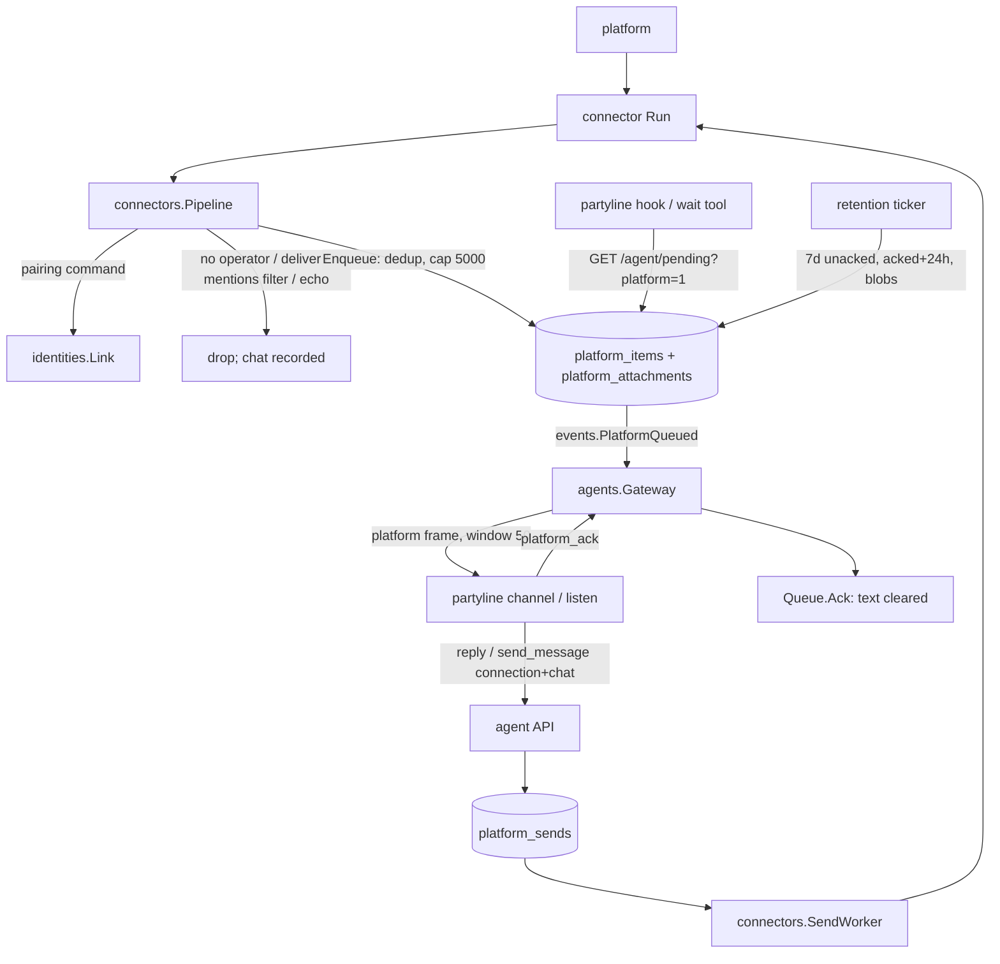

# Connection Identity Design

**Spec**: `.specs/features/connection-identity/spec.md`
**Status**: Draft
**Decision record**: AD-015 (proxy model; supersedes AD-002; amends AD-006, AD-011, AD-013, AD-014)

---

## Summary

Partyline becomes a proxy between integrations and intelligences. A connection (connector) is
the app of exactly one AI, its operator. Every message that arrives on it passes the
connection's filters and lands in that AI's **platform queue**. From there it is pushed to the
AI's live session as a **platform event** over the existing agent WebSocket, and its text is
deleted when the session acknowledges it. The AI answers through the connection with `reply` (a
platform message id) or `send_message` (connection id + chat id). Answers go through a
**platform send queue** and leave unsigned. Rooms (DMs and groups) hold users and AIs only and
never touch a platform again. Old rooms, people and platform DMs stay as read-only history.

## Refinements of the spec

1. **`reply` keeps its endpoint.** `POST /agent/messages/{id}/reply` first looks for a room
   message, then for a platform item of the caller. The channel's `reply` tool does not change.
   A platform message id stays valid for `reply` until its 24-hour attachment window ends.
2. **CID-03 does not reveal connections the caller cannot see.** `not_operator` (403) goes to an
   AI whose owner owns the connection or may `use` it. Any other caller gets `404 not_found`, the
   same answer as for an unknown id (ROUTE-04). The spec's independent test (another AI of the
   same owner) gets 403.
3. **Owner-operated connections go idle at upgrade.** A connection whose operator was the owner
   (NULL `operator_iid`) ends the upgrade with **no operator**. It delivers nothing until the
   owner picks an AI (CID-02). Every connection, new or upgraded, starts with `deliver=all` and
   `groups_mentions_only=on` (CID-27); the old auto-route scope is not carried over.
4. **Old CLIs never get platform events.** A session opts in with the header
   `X-Partyline-Features: platform` (WebSocket) or `?platform=1` (`GET /agent/pending`). A v0.4
   CLI keeps its room messages. Its platform items stay queued, so a client that cannot show
   them neither loses nor acknowledges them, and they expire after 7 days (CID-10).
5. **Outbound text is not kept either.** A platform send's text is deleted when the send reaches
   `sent` or `failed`. With that, no platform message text is stored outside the delivery queue,
   in either direction. There is no send log (out of scope).

---

## Architecture Overview



---

## Code Reuse Analysis

| Component | Location | How to Use |
| --- | --- | --- |
| Inbound pipeline: pairing, `UpsertChat`, `saveMedia`, `truncate`, `SentIDs` | `internal/connectors/inbound.go`, `selfmsg.go` | Kept up to "who wrote it"; room posting, people and DM creation are replaced by `Queue.Enqueue` |
| `identities.ResolveSender` (AD-008) | `internal/identities` | `trusted` = the resolved user is the operator's owner (CID-13) |
| Blob store + `Sweep` | `internal/attachments/store.go:138`, `internal/rooms/retention.go:52` | Platform attachments are blobs. `Sweep`'s `referenced` also checks `platform_attachments`. The retention ticker also runs `Queue.Purge` |
| Gateway session, welcome, backlog, takeover, ping | `internal/agents/gateway.go` | Adds a platform backlog and live pushes. `readAcks` also handles `platform_ack` |
| Channel link frame loop, `seenBefore` dedup, ack-after-notify | `internal/channel/link.go:625` | New `platform` case. Old CLIs ignore unknown frames (`link.go:667`) |
| `listen` JSON lines, `Format`/`FrameAll` | `internal/channel/listen.go`, `format.go` | Platform records reuse the room keys (`author`, `room_name`, `trusted`, `content`), so adapters need no code change |
| `GET /agent/pending` + hooks | `internal/api/agent_handlers.go:51`, `internal/cli/hook.go` | `?platform=1` adds platform events and acknowledges them |
| Connector `Manager.Apply/Stop`, status detail | `internal/connectors/manager.go:195` | A connection without an operator is not run and shows the CID-02 detail |
| Outbox worker backoff/claim pattern | `internal/delivery/outbox.go` | Copied for `platform_sends`; the room outbox is retired |
| Operator audit `connector.operator` | `internal/connectors/service.go:401` | Kept for CID-05, with `{from, to, moved}` |
| WhatsApp single instance | commit `bebd8d1` (T1) | Done; its contract notes are in `contract-notes.md` on that branch |

---

## Components

### Platform queue: `internal/platform` (new package)

- **Purpose**: owns `platform_items` and `platform_attachments`: enqueue, read, ack, purge and
  move.
- **Interfaces**:
  - `Enqueue(ctx, Item) (id string, queued bool, err error)`:
    - inserts with `ON CONFLICT DO NOTHING` on `(connector_id, chat_id, external_id)` (CID-26);
    - in the same tx, deletes the agent's oldest unacked items above 5,000 and adds them to
      `agents.platform_dropped` (CID-11);
    - publishes `events.PlatformQueued{AgentID, ItemID}` after commit.
  - `Unacked(ctx, agentID, afterSeq, limit) ([]Event, error)`: oldest first (CID-08).
  - `Ack(ctx, agentID, itemID) error`: sets `acked_at` and clears `text` (CID-09). Idempotent;
    another agent's item is a no-op.
  - `TakeDropped(ctx, agentID) (int64, error)`: reads the counter and zeroes it, for the CID-10
    notice.
  - `Purge(ctx, now)`:
    - deletes unacked items older than 7 days and counts them as dropped (CID-10);
    - deletes acked items older than 24 h with their attachment rows (CID-09).
  - `MoveConnector(ctx, q, connectorID, toAgent) (int64, error)`: tx helper (CID-05).
- **Dependencies**: store, events. No import of connectors or agents.

### Inbound: `connectors.Pipeline` (CID-02, 06, 07, 12, 13, 14, 26)

`handle` order:

1. A pairing command links the sender and stops (unchanged).
2. `UpsertChat` (the chat record keeps id, title and kind: metadata only).
3. Connection without operator → drop.
4. Own-account message: the echo of a partyline send (`SentIDs` or a `platform_sends` external
   id) → drop. Otherwise it continues with `from_self=true`, `trusted=false` (CID-14).
5. `deliver` excludes the chat kind → drop.
6. `groups_mentions_only` on a group chat → keep only `MentionsAccount || RepliesToAccount`
   (CID-12). `RepliesToAccount` is central: the replied platform id is one of this connection's
   sends to the chat.
7. Resolve `trusted` (CID-13), store media as blobs, `Queue.Enqueue`.

Nothing is posted to a room, and no person or DM is created (CID-07).

`Inbound` gains `MentionsAccount bool`, set by each connector:

| Connector | Sets `MentionsAccount` when |
| --- | --- |
| Telegram | a `mention` entity equals the bot's `@username`, or a `text_mention` names the bot's id |
| Discord | the bot user id is in `mentions` |
| WhatsApp | the instance jid is in `contextInfo.mentionedJid` |
| Webhook | the payload field `mentions_account` is true |

### Connection settings and operator rule (CID-01, CID-02, CID-23, CID-27)

- `connectors.Service.operator` accepts only an AI the owner owns. A user id, the owner's id or an
  empty string gets 422 on `operator_id` ("must be an AI you own"). Creation may omit the
  operator.
- `Manager.Apply` does not run a connection whose `operator_iid` is NULL. It persists status
  `error` with the detail `choose the AI that operates this connection`, and setting the
  operator applies it again.
- Defaults (CID-27): the columns default to `deliver='all'` and `groups_mentions_only=1`. `Create`
  stores the defaults whatever the request carries: the create DTO has no such fields, and only
  PATCH changes them. Migration 0017 adds both columns with those defaults, so every existing
  connection is upgraded to them.
- The `Connector` DTO gains `deliver`, `groups_mentions_only`, `queued` (the unacked count) and
  `operator` (an AI, or absent). It loses `auto_route_scope` and `auto_route_room_id`. PATCH
  validates `deliver` and `operator_id`. No endpoint returns platform text to users.

### Delivery to the session (CID-06, 08, 09, 10, 25)

- **Opt-in**: the channel sends `X-Partyline-Features: platform` on `GET /agent/ws`; the
  gateway records it on the connection.
- **On connect**, after the room backlog:
  1. If `TakeDropped` returns more than 0, send an `AgentNoticeFrame` (empty room) with
     `N platform messages were dropped (older than 7 days or over 5,000 queued)`.
  2. Push unacked items oldest first, at most **50 frames in flight**. Each ack releases the
     next.
- **Live**: `events.PlatformQueued` for the agent's capable connection is queued behind the
  window; items already sent are skipped by seq.
- **Ack**: `readAcks` accepts `{"type":"platform_ack","item_id":…}` and calls `Queue.Ack`.
- **Takeover (CID-25)**: items are acked one by one, not by cursor. A new session's backlog
  sends every unacked item again, including those in flight to the old session. The channel's
  `seenBefore` drops duplicates within one process.
- **Frames (DTO, AD-003)**:

```go
AgentFrameTypePlatform    AgentFrameType = "platform"     // server → channel
AgentFrameTypePlatformAck AgentFrameType = "platform_ack" // channel → server

type PlatformEvent struct {
    ID           string       `json:"id"`            // platform message id for reply
    Platform     string       `json:"platform"`      // whatsapp, telegram, discord, webhook
    ConnectionID string       `json:"connection_id"`
    ChatID       string       `json:"chat_id"`       // partyline chat id, for send_message
    ChatTitle    string       `json:"chat_title"`
    ChatKind     ChatKind     `json:"chat_kind"`
    SenderName   string       `json:"sender_name"`
    SenderID     string       `json:"sender_id"`
    Trusted      bool         `json:"trusted"`
    FromSelf     bool         `json:"from_self"`
    Kind         MessageKind  `json:"kind"`
    Text         string       `json:"text"`
    Attachments  []Attachment `json:"attachments"`
    ReceivedAt   time.Time    `json:"received_at"`
}
type AgentPlatformFrame    struct { Type AgentFrameType `json:"type"`; Event PlatformEvent `json:"event"` }
type AgentPlatformAckFrame struct { Type AgentFrameType `json:"type"`; ItemID string `json:"item_id"` }
```

- **Welcome**: `AgentWelcomeFrame` gains `connections []{id, platform, account_label}`, the
  connections the AI operates. The channel tells the model which numbers are its own.

### Channel, listen, hooks, adapters

- **MCP channel**: a `platform` frame becomes one notification. Its meta carries the
  PlatformEvent fields mapped onto the existing keys:
  - `author` = sender name, `author_kind="platform"`;
  - `room_name` = `"<Platform> · <chat title>"`;
  - `message_id` = event id;
  - `trusted`, `chat_id`, `chat_kind`, `connection_id`, `from_self`.

  Attachments are listed in the content as today, and the ack follows the notification.
- **listen** writes the same record as one JSON line with `type="platform"`. pi, OpenCode and omp
  frame records from `author`, `room_name`, `trusted` and `content`, so they need no code change.
  The shared `integrations/testdata/framing.ts` gains a platform case that every adapter's test
  runs.
- **Codex/Gemini hooks and `wait_for_messages`**: `channel.Pending` requests
  `GET /agent/pending?platform=1`. The server acknowledges the response's `platform` list when it
  returns it ("taken", as for room messages). `FrameAll` frames both kinds.
- **Instructions** are rewritten to cover platform events:
  - they come from your own number;
  - answer with `reply`, or with `send_message` + `connection` + `chat`.

  The `chat_ids`, broadcast and bridge sentences are removed.

### Answering (CID-03, 15, 16, 17, 18)

- **Table** `platform_sends`:
  - columns: id, connector_id, chat_id, agent_id, text, reply_to_external_id, status
    (`pending|sending|sent|failed`), attempts, next_attempt_at, last_error, external_id,
    created_at, updated_at;
  - text is cleared at `sent` or `failed` (refinement 5).
- **`connectors.Sends.Send(ctx, agentID, connectorID, chatID, text, replyTo)`**:
  1. Check the operator (CID-03) and that the chat belongs to the connector (CID-17,
     `unknown_chat` 404).
  2. Insert the row and make one synchronous attempt (15 s timeout) through `Manager.Send`,
     with `Unsigned=true`.
     - Success: `sent`, and the `external_id` goes to `SentIDs` for echo detection.
     - Failure: stays `pending` with `last_error`, and the tool answer says
       `not sent yet: <reason>; partyline retries` (CID-18).
  3. The worker retries with the outbox backoff and marks `failed` after the existing attempt
     limit.
- **HTTP**:
  - `POST /api/v1/agent/messages/{id}/reply`: a room message as today, else the caller's
    platform item, sent through `Sends.Send` with `replyTo` = the item's external id (CID-15).
    Not found → 404.
  - `POST /api/v1/agent/connections/{id}/chats/{chat}/messages {text}` (CID-16, CID-17, CID-03).
  - Both answer `PlatformSendResult {id, status, error?}`: 201 when sent, 202 when queued.
- **New chats** (CID-31, v0.6.2): the `{chat}` of that endpoint, and `chat` of the tool, may also be the *address* of a chat the connection has not heard from. `Sends.destination` looks the value up as a chat id of the connection first; anything else is offered to `Kind.Address(cfg, raw)` of the connection's kind, a pure function of its public config: WhatsApp takes a phone number with its country code (7 to 15 digits, an optional `+`) or a JID (personal, `@lid`, group; the device suffix is dropped) on the connection's one instance, and titles a DM with the masked number; Telegram a canonical 64-bit chat id (negative: group); Discord a snowflake (17 to 20 digits, kind channel); the webhook has no rule. An address of a chat the connection already has is that chat. Otherwise the chat is created (`UpsertChat`, announced as `ChatDiscovered`) after `AllowNewChat`, 10 per AI per hour (`agents.Registry.AllowNewChat`, a limiter of its own: 429 `rate_limited`), and the send goes on as any other, so a platform that refuses the first message leaves a pending send that the worker retries and a chat that stays. The order of the checks is the same (connection, operator, chat, text): only the operator creates a chat, a refused request creates nothing and spends no allowance.
- **Tool `send_message`**: new optional `connection` and `chat`. Exactly one of `room`, `to` or
  (`connection` + `chat`). `chat_ids` leaves the schema and is still accepted and ignored.
- **Files** (CID-32, v0.6.2): `POST /agent/connections/{id}/chats/{chat}/messages` also takes a multipart body (a `message` part with `{text}` as the caption and one `file` part, as the room endpoint does). The file is read into memory (at most `PARTYLINE_MAX_UPLOAD_MB`, 413 over it), passed to `Sends.Send` as `SendInput.File` and to the connector as the one `OutFile` of the `Outbound`; nothing stores it. A send with a file is marked `once` (`platform_sends.once`, migration 0021): it is attempted only by the request, under `SendFileTimeout` (90 s) instead of 15 s, and a refusal or a timeout fails it at once (`failed`, text cleared, 502 `unavailable` "the platform did not take the file: <reason>", with "; the caption was sent, the file was not" when the text went out first). `Recover` fails the `once` sends a dead process left in flight (`interrupted by a restart: the file was not kept`) instead of requeueing them, since the worker would send their caption alone. The caption is the text of the `Outbound`: the connectors send the text and then the file, as they always did (Discord in one message). A kind says it can with `Kind.CanSendFiles` (WhatsApp, Telegram, Discord); the webhook cannot and answers 422 `unsupported`. The checks keep their order, with the capability after the operator and before the chat, so nothing is created for a refused file. The tool `send_file` takes `room` or `connection` + `chat` (exactly one); `reply_to` is for rooms.
- **Reactions** (CID-33, v0.6.2): `POST /agent/messages/{id}/react` for a message of the AI's own platform queue (no longer `unsupported`) goes to `Sends.React`: the checks in the order of any send (connection, operator, `Kind.CanReact`, chat, a platform id on the message, one emoji), the AI's 30 posts a minute, then a `platform_sends` row without text, `once`, attempted at once through `Manager.React` (`connectors.Reaction` carries the platform ids of the chat, the message and its sender, `TargetFromMe` for a message the account wrote, and `Created`). The row, as for a text, is what makes `Pipeline.settle` hold an own-account message of the chat while the reaction runs, and `Created` (the id evolution-go answers with, best effort) is what lets it drop the echo. A refusal is `failed` and 502 `unavailable` "the platform did not take the reaction: <reason>" (Telegram, for an emoji outside its set: "emoji is not one of Telegram's allowed reactions"); a kind without reactions (webhook) is 422 `unsupported`. The answer is `PlatformSendResult`; the tool says `reacted`.

### Operator change and deletion (CID-05, CID-24)

- **Change**: in one tx, `Service.Update` runs `Queue.MoveConnector` and records one
  `connector.operator` audit entry `{from, to, moved}`. The move takes every item of the
  connection, acked ones too, so `reply` keeps working. After commit it publishes
  `events.PlatformQueued` for the new agent (the gateway re-runs the platform backlog) and calls
  `Manager.Apply`.
- **Deleted AI**:
  - `platform_items.agent_id … ON DELETE CASCADE` deletes its queue;
  - `connectors.operator_iid` becomes NULL through its FK;
  - `Registry.Delete` reads the connections the AI operates before deleting it, then publishes
    `events.ConnectorsOrphaned{IDs}`;
  - the manager re-applies those connections, which then show the CID-02 detail.
- **Merge**: `ReassignConnectorOperator` gains `UPDATE platform_items SET agent_id = into`.

### Partyline is one more app (CID-19, 20, 21, 22)

- `AddMember`, `CreateWithMembers` and group creation refuse kind `chat` with 422
  `chats_not_members`.
- **History stays read-only**:
  - a post in a DM with a person participant gets 422 `history_only` ("this conversation is
    history: answer on the platform");
  - `send_message to:@person` answers `no_route_to_person` (DM-05 retired);
  - an edit of a person's profile gets 422 `history_only`;
  - people and contacts pages keep reading them, and no new person is created.
- **Rooms stop delivering to chats**: `delivery.Plan` returns agents only and `rooms.insert`
  creates no outbox. Removed with it: the room outbox and its worker, the `Sender` room path,
  notify copies, `applyNoBroadcast` and chat recipients. `recipients` is still accepted and
  ignored (old CLIs).
- **Retired API**:
  - routes: `POST /chats/{id}/route`, `GET /chats`, `/me/notify-options`, `PUT /me/notify`;
  - DTO fields: `bridge_chats`, `broadcast`, `catch_all`, `sign_outbound`, member `outbound`,
    `Message.outbox`, `notify_chat_id`, `auto_route_*`.

---

## Data Models

### Migration `0017_platform_queue.sql` (additive, Phase 2)

```sql
CREATE TABLE platform_items (
    seq           INTEGER PRIMARY KEY AUTOINCREMENT,        -- delivery order (CID-08)
    id            TEXT NOT NULL UNIQUE,
    agent_id      TEXT NOT NULL REFERENCES agents (id) ON DELETE CASCADE,       -- CID-24
    connector_id  TEXT NOT NULL REFERENCES connectors (id) ON DELETE CASCADE,
    chat_id       TEXT NOT NULL REFERENCES chats (id) ON DELETE CASCADE,
    external_id   TEXT NOT NULL DEFAULT '',                 -- platform message id
    sender_id     TEXT NOT NULL DEFAULT '',
    sender_name   TEXT NOT NULL DEFAULT '',
    trusted       BOOLEAN NOT NULL DEFAULT 0,
    from_self     BOOLEAN NOT NULL DEFAULT 0,
    kind          TEXT NOT NULL DEFAULT 'text',
    text          TEXT NOT NULL DEFAULT '',                 -- cleared on ack (CID-09)
    received_at   INTEGER NOT NULL,
    acked_at      INTEGER
);
CREATE UNIQUE INDEX platform_items_dedupe ON platform_items (connector_id, chat_id, external_id)
    WHERE external_id <> '';                                -- CID-26
CREATE INDEX platform_items_agent ON platform_items (agent_id, acked_at, seq);
CREATE TABLE platform_attachments (
    id      TEXT PRIMARY KEY,
    item_id TEXT NOT NULL REFERENCES platform_items (id) ON DELETE CASCADE,
    sha256  TEXT NOT NULL DEFAULT '', name TEXT NOT NULL, mime TEXT NOT NULL,
    size    INTEGER NOT NULL, status TEXT NOT NULL
);
CREATE INDEX platform_attachments_sha ON platform_attachments (sha256) WHERE sha256 <> '';
CREATE TABLE platform_sends ( /* columns listed under Answering */ );
ALTER TABLE agents ADD COLUMN platform_dropped INTEGER NOT NULL DEFAULT 0;
ALTER TABLE connectors ADD COLUMN deliver TEXT NOT NULL DEFAULT 'all'
    CHECK (deliver IN ('dms', 'groups', 'all'));                            -- CID-27
ALTER TABLE connectors ADD COLUMN groups_mentions_only BOOLEAN NOT NULL DEFAULT 1;  -- CID-27
```

`GET /api/v1/agent/attachments/{id}` falls back to the caller's `platform_attachments`, so the
`download_attachment` tool works unchanged.

### Migration `0018_connection_proxy.sql` (upgrade, Phase 9, CID-21)

1. `DELETE FROM room_members WHERE kind = 'chat'`. Rooms keep messages, intelligences and
   settings; people, `chat_people` and DM rooms stay.
2. `UPDATE connectors SET auto_route_room_id = NULL`. `operator_iid` is left alone: NULL now
   means "no operator". `deliver` and `groups_mentions_only` already hold the CID-27 defaults
   from 0017.
3. `UPDATE users SET notify_chat_id = NULL` (it becomes a dead FK column).
4. `DROP TABLE outbox; DROP TABLE auto_route_skips;` (nothing references them).
5. `ALTER TABLE connectors DROP COLUMN auto_route_scope; ALTER TABLE rooms DROP COLUMN bridge_chats; ALTER TABLE rooms DROP COLUMN broadcast;`
   No index, view or trigger names these columns. `auto_route_room_id` and `notify_chat_id` stay
   as dead FK columns (AD-012).

No Go hook is needed; the file runs inside the single migration transaction (MIG-05).

---

## Error Handling Strategy

| Error Scenario | Handling | User / AI Impact |
| --- | --- | --- |
| Caller is not the operator, but its owner can see the connection | `ErrNotOperator` | 403 `not_operator` |
| Caller cannot see the connection | `ErrNotFound` | 404 `not_found` |
| Chat not of the connection and not an address its platform accepts | `ErrUnknownChat` | 404 `unknown_chat` |
| Platform has no reactions (webhook), or the message has no platform id | `ErrReactionsUnsupported`, `ErrNoReactionTarget` | 422 `unsupported`; nothing is recorded or sent |
| Platform refuses a reaction | The send is failed at once, nothing retries it | 502 `unavailable` with the reason |
| Platform has no media send (webhook) | `ErrFilesUnsupported` | 422 `unsupported`; nothing is created or sent |
| Platform refuses or never answers a file | The send is failed at once, nothing retries it | 502 `unavailable` with the reason |
| More than 10 chats started in an hour | `ErrNewChatRateLimited` | 429 `rate_limited`; nothing is created |
| Reply id unknown or expired | not found | 404; the AI uses `send_message` with the chat |
| Platform refuses or times out | Send stays pending, worker retries | 202 with `error`; the tool text says it retries |
| Connection without operator | Not run | Status error "choose the AI that operates this connection" |
| Post in a platform DM (history) or edit of a person | `ErrHistoryOnly` | 422 `history_only` |
| Chat as member | `ErrChatsNotMembers` | 422 `chats_not_members` |
| Queue over 5,000 or older than 7 days | Oldest dropped and counted | Notice on the next connection |
| Migration failure | Whole upgrade rolls back | Server keeps the old schema |

---

## Risks & Concerns

| Concern | Location (file:line) | Impact | Mitigation |
| --- | --- | --- | --- |
| Many tests assume chats in rooms (routing, catch-all, bridges, notify, platform DMs, chat → room delivery) | `internal/connectors/*_test.go`, `internal/api/hooks_handlers_test.go`, `no_broadcast_test.go`, `notify_test.go`, `platform_dm_test.go` | Phases 3 and 8 delete or rewrite many tests | Each retiring task deletes the tests of what it retires and names the retired IDs in its commit body. Connector and webhook tests are rewritten to assert queue items instead of room messages |
| Platform DM rooms and people stay listed but frozen | `internal/conversations/list.go` | Users see DMs they cannot answer | `history_only` banner in the web app (T30); listing unchanged |
| An old CLI never acks platform frames | gateway | The queue grows until 7 days or 5,000 items | Opt-in header: old CLIs get no platform frames, and the owner sees `queued` grow |
| Burst of up to 5,000 frames on reconnect | `internal/channel/link.go:570` (queue cap 2,000) | Channel queue overflow | Server window of 50 frames in flight |
| Blob shared with a room attachment | `internal/attachments/store.go:138` | Shared blob lost | Purge deletes rows only; `Sweep` deletes a blob only when no room or platform attachment references it |
| Mention detection differs per platform | connector adapters | `groups_mentions_only` (on by default, CID-27) misses a mention and drops a group message | One task per adapter, each tested with captured payloads; replies to the account count too |
| Owner-operated connections go idle at upgrade | migration 0018 | The owner must pick an AI | Status detail says so; release notes |
| Group messages that do not mention the account stop after upgrade (CID-27) | migration 0017 defaults | Operators that relied on whole-group delivery see less | Intended by CID-27; release notes; the owner can turn `groups_mentions_only` off |

---

## Test Strategy per requirement

| ID | Layer | Asserts |
| --- | --- | --- |
| CID-01 | e2e PATCH connector | Owner's AI accepted. The owner's own id, another owner's AI and "" → 422 `operator_id` |
| CID-02 | manager integration | NULL operator: not run, status error with the exact detail; setting an AI runs it |
| CID-03 | e2e | Another AI of the owner → 403 `not_operator`; an AI of another user → 404; nothing sent |
| CID-04 | done (T1) | `internal/connectors/whatsapp/connector_test.go` at `bebd8d1` |
| CID-05 | e2e | PATCH operator moves unacked and acked items; the new AI's session receives them; one audit entry; a forced failure leaves everything unchanged |
| CID-06 | pipeline integration + channel e2e | Event fields complete for a group and a DM; the channel notification meta and the listen line carry them |
| CID-07 | pipeline integration | After inbound, the `messages` row count is unchanged; no person or room created |
| CID-08 | gateway e2e | Offline, 3 items queued; on connect, 3 frames oldest first |
| CID-09 | queue + purge integration | Ack clears text at once; the attachment row and blob are removed after 24 h (fake clock), not before |
| CID-10 | purge + gateway | An item at 7 d − 1 ms is kept, at 7 d deleted; the next connection gets the notice with N and the counter resets |
| CID-11 | queue integration | The 5,001st item drops the oldest and counts 1 |
| CID-12 | pipeline integration + adapters | Mentions-only on: a group message without mention is dropped; with a mention, or as a reply to the account's send, it is kept; DMs unaffected. Each condition is tested alone (L-042) |
| CID-13 | pipeline integration | Linked to the owner → true; linked to another user → false; unlinked → false; from_self → false |
| CID-14 | pipeline integration | The echo of a send is not queued; an own-account typed message is queued with `from_self=true`, `trusted=false` |
| CID-15 | e2e | Reply to an item: the fake connector gets the text, `Unsigned`, `ReplyToID` = the item's external id |
| CID-16 | e2e + channel | `send_message` with connection+chat is sent unsigned; exactly-one-target validation |
| CID-17 | e2e | A chat of another connection → 404 `unknown_chat`, nothing sent |
| CID-28 | adapter | A fake evolution-go answers the instance as production does (`connected: false`, `disconnect_reason: "Reconnecting"`): the detail names the reason; a changed reason is reported; a connected number shows none |
| CID-29 | adapter | A header and wrapped, plain and nested items of an album: each item is the media it holds, the header nothing; an HD copy stays unsupported |
| CID-30 | adapter | `contactMessage` and `contactsArrayMessage` with real-shaped vCards: names and numbers in the text, bounded |
| CID-33 | unit + adapter + e2e + channel | A reaction reaches the fake platform with the chat, message, sender, from-self flag and emoji; its echo is held while it runs and dropped, a typed one is delivered; a refusal is 502 and not retried; webhook and id-less messages are unsupported; one emoji; operator-only; counts against 30 posts a minute |
| CID-32 | unit + e2e + channel + store | A file reaches the fake platform with its name, type, size and content; a refusal fails it with no retry; a restart fails the send in flight and still requeues a text; the webhook refuses it; over the limit is 413; operator-only; the tool's targets and wording |
| CID-31 | unit + e2e + channel | Each kind's address rule; a new address creates the chat and sends; an existing one reuses it; invalid, foreign and non-operator are refused with nothing created; the 11th chat in an hour is 429 and refused requests spend nothing |
| CID-18 | e2e | Failing fake platform → 202 with the reason; the worker retries and succeeds; text cleared after `sent` |
| CID-19 | e2e | `POST /rooms/{id}/members {kind: chat}` → 422 `chats_not_members` (L-018) |
| CID-20 | web unit | Picker without chats |
| CID-21 | store migration test (0016 fixture → 0017 → 0018) + e2e boot | Chat members gone, history kept, tables and columns dropped, rollback on failure; the spec's independent test passes through the API |
| CID-22 | e2e + channel + web | Retired routes 404/405, DTO fields absent, `chat_ids` accepted and ignored, notify endpoints gone, `history_only` refusals |
| CID-23 | e2e + web | Connector DTO and page show operator, deliver, mentions-only, queued and status; no message text anywhere |
| CID-24 | agents integration | Deleting the operator AI removes its items, sets `operator_iid` NULL, and the connection shows the CID-02 detail |
| CID-25 | gateway e2e | An item pushed to session A is not acked; after takeover by B, B receives it |
| CID-26 | queue integration + pipeline | The same platform message twice → one item, one frame |
| CID-27 | e2e create + store migration | A created connection reads `deliver=all`, `groups_mentions_only=true` even when the request tried other values; an upgraded connection (scope `groups` before) reads the same |

---

## Tech Decisions (only non-obvious ones)

| Decision | Choice | Rationale |
| --- | --- | --- |
| Queue ack model | Per-item `acked_at`, ordered by `seq` | Items move between agents (CID-05); a per-agent cursor would mark moved items as delivered |
| Platform frame transport | Same agent WebSocket, new frame types, opt-in header | Reuses session, takeover and ping; old CLIs unaffected |
| `reply` to platform messages | Same endpoint, server-side fallback | No CLI change for `reply` |
| Outbound table | New `platform_sends`; the room `outbox` is dropped | Room outbox rows need a room message, and platform sends must not create one (CID-07) |
| Reply window | Acked metadata kept 24 h with the attachments | The spec keeps files 24 h; replies need the platform id meanwhile |
| Mentions flag | Per-adapter `MentionsAccount`, central `RepliesToAccount` | Only the adapter knows the platform's mention syntax |
| CID-27 defaults | Column defaults + no create fields | One source of truth for new and upgraded connections |
