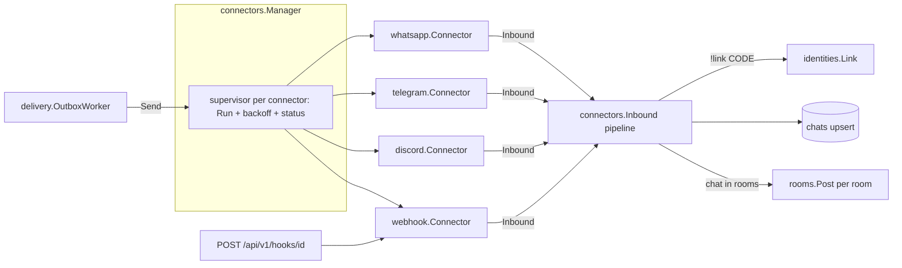

# Connectors Design

**Spec**: `.specs/features/connectors/spec.md`
**Status**: Approved
**Architecture**: see `.specs/features/core-platform/design.md`

---

## Architecture Overview



## Components

### internal/connectors (framework)
- **Kind registry**: `Register(Kind)`; `Kinds() []Kind`; `Kind{Name, Label, Fields []Field, CanListChats bool, Address func(Config, string) (ChatInfo, bool), New func(Config, Deps) (Connector, error)}`. `Address`, optional, is the kind's rule for the address of a chat the connection has not heard from (CID-31): WhatsApp, Telegram and Discord have one, the webhook does not.
- **Field**: `{Name, Label, Type: "string"|"url"|"secret"|"bool"|"string_list", Required bool, Help string, Default any}` - served as `dto.ConnectorKind` (CON-01).
- **Config**: `map[string]any`; `Validate(kind, cfg) map[string]string` (CON-02); secrets split into `secrets_enc` via `secrets.Box`, masked as `"********"` on read (CON-03); a PATCH with `"********"` keeps the stored secret.
- **Connector interface**:
  ```go
  type Connector interface {
      Run(ctx context.Context, h Handler) error            // blocks until ctx done or fatal error
      Send(ctx context.Context, m Outbound) (externalID string, err error)
  }
  type ChatLister interface{ ListChats(ctx context.Context) ([]ChatInfo, error) }
  type Handler interface {
      Inbound(ctx context.Context, m Inbound)
      Status(s Status, detail string)                      // connecting | connected | error
  }
  type Inbound struct {
      ChatID, ChatTitle, ChatKind string                   // ChatKind: group | dm | channel
      MessageID, SenderID, SenderAltID, SenderName string
      FromSelf bool
      Kind, Text, ReplyToID string                         // Kind: text|image|video|audio|document|sticker|reaction|edit|revoke|location|contact|poll|unknown
      Media []Media                                        // Media{Name, Mime string; Size int64; Open func(ctx) (io.ReadCloser, error)}
      At time.Time
  }
  type Outbound struct {
      ChatID, Text, ReplyToID, ReplyToSenderID string
      Files []OutFile                                      // OutFile{Name, Mime string; Size int64; Open func() (io.ReadCloser, error)}
  }
  ```
- **Manager**: `Start(ctx)` loads enabled connectors; `Apply(id)` (re)starts after create/update/enable (CON-04); `Stop(id)` (CON-05); `Send(ctx, connectorID, Outbound)`; supervisor restarts `Run` with backoff 2 s → 120 s and redacts secrets from status text (CON-06).
- **Inbound pipeline** (`inbound.go`): drop `FromSelf` (CON-12) → pairing command match `^\s*[!/]link\s+([A-Z2-9]{6})\s*$` (case-insensitive) → `identities.Link` (IDN-02/03) → `chats.Upsert` (+ `ChatDiscovered` event) → rooms containing this chat → if none, stop (CON-07) → save media once to blob store (CON-11, size limit) → `rooms.PostFromChat` per room with dedupe by `MessageID` (CON-08, CON-10).
- **HTTP**: `GET /connector-kinds`, `GET/POST /connectors`, `GET/PATCH/DELETE /connectors/{id}`, `GET/PUT /connectors/{id}/sharing`, `GET /connectors/{id}/chats`, `POST /connectors/{id}/chats/refresh` (CON-09), `GET /chats` (usable chats), `POST /chats/{id}/route {agent_id}` (web-app UI-13).

### internal/connectors/whatsapp (evolution-go)
- **Config**: `base_url` (url, required), `api_key` (secret, required), `instances` (string_list, optional).
- **Transport**: WS `wss://<host>/ws?token=<api_key>` (no `instanceId`), `User-Agent: partyline/<version>` (Cloudflare blocks empty UA), ping 30 s. Frames `{"queue": "...", "payload": "<json string>"}`; payload `event == "Message"` (WA-01).
- **Instances**: `GET /instance/all` with global key → `{name, token, websocketEnable, connected}`; cache 5 min; tokens memory-only.
- **Number state** (WA-06): the API and the WebSocket can work while evolution-go has lost the number (instances left "Reconnecting" after an outage); the instance's `connected` flag in that list is what tells. `Run` reads the list when it starts, which is also when the supervisor reconnects the WebSocket, and a goroutine of `Run` reads it again every 60 s (`statusInterval`). `connected: false` of the connection's instance is status `error` with a fixed detail, which names the instance's `disconnect_reason` in parentheses when evolution-go gives one (CID-28: `"Reconnecting"` after an outage, or the reason of a logout; it is server text, so white space, control and formatting characters become single spaces, the closing full stop goes and more than 120 characters are cut with an ellipsis, and a reason that is not text counts as none; a changed reason of a number that stays disconnected is a change and is reported; the flag decides, so a number that is connected shows no reason); the status goes back to `connected` (with the idle warning when evolution-go lacks the instance) as soon as the flag is true, a flag that is absent or `null` counts as connected, and only a change is reported (each report is a database write and a `connector.status` event). The WebSocket stays up and messages are delivered whatever the flag says. A check that fails ends `Run` with its error, so the supervisor shows it and retries with backoff, like a failed check at start.
- **Chat ids**: `<instance>|<jid>`; jid bare (strip `:NN` device suffix) (WA-02). Group: `Chat`. DM: `Chat`, sender/senderAlt as `SenderID/SenderAltID`.
- **Parsing**: port of `unwrap` (envelopes `ephemeralMessage`, `viewOnceMessage`, `viewOnceMessageV2`, `viewOnceMessageV2Extension`, `documentWithCaptionMessage`, `editedMessage`, `associatedChildMessage`), `conversation`, `extendedTextMessage`, media nodes (`imageMessage`, `videoMessage`, `audioMessage`, `documentMessage`, `stickerMessage`), `reactionMessage`, `protocolMessage` (edit type 14, revoke type 0), contact, location, poll. Quote id from `contextInfo.stanzaID|stanzaId`.
- **Contacts** (CID-30): `contactMessage {displayName, vcard}` and `contactsArrayMessage {displayName, contacts: [contactMessage]}` are kind `contact`. The text names each contact (the name the sharer saw, else the card's FN or N) and puts the numbers of its vCard in parentheses: `Contact: Ana Test (+5511999990000, +5511988880000)`, `Contacts: Ana Test (+5511999990000); Bruno Test (...)` for a list, the first 50 and `; and N more`, `Contacts: (none)` for an empty one. `vcard.go` reads the card (unfolded, case-insensitive, with or without a group prefix such as `item1.TEL`, parameters in quotes respected, at most 64 KiB): a number is the `waid` parameter of its TEL line with a plus (the WhatsApp id, international and digits only) or else the value with its digits and a leading plus when it is made of digits and separators, and as written when it has a word, an extension or a code in it (merging its digits would make another number); at most 10 per card, once each, 80 characters. Names and numbers are one line of text of a stranger (`oneLine`). The event has no structured field for contacts (the queue stores text and files), so the numbers are in the text.
- **Albums** (CID-29): evolution-go forwards what WhatsApp sends, which is a header, `albumMessage {expectedImageCount, expectedVideoCount}` with no content, and then each photo or video as a message of its own (own `Info.ID`, caption, file and quote). Current WhatsApp wraps each item in an `associatedChildMessage` (`associatedChildMessage.message.imageMessage`); the association to the header is `messageContextInfo.messageAssociation {associationType: MEDIA_ALBUM (1), parentMessageKey, messageIndex}` on the wrapper or inside it, and the type is a number or the enum name. The connector delivers every item as its own inbound message, as it arrives, as the photo, video or document it holds (the media node alone goes to `downloadmedia`), and ignores the header (`ErrNotMessage`). It does not group the items: that needs the announced count, which may be wrong, and a timer, so photos would wait, be lost with a restart (evolution-go does not replay) and share one id to quote; Telegram's media groups already arrive item by item, and the group rules of CID-12 judge each item. An `associatedChildMessage` is unwrapped only when it states no association, UNKNOWN or MEDIA_ALBUM; one that states another (`HD_IMAGE_DUAL_UPLOAD`, `HD_VIDEO_DUAL_UPLOAD`, `MOTION_PHOTO`, ...) is the better copy of a message delivered already and stays an unsupported message, so that it does not arrive as a second photo.
- **Media**: `data.Message.base64` when present; else `POST /message/downloadmedia {"message": <proto>}` lazily through `Media.Open`.
- **Send**: `POST /send/text {number, text, quoted?{messageId, participant}}` (WA-03); `POST /send/media {number, type, filename, caption, url: <base64>}` (WA-04); id from `data.Info.ID`.
- **ListChats**: `GET /group/list` per allowed instance (WA-05).

### internal/connectors/telegram
- **Config**: `bot_token` (secret, required), `api_base` (url, default `https://api.telegram.org`, for tests/self-hosted Bot API).
- **Run**: `getMe` (self id) → loop `getUpdates?offset=<last+1>&timeout=30&allowed_updates=["message","channel_post"]` (TG-01). `migrate_to_chat_id` updates chat id.
- **Send**: `sendMessage` with `reply_parameters{message_id}`; split at 4,096 runes on line boundaries when possible (TG-02); `sendPhoto` for image/jpeg|png|webp ≤ 10 MiB else `sendDocument` (TG-03).
- **Media**: largest `photo` size, `document`, `video`, `audio`, `voice`, `sticker` → `getFile` + `<api_base>/file/bot<token>/<path>` (TG-04).
- No ListChats (Bot API cannot list chats).

### internal/connectors/discord
- **Config**: `bot_token` (secret, required).
- **Session seam**: `type session interface{ Open() error; Close() error; AddHandler(any) func(); ChannelMessageSendComplex(ch string, m *discordgo.MessageSend, ...) (*discordgo.Message, error); UserGuilds(...); GuildChannels(...) }` - production wraps `*discordgo.Session`; tests use a fake.
- **Intents**: Guilds | GuildMessages | DirectMessages | MessageContent.
- **Inbound**: `MessageCreate` where `!Author.Bot` (DC-01); attachments by URL (download through `Media.Open`, size checked).
- **Send**: split at 2,000 runes (DC-02); `Reference` for replies; files via `MessageSend.Files`.
- **ListChats**: text channels of each guild (DC-03). Guild channel titles are `<guild> #<channel>` inbound and listed alike (`Guild` on the session seam).

### internal/connectors/webhook
- **Config**: `secret` (secret, required, generated when empty on create), `outbound_url` (url, optional).
- **Inbound**: handler `POST /api/v1/hooks/{connector_id}`: verify `X-Partyline-Timestamp` within ±300 s and `X-Partyline-Signature = "sha256=" + hex(HMAC_SHA256(secret, timestamp + "." + body))` with constant-time compare (HOOK-01/02); 64 KiB body limit. Rate limits run after the check (HOOK-04): 60 authenticated req/min per connector; invalid requests 30/min per client IP (then 429, no audit). Accepted signatures (normalized: trimmed, lower-case hex) are remembered 10 min per connector in `webhook_replays` (migration `0004`, SHA-256 of the signature), so a replay answers 409 also after a connector or server restart (HOOK-05; fix iteration 2). The rate-limit windows stay in memory.
- **Identities**: `Kind.LinkOwnerOnly` - the caller picks `sender_id`, so `!link` links only the connector owner's codes (IDN-05).
- **Outbound**: POST JSON `{event:"message", connector_id, chat_id, message:{id, room_id, text, reply_to_external_id, author_name, created_at}, attachments:[{name, mime, size, url}]}` signed the same way; attachment URLs are signed, expiring (10 min) download links; non-2xx = failure (HOOK-03).

### internal/identities
- `CreatePairing(ctx, userID, connectorID) (code string, expires time.Time)` - 6 chars from `ABCDEFGHJKLMNPQRSTUVWXYZ23456789`, sha256 stored, 10 min, bound to the connector (IDN-01; the handler checks `use` on it).
- `Link(ctx, code, Account{ConnectorID, ConnectorKind, SenderID, AltID, Display}, onlyUser) (userID string, ok bool)` (IDN-02/03/05).
- `ResolveSender(ctx, connectorID, senderID, altID) (userID string)` - used by `rooms.PostFromChat` to fill `author_user_id` (IDN-04, DLV-06).
- **Identities are scoped to the connector instance**, not the kind (fix iteration 1, S1). A sender id is only as
  trustworthy as the connector that reports it: a webhook caller picks `sender_id` freely, and the owner of a Telegram
  connector with a custom `api_base` or a WhatsApp connector with its own `base_url` controls the payload too. So
  `identities.connector_id` (FK, cascade on connector delete; unique `(connector_id, external_id)`) is matched on
  resolve. Linking through a connector you don't own means trusting that connector's owner; webhook connectors
  (`Kind.LinkOwnerOnly`) can link only for their own owner. Migration `0003` drops identities linked before it.
- **Codes are bound to a connector** (fix iteration 2, S5): `pairing_codes.connector_id` (migration `0005`); `Link`
  takes a code only on its connector, so a code typed where someone else's connector listens links nothing there.
  Changing an endpoint field (`Field.Endpoint`: `base_url`, `api_base`, `outbound_url`) deletes the connector's
  identities (`connector.identities_reset` audit entry).
- HTTP: `GET /identities`, `POST /identities/pairing`, `DELETE /identities/{id}`.

## Data Models

Uses `connectors`, `chats`, `identities`, `pairing_codes` from core migrations.

## Error Handling Strategy

| Error Scenario | Handling | User Impact |
| --- | --- | --- |
| Platform auth failure | status `error: unauthorized`, backoff retry | Red badge with message |
| Media download fails | attachment status `unavailable` | Placeholder in timeline |
| Send fails | Outbox retry (core DLV-07) | Failed badge after 5 attempts |
| Webhook bad signature | 401, nothing stored, audit entry | Caller sees 401 |
| A connector panics (its `Run`, a send, a reaction, a chat listing, a hook request, or the server code it calls) | `connectors.Guard` recovers; the stack is logged without the panic's value (it may carry message text); a run that panicked ends in status `error: the connector crashed in <where>` and restarts with backoff, a call that panicked fails alone; three runs in a row make the connector crash-looping, which `/readyz` reports as `degraded` (CON-15, OPS-04) | Red badge naming where it crashed; the rest of the server keeps working |

## Risks & Concerns

| Concern | Location | Impact | Mitigation |
| --- | --- | --- | --- |
| evolution-go broadcast caveat (instance client write failure skips broadcast) | evolution-go 0.7.2 | Missed events while a per-instance client is broken | Document; recommend Partyline as the only consumer |
| Secrets in error strings (Telegram token in URL) | telegram client | Token in logs/status | `redact(err, secrets...)` in supervisor; never log URLs |
| SSRF through user-set URLs (`outbound_url`, `api_base`, `base_url`) and media URLs | every adapter | Server calls internal services | `internal/connectors/safehttp`: dial-time address check after DNS (loopback, private, link-local, CGNAT, multicast, unspecified, reserved), no redirects, timeouts, body caps (4 MiB JSON/API, upload limit for media); `PARTYLINE_ALLOW_PRIVATE_NETWORKS=true` lifts the address check, `PARTYLINE_PRIVATE_NETWORK_ALLOWLIST` lets listed CIDRs/hosts through (CON-13). Platform error bodies never reach status text |
| Discord gateway hard to test | discord | Low coverage | Session seam with fake; handler logic in pure functions |
| A goroutine an adapter starts itself | every adapter | A panic in a goroutine nobody recovers ends the whole process, whatever supervises `Run` | The manager guards every call it makes and every call the connector makes into it; an adapter wraps each goroutine it starts, and each callback a library runs in a goroutine of its own, in `connectors.Guard` and ends its `Run` with the error (whatsapp `ping` and `watch`, discord handlers) |

## Tech Decisions

| Decision | Choice | Rationale |
| --- | --- | --- |
| Telegram client | Hand-written Bot API calls (`net/http`) | 5 methods; httptest-friendly |
| Discord client | `github.com/bwmarrin/discordgo` | Gateway protocol is large |
| WhatsApp chat id | `<instance>|<jid>` | One connector can serve several instances |
