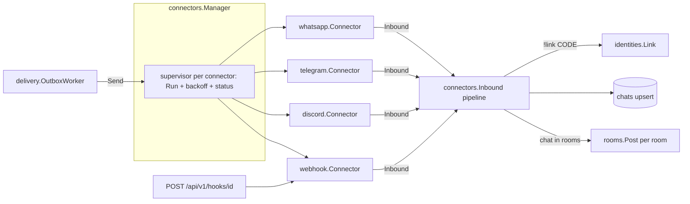

# Connectors Design

**Spec**: `.specs/features/connectors/spec.md`
**Status**: Approved
**Architecture**: see `.specs/features/core-platform/design.md`

---

## Architecture Overview



## Components

### internal/connectors (framework)
- **Kind registry**: `Register(Kind)`; `Kinds() []Kind`; `Kind{Name, Label, Fields []Field, CanListChats bool, New func(Config, Deps) (Connector, error)}`.
- **Field**: `{Name, Label, Type: "string"|"url"|"secret"|"bool"|"string_list", Required bool, Help string, Default any}` - served as `dto.ConnectorKind` (CON-01).
- **Config**: `map[string]any`; `Validate(kind, cfg) map[string]string` (CON-02); secrets split into `secrets_enc` via `secrets.Box`, masked as `"********"` on read (CON-03); a PATCH with `"********"` keeps the stored secret.
- **Connector interface**:
  ```go
  type Connector interface {
      Run(ctx context.Context, h Handler) error            // blocks until ctx done or fatal error
      Send(ctx context.Context, m Outbound) (externalID string, err error)
  }
  type ChatLister interface{ ListChats(ctx context.Context) ([]ChatInfo, error) }
  type Handler interface {
      Inbound(ctx context.Context, m Inbound)
      Status(s Status, detail string)                      // connecting | connected | error
  }
  type Inbound struct {
      ChatID, ChatTitle, ChatKind string                   // ChatKind: group | dm | channel
      MessageID, SenderID, SenderAltID, SenderName string
      FromSelf bool
      Kind, Text, ReplyToID string                         // Kind: text|image|video|audio|document|sticker|reaction|edit|revoke|location|contact|poll|unknown
      Media []Media                                        // Media{Name, Mime string; Size int64; Open func(ctx) (io.ReadCloser, error)}
      At time.Time
  }
  type Outbound struct {
      ChatID, Text, ReplyToID, ReplyToSenderID string
      Files []OutFile                                      // OutFile{Name, Mime string; Size int64; Open func() (io.ReadCloser, error)}
  }
  ```
- **Manager**: `Start(ctx)` loads enabled connectors; `Apply(id)` (re)starts after create/update/enable (CON-04); `Stop(id)` (CON-05); `Send(ctx, connectorID, Outbound)`; supervisor restarts `Run` with backoff 2 s → 120 s and redacts secrets from status text (CON-06).
- **Inbound pipeline** (`inbound.go`): drop `FromSelf` (CON-12) → pairing command match `^\s*[!/]link\s+([A-Z2-9]{6})\s*$` (case-insensitive) → `identities.Link` (IDN-02/03) → `chats.Upsert` (+ `ChatDiscovered` event) → rooms containing this chat → if none, stop (CON-07) → save media once to blob store (CON-11, size limit) → `rooms.PostFromChat` per room with dedupe by `MessageID` (CON-08, CON-10).
- **HTTP**: `GET /connector-kinds`, `GET/POST /connectors`, `GET/PATCH/DELETE /connectors/{id}`, `GET/PUT /connectors/{id}/sharing`, `GET /connectors/{id}/chats`, `POST /connectors/{id}/chats/refresh` (CON-09), `GET /chats` (usable chats), `POST /chats/{id}/route {agent_id}` (web-app UI-13).

### internal/connectors/whatsapp (evolution-go)
- **Config**: `base_url` (url, required), `api_key` (secret, required), `instances` (string_list, optional).
- **Transport**: WS `wss://<host>/ws?token=<api_key>` (no `instanceId`), `User-Agent: partyline/<version>` (Cloudflare blocks empty UA), ping 30 s. Frames `{"queue": "...", "payload": "<json string>"}`; payload `event == "Message"` (WA-01).
- **Instances**: `GET /instance/all` with global key → `{name, token, websocketEnable, connected}`; cache 5 min; tokens memory-only.
- **Chat ids**: `<instance>|<jid>`; jid bare (strip `:NN` device suffix) (WA-02). Group: `Chat`. DM: `Chat`, sender/senderAlt as `SenderID/SenderAltID`.
- **Parsing**: port of `unwrap` (envelopes `ephemeralMessage`, `viewOnceMessage`, `viewOnceMessageV2`, `viewOnceMessageV2Extension`, `documentWithCaptionMessage`, `editedMessage`), `conversation`, `extendedTextMessage`, media nodes (`imageMessage`, `videoMessage`, `audioMessage`, `documentMessage`, `stickerMessage`), `reactionMessage`, `protocolMessage` (edit type 14, revoke type 0), contact, location, poll. Quote id from `contextInfo.stanzaID|stanzaId`.
- **Media**: `data.Message.base64` when present; else `POST /message/downloadmedia {"message": <proto>}` lazily through `Media.Open`.
- **Send**: `POST /send/text {number, text, quoted?{messageId, participant}}` (WA-03); `POST /send/media {number, type, filename, caption, url: <base64>}` (WA-04); id from `data.Info.ID`.
- **ListChats**: `GET /group/list` per allowed instance (WA-05).

### internal/connectors/telegram
- **Config**: `bot_token` (secret, required), `api_base` (url, default `https://api.telegram.org`, for tests/self-hosted Bot API).
- **Run**: `getMe` (self id) → loop `getUpdates?offset=<last+1>&timeout=30&allowed_updates=["message","channel_post"]` (TG-01). `migrate_to_chat_id` updates chat id.
- **Send**: `sendMessage` with `reply_parameters{message_id}`; split at 4,096 runes on line boundaries when possible (TG-02); `sendPhoto` for image/jpeg|png|webp ≤ 10 MiB else `sendDocument` (TG-03).
- **Media**: largest `photo` size, `document`, `video`, `audio`, `voice`, `sticker` → `getFile` + `<api_base>/file/bot<token>/<path>` (TG-04).
- No ListChats (Bot API cannot list chats).

### internal/connectors/discord
- **Config**: `bot_token` (secret, required).
- **Session seam**: `type session interface{ Open() error; Close() error; AddHandler(any) func(); ChannelMessageSendComplex(ch string, m *discordgo.MessageSend, ...) (*discordgo.Message, error); UserGuilds(...); GuildChannels(...) }` - production wraps `*discordgo.Session`; tests use a fake.
- **Intents**: Guilds | GuildMessages | DirectMessages | MessageContent.
- **Inbound**: `MessageCreate` where `!Author.Bot` (DC-01); attachments by URL (download through `Media.Open`, size checked).
- **Send**: split at 2,000 runes (DC-02); `Reference` for replies; files via `MessageSend.Files`.
- **ListChats**: text channels of each guild (DC-03).

### internal/connectors/webhook
- **Config**: `secret` (secret, required, generated when empty on create), `outbound_url` (url, optional).
- **Inbound**: handler `POST /api/v1/hooks/{connector_id}`: verify `X-Partyline-Timestamp` within ±300 s and `X-Partyline-Signature = "sha256=" + hex(HMAC_SHA256(secret, timestamp + "." + body))` with constant-time compare (HOOK-01/02); 64 KiB body limit; 60 req/min.
- **Outbound**: POST JSON `{event:"message", connector_id, chat_id, message:{id, room_id, text, reply_to_external_id, author_name, created_at}, attachments:[{name, mime, size, url}]}` signed the same way; attachment URLs are signed, expiring (10 min) download links; non-2xx = failure (HOOK-03).

### internal/identities
- `CreatePairing(ctx, userID) (code string, expires time.Time)` - 6 chars from `ABCDEFGHJKLMNPQRSTUVWXYZ23456789`, sha256 stored, 10 min (IDN-01).
- `Link(ctx, code, Account{ConnectorID, ConnectorKind, SenderID, AltID, Display}, onlyUser) (userID string, ok bool)` (IDN-02/03/05).
- `ResolveSender(ctx, connectorID, senderID, altID) (userID string)` - used by `rooms.PostFromChat` to fill `author_user_id` (IDN-04, DLV-06).
- **Identities are scoped to the connector instance**, not the kind (fix iteration 1, S1). A sender id is only as
  trustworthy as the connector that reports it: a webhook caller picks `sender_id` freely, and the owner of a Telegram
  connector with a custom `api_base` or a WhatsApp connector with its own `base_url` controls the payload too. So
  `identities.connector_id` (FK, cascade on connector delete; unique `(connector_id, external_id)`) is matched on
  resolve. Linking through a connector you don't own means trusting that connector's owner; webhook connectors
  (`Kind.LinkOwnerOnly`) can link only for their own owner. Migration `0003` drops identities linked before it.
- HTTP: `GET /identities`, `POST /identities/pairing`, `DELETE /identities/{id}`.

## Data Models

Uses `connectors`, `chats`, `identities`, `pairing_codes` from core migrations.

## Error Handling Strategy

| Error Scenario | Handling | User Impact |
| --- | --- | --- |
| Platform auth failure | status `error: unauthorized`, backoff retry | Red badge with message |
| Media download fails | attachment status `unavailable` | Placeholder in timeline |
| Send fails | Outbox retry (core DLV-07) | Failed badge after 5 attempts |
| Webhook bad signature | 401, nothing stored, audit entry | Caller sees 401 |

## Risks & Concerns

| Concern | Location | Impact | Mitigation |
| --- | --- | --- | --- |
| evolution-go broadcast caveat (instance client write failure skips broadcast) | evolution-go 0.7.2 | Missed events while a per-instance client is broken | Document; recommend Partyline as the only consumer |
| Secrets in error strings (Telegram token in URL) | telegram client | Token in logs/status | `redact(err, secrets...)` in supervisor; never log URLs |
| Discord gateway hard to test | discord | Low coverage | Session seam with fake; handler logic in pure functions |

## Tech Decisions

| Decision | Choice | Rationale |
| --- | --- | --- |
| Telegram client | Hand-written Bot API calls (`net/http`) | 5 methods; httptest-friendly |
| Discord client | `github.com/bwmarrin/discordgo` | Gateway protocol is large |
| WhatsApp chat id | `<instance>|<jid>` | One connector can serve several instances |
