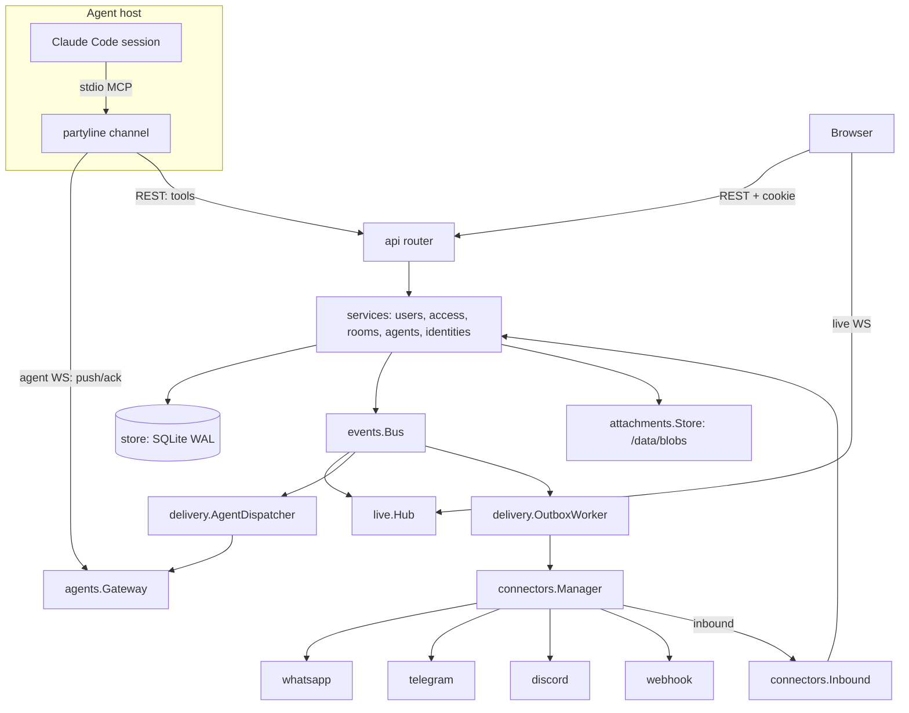

# Core Platform Design

**Spec**: `.specs/features/core-platform/spec.md`
**Status**: Approved (user delegated decisions: "mete marcha", "pode implementar")

This document is also the architecture reference for `agent-channel`, `connectors` and `web-app`.

---

## Approaches considered

| Approach | Summary | Verdict |
| --- | --- | --- |
| **A. Modular monolith (chosen)** | One Go binary: API, live WS, connectors, outbox worker, embedded SPA; SQLite | Fits self-hosting, one volume, tiny image (AD-001) |
| B. Services + Postgres + NATS | Gateway per connector, core API, broker | Operationally heavy for 1-50 users; no benefit at this scale |
| C. TypeScript backend with MCP SDK | Bun server, SDK channel | User asked for Go; channel would need Bun on every agent host |

## Architecture Overview



Request path: middleware (recover → request id → security headers → body limit → principal resolution → CSRF/origin → rate limit) → handler → service (authorization inside the service, never only in the handler) → store.

## Package Layout

```
cmd/partyline/main.go            calls cli.Run(os.Args)
internal/cli/                    subcommands: serve, channel, admin (create-user, reset-password), version
internal/config/                 Config from env (PARTYLINE_*), validation, defaults
internal/app/                    App: wires store, services, bus, hubs, workers, router; Start/Shutdown
internal/store/                  Open (read + write pools), migrations runner, WithTx
internal/store/migrations/       0001_init.sql ... (embedded)
internal/store/queries/          sqlc query files; generated code in internal/store/db
internal/secrets/                Box (AES-256-GCM), LoadOrCreateKey
internal/authn/                  Principal, password (argon2id), tokens (generate/hash/parse), session cookie
internal/users/                  setup, login, sessions, invites, users admin, tokens service
internal/access/                 Authorizer, grants service, visibility presets
internal/rooms/                  rooms, members, settings, messages (Post/List), retention
internal/delivery/               Plan (pure rules), Trust (pure), LoopGuard (pure), AgentDispatcher, OutboxWorker
internal/agents/                 registry (upsert owner/name), Presence, Gateway (agent WS server)
internal/identities/             pairing codes, links, ResolveSender
internal/attachments/            content-addressed blob store with size limit
internal/events/                 typed in-process Bus (fan-out, non-blocking per subscriber)
internal/live/                   UI WS Hub, per-connection access filter
internal/audit/                  Append, List
internal/api/                    router, middleware, handlers per resource
internal/api/dto/                request/response/event DTOs + shared validation constants (tygo source, AD-003)
internal/api/httpx/              JSON decode with limit, error envelope, pagination helpers
internal/webui/                  go:embed of web/dist with SPA fallback
internal/testkit/                apptest: boots App on temp dir + httptest server, typed client helpers
```

## Code Reuse Analysis

### Existing Components to Leverage

| Component | Location | How to Use |
| --- | --- | --- |
| evolution-go parsing and routing logic | earlier private prototype (not copied) | Re-implement `unwrap`, `parse_message`, `bare`, route candidates in Go for the WhatsApp connector |
| Broadcast WS findings | earlier private prototype notes | Connector transport choice |
| Channel handshake transcript | captured 2026-10-19 (AD-004) | Golden test fixture for `internal/channel/mcp` |

### Integration Points

| System | Integration Method |
| --- | --- |
| Claude Code | MCP stdio via `partyline channel` (agent-channel feature) |
| evolution-go, Telegram, Discord, webhooks | `connectors` feature behind `connectors.Connector` |

## Components

### store
- **Purpose**: SQLite access with one writer.
- **Interfaces**: `Open(path string) (*Store, error)`; `(*Store).R() *db.Queries` (read pool, 4 conns); `(*Store).WithTx(ctx, func(q *db.Queries) error) error` (write pool, 1 conn, `BEGIN IMMEDIATE`); `Migrate(ctx) error`.
- **DSN**: `file:<data>/partyline.db?_pragma=journal_mode(WAL)&_pragma=busy_timeout(5000)&_pragma=foreign_keys(1)&_txlock=immediate`.

### authn
- `Principal{Kind: User|Agent, UserID, Role, AgentID, AgentName, TokenID, SessionID}`.
- Passwords: argon2id m=19 MiB, t=2, p=1, 16-byte salt, PHC string.
- Tokens: `pl_<kind>_<base62(32 random bytes)>`; stored `sha256(secret)` hex; prefix = first 12 chars.
- Session cookie `pl_session` = base62(32 bytes); DB keeps sha256; Secure when public URL is https.

### access
- `Authorizer.RoomLevel(ctx, p Principal, roomID) (Level, error)` - for agents: `post` if the agent is a member, else none.
- `CanUseAgent(ctx, userID, agentID) bool`, `CanUseConnector(ctx, userID, connectorID) bool`, `ConnectorLevel` (owner = manage).
- `SetVisibility(ctx, kind, id, Visibility{Mode, Users []UserLevel, PublicLevel})` replaces grants in one tx (ACL-07).
- Services return `access.ErrNotFound` (mapped 404) when the caller lacks view, `ErrForbidden` (403) when it sees but cannot act.

### rooms
- `Create, Get, List(visible), Update(name, description, bridge_chats, retention_days), Delete`.
- `AddMember(ctx, p, roomID, MemberRef{Kind, ID, Outbound})`, `UpdateMember`, `RemoveMember`.
- `Post(ctx, author Author, roomID, PostInput{Text, ReplyTo, Recipients []memberID, Files []attachments.Ref, ExternalID, Sender}) (Message, error)`:
  in one write tx: validate (MSG-02) → `UPDATE rooms SET next_seq=next_seq+1 ... RETURNING` → insert message (+ `author_user_id` resolved) → attachments → `delivery.Plan` → insert outbox rows → `LoopGuard` update → commit → publish `MessageCreated`.
- Dedupe (CON-10): unique index `(room_id, author_kind, author_id, external_id)`; conflict returns existing message, no event.
- `List(ctx, p, roomID, Page{BeforeSeq, AfterSeq, Limit<=100})`.
- `Resume(ctx, p, roomID)` (DLV-09).

### delivery
- `Plan(room RoomState, members []Member, msg Draft) Targets{AgentIDs, ChatMemberIDs}` - pure; implements DLV-01..05.
- `Trusted(msgAuthorUserID, recipientOwnerID string) bool` - pure; DLV-06 (author user resolved at insert: user → itself, agent → owner, chat → identity link owner or empty).
- `LoopGuard.Next(state, authorKind) (state, pausedNow bool)` - pure; DLV-08/10, limit 25.
- `AgentDispatcher`: subscribes to `MessageCreated`; for each target agent online and room not paused → `Gateway.Push`.
- `OutboxWorker`: loop woken by events or 1 s ticker; claims due rows (`status=pending AND next_attempt_at<=now`), sends via `connectors.Manager.Send`, backoff `2s * 2^(attempt-1)`, max 5 (DLV-07), publishes `OutboxChanged`.

### events
- `Bus.Publish(e Event)`; `Bus.Subscribe(buffer int) (<-chan Event, cancel)`; slow subscribers drop events and get a `Lagged` marker (live clients refetch).
- Event types: `MessageCreated`, `RoomChanged`, `MembersChanged`, `GrantsChanged`, `AgentPresence`, `ConnectorStatus`, `ChatDiscovered`, `OutboxChanged`, `IdentityLinked`.

### live
- `GET /api/v1/live` (cookie auth, Origin must equal public URL origin - LIVE-03).
- Frames: `{"type":"room.message","data":MessageDTO}` etc.; audience computed per connection via `Authorizer` (LIVE-02); `hello` frame with server time; ping every 25 s.

### api
- Error envelope: `{"error":{"code":"not_found|forbidden|invalid|conflict|rate_limited|unauthorized|too_large","message":"...","fields":{"name":"reason"}}}`.
- CSRF (SEC-02): cookie-authenticated non-GET requests require `Sec-Fetch-Site: same-origin` or an `Origin` equal to the public origin; bearer requests skip it.
- Rate limits (`golang.org/x/time/rate`): login 5/min per IP (AUTH-05); agent posts 30/min per agent (TOOL-08); hooks 60/min per connector.
- Client IP: `RemoteAddr`, or `X-Forwarded-For` only when the peer is in `PARTYLINE_TRUSTED_PROXIES`.

### Endpoints (v1)

| Area | Endpoints |
| --- | --- |
| Setup/auth | `GET /setup/status`, `POST /setup`, `POST /auth/login`, `POST /auth/logout`, `GET/PATCH /me`, `POST /me/password`, `GET /me/sessions`, `DELETE /me/sessions/{id}` |
| Invites | `GET /invites/{token}`, `POST /invites/{token}/accept`; admin: `GET/POST /admin/invites`, `DELETE /admin/invites/{id}` |
| Admin | `GET /admin/users`, `PATCH /admin/users/{id}`, `GET /admin/audit` |
| Directory | `GET /users` (id, username, display name) |
| Tokens | `GET/POST /tokens`, `DELETE /tokens/{id}` |
| Agents | `GET /agents`, `PATCH/DELETE /agents/{id}`, `GET/PUT /agents/{id}/sharing` |
| Rooms | `GET/POST /rooms`, `GET/PATCH/DELETE /rooms/{id}`, `GET/PUT /rooms/{id}/sharing`, `GET/POST /rooms/{id}/members`, `PATCH/DELETE /rooms/{id}/members/{mid}`, `GET/POST /rooms/{id}/messages`, `POST /rooms/{id}/resume` |
| Files | `GET /attachments/{id}` (`Content-Disposition: attachment` unless image/png, jpeg, gif, webp) |
| Live | `GET /live` (WS) |
| Health | `/healthz`, `/readyz` (no `/api/v1` prefix) |

Connector, chat, identity, hook and agent endpoints are designed in their features. All paths above are under `/api/v1`.

## Data Models

`internal/store/migrations/0001_init.sql` (SQLite, all ids TEXT UUIDv7, times INTEGER unix ms):

```sql
users(id PK, username UNIQUE COLLATE NOCASE, display_name, password_hash, role CHECK(role IN('admin','member')), locale, disabled_at, created_at)
sessions(id PK, token_hash UNIQUE, user_id FK→users CASCADE, created_at, expires_at, last_seen_at, user_agent, ip)
invites(id PK, token_hash UNIQUE, role, created_by FK→users, created_at, expires_at, used_by, used_at, revoked_at)
api_tokens(id PK, user_id FK CASCADE, kind CHECK(kind IN('agent','user')), name, prefix, token_hash UNIQUE, created_at, last_used_at, expires_at, revoked_at)
agents(id PK, owner_id FK CASCADE, name, description, created_at, last_seen_at, UNIQUE(owner_id,name))
connectors(id PK, owner_id FK CASCADE, kind, name, config_json, secrets_enc BLOB, enabled, status, last_error, created_at, updated_at)
chats(id PK, connector_id FK CASCADE, external_id, title, kind, last_seen_at, created_at, UNIQUE(connector_id,external_id))
rooms(id PK, owner_id FK CASCADE, name, description, bridge_chats, retention_days DEFAULT 90, next_seq DEFAULT 1, agent_streak DEFAULT 0, agents_paused DEFAULT 0, created_at, updated_at)
room_members(id PK, room_id FK CASCADE, kind CHECK(kind IN('agent','chat','user')), member_id, outbound DEFAULT 1, added_by, created_at, UNIQUE(room_id,kind,member_id))
grants(resource_kind, resource_id, subject, level, created_by, created_at, PRIMARY KEY(resource_kind,resource_id,subject))
messages(id PK, room_id FK CASCADE, seq, author_kind, author_id, author_user_id, sender_id, sender_alt_id, sender_name, kind, text, reply_to, recipients_json, external_id, created_at, UNIQUE(room_id,seq))
  UNIQUE INDEX messages_dedupe ON messages(room_id,author_kind,author_id,external_id) WHERE external_id IS NOT NULL
attachments(id PK, message_id FK CASCADE, sha256, mime, name, size, status, created_at)
agent_cursors(agent_id FK CASCADE, room_id FK CASCADE, seq, PRIMARY KEY(agent_id,room_id))
outbox(id PK, message_id FK CASCADE, chat_id FK CASCADE, status, attempts, next_attempt_at, last_error, external_id, updated_at)
identities(id PK, user_id FK CASCADE, connector_kind, external_id, alt_external_id, display, created_at, UNIQUE(connector_kind,external_id))
pairing_codes(code_hash PK, user_id FK CASCADE, expires_at)
audit_log(id PK, actor_id, action, target_kind, target_id, detail_json, ip, created_at)
```

Room membership and grants rows for a deleted agent, chat or user are removed by the owning service in the same transaction (no polymorphic FKs).

## Error Handling Strategy

| Error Scenario | Handling | User Impact |
| --- | --- | --- |
| Caller lacks view | `ErrNotFound` → 404 | Resource looks nonexistent |
| Validation | `httpx.Invalid(fields)` → 422 | Form shows field errors |
| SQLite busy | busy_timeout 5 s, then 503 `unavailable` | Retry |
| Outbound send failure | Outbox retry/backoff, then `failed` + event | Message shows "failed" badge |
| Panic in handler | recover middleware → 500, logged with request id | Generic error toast |

## Risks & Concerns

| Concern | Location (file:line) | Impact | Mitigation |
| --- | --- | --- | --- |
| Prompt injection through bridged chats | design-level | Agent executes attacker text | AD-006 trust flag, channel instructions, no permission relay, docs warn against bypass-permissions mode |
| Agent ping-pong loops | design-level | Cost explosion | LoopGuard (DLV-08), per-agent rate limit (TOOL-08) |
| Single writer contention | store | Latency spikes | Short write txs; reads on separate pool; blobs written outside tx |
| Channels are research preview | Claude Code | Contract may change | Isolated in `internal/channel/mcp`; golden handshake test; AD-004 |
| Event bus drops under load | events | UI misses events | `Lagged` marker makes clients refetch |

## Tech Decisions

| Decision | Choice | Rationale |
| --- | --- | --- |
| HTTP router | stdlib `net/http` ServeMux (Go 1.22+ patterns) | No dependency needed |
| WebSocket | `github.com/coder/websocket` | Context-aware, maintained |
| Queries | sqlc (sqlite engine) generated into `internal/store/db` | No hand-written scan code |
| IDs | `github.com/google/uuid` v7 | Sortable |
| Logging | `log/slog` JSON, request id attr, redaction helper | Stdlib |
| Tests | stdlib `testing` + `testify/require` | Readable assertions |
| Lint | golangci-lint (govet, staticcheck, errcheck, gosec, revive) | Security and style gate |
| Config | env only, `PARTYLINE_` prefix, documented in README | 12-factor, Docker-friendly |
