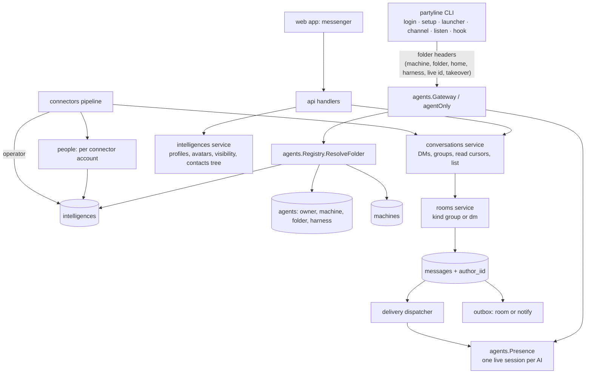
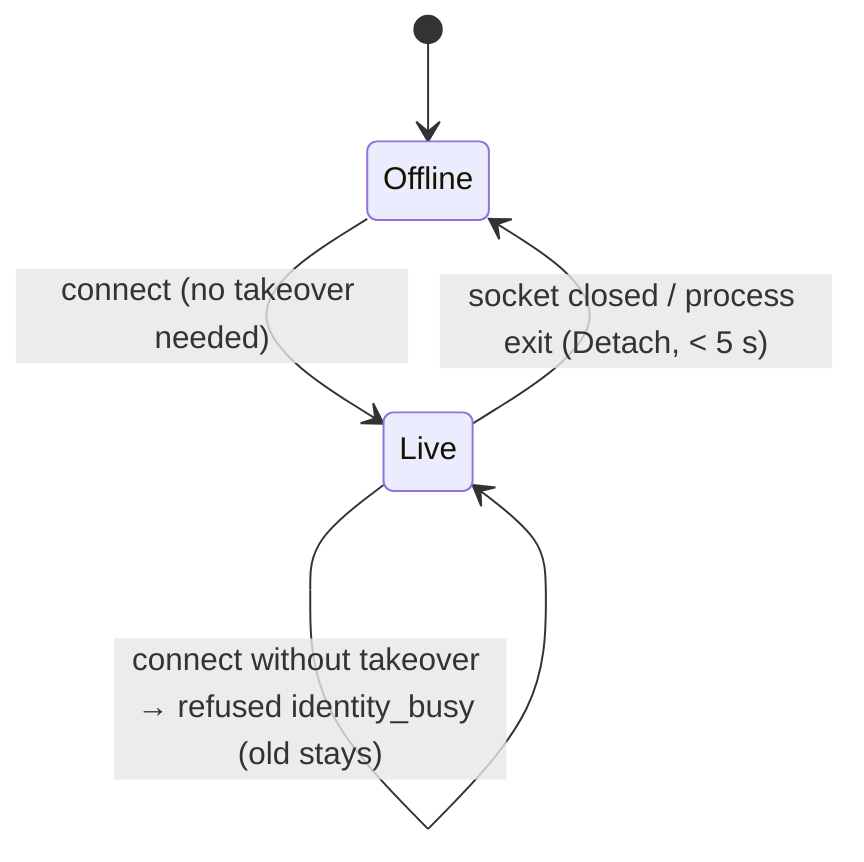

# Intelligences Design

**Spec**: `.specs/features/intelligences/spec.md`
**Status**: Draft (Spec issues 2, 4, 5 and 6 need André's confirmation; the design implements the recommended fix of each)

---

## Spec issues

Found while designing. Wording fixes that keep the meaning are applied to `spec.md` (issues 1
and 3). The others change or add behaviour, so the spec is left as written and the design
implements the recommendation until André confirms or overrules it.

1. **Handle scope (wording, applied).** AID-06 and the "Default name" assumption say handles are
   unique *per owner*; PROF-02 and the "Handles" assumption say unique *across the instance*.
   Instance-wide uniqueness implies per-owner uniqueness and is what mentions need (one
   namespace). Fix applied: AID-06 and the assumption now say "unique across the instance".
2. **v0.3 catch-all rooms vs ACC-06 (needs confirmation).** A connector with a v0.3 catch-all room
   (`auto_route_room_id`, the production WhatsApp routes) routes every new chat into that room.
   ACC-06 makes each new group chat its own group and each DM a DM with the operator. Applying
   ACC-06 on upgrade silently changes where new chats of production connectors go (GRP-01 and
   MIG-01 promise routing stays unchanged). **Recommended**: a connector that has a catch-all
   room keeps the v0.3 behaviour (new chats join that room) until its owner switches it to
   per-chat conversations (clearing the room); ACC-06 and ACC-02 apply to connectors without a
   catch-all room. The design implements this (§ Accounts and operators).
3. **ACC-02 condition (wording, applied).** ACC-02 reads unconditional, but ACC-06 makes the
   platform-DM rule apply only WHERE the auto-route includes DMs (and CON-07 keeps unrouted
   chats out). Fix applied: ACC-02 starts with "WHERE the connector's auto-route includes DMs".
4. **User members of groups (needs confirmation).** Today a `user` room member gets no access and
   no deliveries (`access.UserRoomLevel` reads ownership and grants only). The messenger premise
   (LAY-04 "create it with … the chosen members", AGRP-01, DM-08 "limited to its two
   intelligences") assumes a member sees and writes in the conversation. **Recommended**: a
   `user` member of a group gets `post` on it, and a DM participant gets `post` on the DM.
   Membership becomes an access source next to grants (recorded as AD-011, amends AD-005).
5. **Owner of an AI in the AI's DMs (needs confirmation).** DM-08 makes an AI's DMs visible to
   its owner and `use` grantees, but a DM has exactly two intelligences (DM-02), so a third
   author would break it. **Recommended**: they get `view` (read-only); only the two
   participants post. AI DMs are listed on the AI's profile, not in the owner's sidebar.
6. **Takeover prompt for tools-only harnesses (needs confirmation).** SES-01..03 say "the
   launcher"; Codex and Gemini have no live connection (tools only, assumption "Tools-only
   processes"), so a takeover from them would only disconnect the live session without
   replacing it. **Recommended**: the prompt and `--take-over` apply to launchers whose harness
   opens a live session (claude, opencode, pi, omp). `partyline codex` / `partyline gemini` print
   one informational line ("<name> is also open in another session (<app>, since HH:MM); this
   session uses tools only") and start.

---

## Architecture Overview

### Approaches considered

| Approach | Summary | Verdict |
| --- | --- | --- |
| **A. Shared-id base table (recommended, chosen)** | `intelligences` holds the profile; a user, an AI (`agents`) and a person (`people`) **share their id** with their intelligence row (class-table inheritance). `messages.author_id`, `room_members.member_id`, grants and cursors already store user and agent ids, so they are intelligence ids with no rewrite. One new column `messages.author_iid` names the author intelligence of chat-authored messages. | Smallest migration of referenced tables; AD-002/005/006/008 code paths keep working |
| B. FK column per subtype | Add `intelligence_id` to users/agents/people and rewrite every author/member reference to it | Rewrites `messages`, `room_members`, `grants`, `agent_cursors`; SQLite cannot rebuild referenced tables under `foreign_keys=ON` inside a transaction (see AD-012) |
| C. Union view, no table | A view over users/agents/people | No place for handles (instance-wide unique), avatars, bios or name locks |

The design below is approach A. Rooms stay the only routing primitive (AD-002): a DM is a room
of kind `dm` whose two participants are recorded on the room row.



### Module map

| Package | Change |
| --- | --- |
| `internal/handles` (new, leaf) | Slug, default names, handle validation and allocation helpers (no deps; used by the migration hook and services) |
| `internal/intelligences` (new) | Profiles, visibility (`CanSee`), avatars (storage + serving), contacts and the machine › folder tree |
| `internal/avatars` (new, leaf) | Decode/validate/crop/resize/encode avatar images (stdlib + `golang.org/x/image`) |
| `internal/conversations` (new) | DMs (open/create per pair), groups with members, read cursors, conversation list, platform DMs (ACC-02), merge (MRG) |
| `internal/agents` | Folder identity (`ResolveFolder`), machines, exclusive live session; temporary/project/session-key/archive code deleted |
| `internal/access` | DM participant rule, user members get post, grants on DMs refused |
| `internal/rooms` | `kind`, DM guards, `author_iid` on insert, notify outbox rows |
| `internal/delivery` | Mentions by handle, DM rooms want all, project targets removed |
| `internal/connectors` | People on inbound, operator, account label, platform DM/group routing, own-account messages, signature rule, notify sends |
| `internal/channel`, `internal/cli` | Folder headers, busy/taken-over states, takeover prompt, new tools, `login`, checklist `setup`, `agents` tree |
| `internal/store` | Migrations 0015/0016, single-transaction runner with Go hooks |
| `web/src` | Messenger shell, contacts tree, profiles, avatars, badges |

---

## Code Reuse Analysis

### Existing Components to Leverage

| Component | Location | How to Use |
| --- | --- | --- |
| Migration runner | `internal/store/store.go:96` (`Migrate`, `applyMigration`) | Extended: all pending files in one transaction, plus Go backfill hooks |
| Pre-migration test helper | `internal/store/store_test.go:228` (`openMigratedBefore`) | Builds the v0.3 fixture at `0015` |
| Allocation lock | `internal/agents/registry.go:98` (`allocMu`) | Serialises folder resolution/adoption (same role it has for v0.3 naming) |
| Presence | `internal/agents/presence.go:61` (`Attach`/`Detach`) | Becomes exclusive with an explicit takeover instead of "newest wins" |
| Gateway pre-upgrade errors | `internal/agents/gateway.go:140` (409 agent limit before `websocket.Accept`) | Same place answers `identity_busy` |
| Channel link state machine | `internal/channel/link.go:85-275` | New states `Busy`, `TakenOver` replace `Replaced` |
| Launcher env recovery | `internal/cli/procenv.go:11` (`launcherVars`) | Carries `PARTYLINE_FOLDER`, `PARTYLINE_HARNESS`, `PARTYLINE_TAKEOVER` |
| Device approval | `internal/devices`, `internal/cli/setup.go:313` (`approveInBrowser`) | `partyline login` reuses it unchanged |
| Harness registrars | `internal/harness/harness.go:87` (`Registrar`) | Checklist rows: `Detected()` = installed, `Entries()` non-empty = registered |
| Blob store | `internal/attachments/store.go:54` (`Put`), `:94` (`Open`), `:138` (`Sweep`) | Avatars stored content-addressed; the retention sweep counts avatar references |
| Access + grants | `internal/access/access.go:94-233` | DM/member rules added in `UserRoomLevel`; `CanUseAgent`, `CanUseConnector` reused for visibility |
| Rate limit window | `internal/agents/limit.go` (30 posts/min) | Same sliding window for AI-created conversations |
| Inbound pipeline | `internal/connectors/inbound.go:102` | People upsert, platform DM/group routing and own-account messages hook in here |
| Sender signatures | `internal/connectors/sender.go:61-71` | Operator rule added before the member `sign_outbound` check |
| Outbox worker | `internal/delivery/outbox.go:89-154` | Notify rows (`purpose = notify`) go through the same retries |
| Live hub per-connection filter | `internal/live/hub.go:292` (`render`) | New `intelligence.changed` and `room.read` frames |
| Audit log | `internal/audit/audit.go:85` (`Record` in the caller's tx) | `connector.operator`, `agent.merge`, `agent.adopt` |
| Web sidebar primitives, avatar, badge | `web/src/components/ui/sidebar.tsx`, `ui/avatar.tsx`, `ui/badge.tsx` | Conversation list; `ui/avatar` and `ui/badge` are unused today and become the avatar/badge base |
| Web test helpers | `web/src/test/{render.tsx,fetch.ts,fixtures.ts}` | New fixtures `makeIntelligence`, `makeConversation`, `makeContacts` |
| CLI injection | `internal/cli/cli.go:52` (`stdio`) | Gains `isTerminal`, `rawTerm` and `termSize` so the menu and prompts are testable |

### Integration Points

| System | Integration Method |
| --- | --- |
| SQLite schema | Migration `0015_intelligences.sql` (+ Go hook) adds tables/columns; `0016_drop_v03_identity.sql` drops legacy columns once no code reads them. Both run in the single upgrade transaction |
| sqlc | New `intelligences.sql`, `people.sql`, `conversations.sql`, `machines.sql`; `projects` queries deleted in the cleanup task |
| DTOs / tygo (AD-003) | New `dto/intelligences.go`, `dto/conversations.go`; changed `Agent`, `Room`, `Message`, `RoomMember`, `Me`, `Connector` |
| Agent protocol | New headers, close codes and error codes (§ Folder identity) |
| TS adapters (`integrations/`) | `listen` exit code 3 stops the restart loop; framing gains `conversation` |

---

## Data model

IDs are UUIDv7 strings, times unix milliseconds (as today). New SQL is in `0015`; the legacy
drops are in `0016` (AD-012: no rebuild of referenced tables).

### Migration 0015 (schema)

```sql
CREATE TABLE intelligences (
    id            TEXT PRIMARY KEY,                 -- = users.id | agents.id | people.id
    kind          TEXT NOT NULL CHECK (kind IN ('human', 'ai')),
    display_name  TEXT NOT NULL,
    handle        TEXT NOT NULL COLLATE NOCASE,     -- stored lower-case
    avatar_sha256 TEXT NOT NULL DEFAULT '',         -- blob of the 256x256 PNG, '' = initials
    bio           TEXT NOT NULL DEFAULT '',
    created_at    INTEGER NOT NULL,
    updated_at    INTEGER NOT NULL
);
CREATE UNIQUE INDEX intelligences_handle ON intelligences (handle);
CREATE INDEX intelligences_avatar ON intelligences (avatar_sha256) WHERE avatar_sha256 <> '';

-- AI identity: (owner, machine, folder). folder '' = unlinked (legacy, TREE-06).
ALTER TABLE agents ADD COLUMN folder TEXT NOT NULL DEFAULT '';
CREATE UNIQUE INDEX agents_folder ON agents (owner_id, machine, folder) WHERE folder <> '';

CREATE TABLE machines (
    owner_id     TEXT NOT NULL REFERENCES users (id) ON DELETE CASCADE,
    hostname     TEXT NOT NULL,
    label        TEXT NOT NULL DEFAULT '',          -- TREE-04, '' = show the hostname
    home         TEXT NOT NULL DEFAULT '',          -- canonical home folder sent by the CLI (TREE-02)
    last_seen_at INTEGER,
    PRIMARY KEY (owner_id, hostname)
);

-- External accounts seen by a connector (AD-008: per connector). id = intelligences.id.
CREATE TABLE people (
    id              TEXT PRIMARY KEY,
    connector_id    TEXT NOT NULL REFERENCES connectors (id) ON DELETE CASCADE,
    external_id     TEXT NOT NULL,
    alt_external_id TEXT NOT NULL DEFAULT '',
    platform_name   TEXT NOT NULL DEFAULT '',        -- last name reported by the platform
    name_locked     BOOLEAN NOT NULL DEFAULT 0,      -- a user renamed the contact (PEOP-05, PROF-11)
    last_seen_at    INTEGER,
    created_at      INTEGER NOT NULL,
    UNIQUE (connector_id, external_id)
);
CREATE INDEX people_alt ON people (connector_id, alt_external_id) WHERE alt_external_id <> '';

CREATE TABLE chat_people (                           -- GRP-02: people seen in each chat
    chat_id      TEXT NOT NULL REFERENCES chats (id) ON DELETE CASCADE,
    person_id    TEXT NOT NULL REFERENCES people (id) ON DELETE CASCADE,
    last_seen_at INTEGER NOT NULL,
    PRIMARY KEY (chat_id, person_id)
);
CREATE INDEX chat_people_person ON chat_people (person_id);
ALTER TABLE chats ADD COLUMN person_id TEXT REFERENCES people (id) ON DELETE SET NULL; -- counterpart of a DM chat

-- Conversations (AD-002 holds: a DM is a room).
ALTER TABLE rooms ADD COLUMN kind TEXT NOT NULL DEFAULT 'group' CHECK (kind IN ('group', 'dm'));
ALTER TABLE rooms ADD COLUMN dm_a TEXT REFERENCES intelligences (id) ON DELETE CASCADE;
ALTER TABLE rooms ADD COLUMN dm_b TEXT REFERENCES intelligences (id) ON DELETE CASCADE;
ALTER TABLE rooms ADD COLUMN read_baseline INTEGER NOT NULL DEFAULT 0;
CREATE UNIQUE INDEX rooms_dm_pair ON rooms (dm_a, dm_b) WHERE kind = 'dm';
UPDATE rooms SET read_baseline = next_seq - 1;       -- upgrade: old history is "read"

CREATE TABLE read_cursors (                          -- DM-06, DM-07: per user, per conversation
    user_id TEXT NOT NULL REFERENCES users (id) ON DELETE CASCADE,
    room_id TEXT NOT NULL REFERENCES rooms (id) ON DELETE CASCADE,
    seq     INTEGER NOT NULL,
    PRIMARY KEY (user_id, room_id)
);

ALTER TABLE messages ADD COLUMN author_iid TEXT NOT NULL DEFAULT '';  -- author intelligence ('' = system or a chat without sender)
CREATE INDEX messages_author_iid ON messages (author_iid) WHERE author_iid <> '';

ALTER TABLE connectors ADD COLUMN operator_iid TEXT REFERENCES intelligences (id) ON DELETE SET NULL; -- NULL = the owner (ACC-01)
ALTER TABLE connectors ADD COLUMN account_label TEXT NOT NULL DEFAULT '';  -- "@bot", "+•••• 1234" (ACC-07)
ALTER TABLE users ADD COLUMN notify_chat_id TEXT REFERENCES chats (id) ON DELETE SET NULL; -- NOTI-01
ALTER TABLE outbox ADD COLUMN purpose TEXT NOT NULL DEFAULT 'room' CHECK (purpose IN ('room', 'notify'));

-- Deleting a user, an AI or a person deletes its intelligence; its DMs follow (ON DELETE CASCADE).
CREATE TRIGGER users_intelligence_delete AFTER DELETE ON users
BEGIN DELETE FROM intelligences WHERE id = OLD.id; END;
CREATE TRIGGER agents_intelligence_delete AFTER DELETE ON agents
BEGIN DELETE FROM intelligences WHERE id = OLD.id; END;
CREATE TRIGGER people_intelligence_delete AFTER DELETE ON people
BEGIN DELETE FROM intelligences WHERE id = OLD.id; END;
```

Facts this relies on (verified with SQLite 3.45 and sqlc 1.31 while designing): `ADD COLUMN …
REFERENCES` is allowed with a NULL default under `foreign_keys=ON`; AFTER DELETE triggers fire for
rows deleted by an `ON DELETE CASCADE` (user → agents → intelligence → DM rooms); sqlc parses
`ALTER TABLE … DROP COLUMN` and triggers.

`message_views` is recreated in 0015:

```sql
CREATE VIEW message_views AS
SELECT m.id, m.room_id, m.seq, m.author_kind, m.author_id, m.author_user_id, m.author_iid,
       m.sender_id, m.sender_alt_id, m.sender_name, m.kind, m.text, m.reply_to,
       m.recipients_json, m.external_id, m.created_at,
       CAST(CASE
            WHEN m.author_kind = 'system' THEN 'Partyline'
            WHEN m.author_kind = 'agent' THEN COALESCE(NULLIF(rm.display_name, ''), i.display_name, ia.display_name,
                                                       NULLIF(a.display_name, ''), NULLIF(a.auto_name, ''), a.name, '')
            WHEN m.author_kind = 'user' THEN COALESCE(i.display_name, iu.display_name,
                                                      NULLIF(u.display_name, ''), u.username, '')
            ELSE COALESCE(i.display_name, NULLIF(m.sender_name, ''), c.title, '')
            END AS TEXT) AS author_name,
       CAST(COALESCE(i.handle, '') AS TEXT) AS author_handle,
       CAST(COALESCE(i.kind, '') AS TEXT) AS author_ikind,
       CAST(COALESCE(i.avatar_sha256, '') AS TEXT) AS author_avatar
FROM messages m
LEFT JOIN intelligences i ON i.id = NULLIF(m.author_iid, '')
-- transitional fallbacks (removed in 0016): rows written before author_iid is set on insert
LEFT JOIN intelligences ia ON m.author_kind = 'agent' AND ia.id = m.author_id
LEFT JOIN intelligences iu ON m.author_kind = 'user' AND iu.id = m.author_id
LEFT JOIN agents a ON m.author_kind = 'agent' AND a.id = m.author_id
LEFT JOIN users u ON m.author_kind = 'user' AND u.id = m.author_id
LEFT JOIN room_members rm ON m.author_kind = 'agent' AND rm.room_id = m.room_id
                         AND rm.kind = 'agent' AND rm.member_id = m.author_id
LEFT JOIN chats c ON m.author_kind = 'chat' AND c.id = m.author_id;
```

The transitional joins keep every task between 0015 and the cleanup green: agents and users
created before their intelligence exists (or messages inserted before `author_iid` is written)
still get their v0.3 names. `0016` recreates the view with only the `i`, `rm` and `c` joins
(`author_handle`/`author_ikind`/`author_avatar` then also come from `i` only, and every insert
sets `author_iid` by then).

The per-room agent display name (`room_members.display_name`, a GRP-04 member setting) still wins
in that room; everywhere else the intelligence's display name is used (PROF-03, AID-06).

### Migration 0015 (data: SQL part)

- **Projects → agent members (MIG-03).** For every `room_members` row of kind `project`: pick the
  project's agent with the latest `connected_at` (NULL last, then id; the v0.3 active-session
  order). Insert an agent member for it copying `outbound`, `display_name`, `sign_outbound`,
  `delivery`, `keywords_json`, `added_by`, `created_at` (`INSERT OR IGNORE`: an existing direct
  membership keeps its own settings). Copy `project_cursors` into `agent_cursors` with
  `MAX(seq)`. A project with no agents loses its membership (nothing could receive it). Then
  delete project members, project grants and all `projects` rows (agents' `project_id` becomes
  NULL through `ON DELETE SET NULL`). The `projects` and `project_cursors` tables stay until
  `0016` (code still compiles against them until the cleanup task).
- **Rooms → groups (MIG-01).** `kind` defaults to `group`; `read_baseline` = last seq.

### Migration 0015 (data: Go hook `store.hooks["0015_intelligences"]`)

Runs in the same transaction right after the SQL file, with raw SQL (never sqlc, which tracks the
latest schema). Handles come from `internal/handles`.

1. **Users** → `intelligences(id = users.id, kind human, display_name = users.display_name or
   username, handle = Allocate(DefaultUserHandle(username)))`, ordered by `created_at`.
2. **Agents** → `intelligences(id = agents.id, kind ai, display_name = COALESCE(display_name,
   auto_name, name) (first non-empty), handle = Allocate(DefaultHandle(name)))`. All v0.3 agents
   keep `folder = ''` (unlinked; fixed and temporary alike).
3. **People (MIG-04)** from the union of `identities (connector_id, external_id, alt, display)`
   and `messages (author_kind = 'chat', sender_id <> '')` joined to `chats.connector_id`:
   one person per `(connector_id, sender id)`; an alt id that matches another row's external id
   folds into that row. Name = latest non-empty `sender_name`, else identity `display`, else
   `"<Platform> contact"`. Handle = `Allocate(DefaultPersonHandle(name))`.
4. **`messages.author_iid`**: `user`/`agent` → `author_id`; `chat` with `author_user_id <> ''` →
   `author_user_id` (PEOP-02); `chat` with a sender id → that person; else `''`.
5. **`chat_people`** = distinct (chat, person) of chat-authored messages, `last_seen_at` = latest
   message time. **`chats.person_id`** for `dm` chats = the person of their latest chat message.

### Migration 0016 (cleanup, last code task)

```sql
DROP VIEW message_views;            -- recreated at the end without the transitional fallbacks
ALTER TABLE users DROP COLUMN display_name;            -- moved to intelligences
ALTER TABLE agents DROP COLUMN display_name;
ALTER TABLE agents DROP COLUMN auto_name;
ALTER TABLE agents DROP COLUMN kind;
ALTER TABLE agents DROP COLUMN session_no;
ALTER TABLE agents DROP COLUMN archived_at;
ALTER TABLE agents DROP COLUMN session_key;
DROP TABLE project_cursors;
-- kept as dead schema (AD-012): agents.name (UNIQUE(owner_id, name); new agents store their id),
-- agents.project_id (FK to projects), the empty projects table, and the 'project' values
-- allowed by the room_members/grants CHECKs (no row uses them; the API refuses them).
```

### Single-transaction upgrade (MIG-05)

`Store.Migrate` opens **one** write transaction, applies every pending file in order, runs each
file's Go hook right after it, records each version in `schema_migrations`, and commits once. Any
error rolls everything back (an upgrade from v0.3 applies 0015 and 0016 atomically). Fresh
databases run all files in that one transaction too.

### Go-side models (DTO, `internal/api/dto`)

```go
type IntelligenceKind string // "human" | "ai"
type IntelligenceRole string // "user" | "ai" | "person"

// IntelligenceRef is the public summary shown next to every name (PROF-09).
type IntelligenceRef struct {
	ID          string           `json:"id"`
	Kind        IntelligenceKind `json:"kind"`
	Role        IntelligenceRole `json:"role"`
	DisplayName string           `json:"display_name"`
	Handle      string           `json:"handle"`
	AvatarURL   string           `json:"avatar_url,omitempty"` // /api/v1/intelligences/{id}/avatar?v=<sha>
	Platform    string           `json:"platform,omitempty"`   // person: connector kind (whatsapp, …)
}

type IntelligenceProfile struct {
	IntelligenceRef
	Bio           string        `json:"bio"`
	CanEdit       bool          `json:"can_edit"`
	AI            *AIDetail     `json:"ai,omitempty"`
	Person        *PersonDetail `json:"person,omitempty"`
	Apps          []App         `json:"apps"`          // web app, linked accounts, operated connectors (ACC-07)
	Conversations []RoomRef     `json:"conversations"` // the ones the caller can view (PEOP-03, AI DMs)
}
type AIDetail struct {
	Owner        IntelligenceRef `json:"owner"`
	Machine      string          `json:"machine"`
	MachineLabel string          `json:"machine_label"`
	Folder       string          `json:"folder"`        // '' = unlinked
	FolderLabel  string          `json:"folder_label"`  // "~/x" form
	App          string          `json:"app"`           // current harness id
	Online       bool            `json:"online"`
	LastSeenAt   *time.Time      `json:"last_seen_at,omitempty"`
	ConnectedAt  *time.Time      `json:"connected_at,omitempty"`
	MyLevel      AccessLevel     `json:"my_level"`
}
type PersonDetail struct {
	Connector  ConnectorRef     `json:"connector"`
	ExternalID string           `json:"external_id"`
	LinkedUser *IntelligenceRef `json:"linked_user,omitempty"` // PEOP-02
	NameLocked bool             `json:"name_locked"`
}
type App struct {
	Kind        string `json:"kind"`  // "web" | connector kind | harness id
	Label       string `json:"label"` // "Discord: @bot", "Claude Code"
	ConnectorID string `json:"connector_id,omitempty"`
}
type UpdateProfileRequest struct {
	DisplayName *string `json:"display_name,omitempty"` // 1-64 code points
	Handle      *string `json:"handle,omitempty"`       // ^[a-z][a-z0-9-]{0,39}$ after lower-casing
	Bio         *string `json:"bio,omitempty"`          // 0-280 code points
}
```

`Agent` (list/owner views) becomes `{id, intelligence: IntelligenceRef, owner, machine,
machine_label, folder, folder_label, app, online, last_seen_at, connected_at, my_level}`; the v0.3
fields (`name`, `project`, `kind`, `archived`, `display_name`) stay with constant values until the
cleanup task removes them with the web pages that read them. `Room` gains `kind` and
`participants []IntelligenceRef` (DMs). `Message` gains `author: IntelligenceRef` (empty id for
system/senderless chat messages). `RoomMember` gains `intelligence` (agent/user members) and
`people []IntelligenceRef` (chat members, the 200 most recently seen). `Me` gains `intelligence`
and `notify_chat_id`. `Connector` gains `operator: IntelligenceRef` and `account_label`.

Conversations and contacts:

```go
type Conversation struct {
	ID          string           `json:"id"`           // room id
	Kind        ConversationKind `json:"kind"`         // "group" | "dm"
	Title       string           `json:"title"`        // group name, or the DM counterpart's display name
	Counterpart *IntelligenceRef `json:"counterpart,omitempty"`
	MyLevel     AccessLevel      `json:"my_level"`
	LastMessage *MessagePreview  `json:"last_message,omitempty"`
	Unread      int              `json:"unread"`
	ActivityAt  time.Time        `json:"activity_at"`  // last message time, else room creation
	MemberNames []string         `json:"member_names"` // up to 20 "Name @handle", for sidebar search
}
type MessagePreview struct {
	Seq        int64     `json:"seq"`
	AuthorID   string    `json:"author_id"`
	AuthorName string    `json:"author_name"`
	Text       string    `json:"text"` // first 80 code points; "[file name]" when there is no text
	CreatedAt  time.Time `json:"created_at"`
}
type Contacts struct {
	Me       IntelligenceRef `json:"me"`
	Machines []MachineTree   `json:"machines"` // the caller's own AIs (TREE-01)
	Unlinked []AIContact     `json:"unlinked"` // TREE-06
	Shared   []AIContact     `json:"shared"`   // other owners' AIs the caller may use
	Users    []IntelligenceRef `json:"users"`  // other enabled users of the instance
	People   []PeopleGroup   `json:"people"`   // per connector the caller owns or may use
}
type MachineTree struct {
	Hostname string     `json:"hostname"`
	Label    string     `json:"label"` // TREE-04, falls back to hostname
	Online   bool       `json:"online"`
	Nodes    []TreeNode `json:"nodes"`
}
type TreeNode struct {
	AI       AIContact  `json:"ai"`
	Path     string     `json:"path"` // collapsed chain before the node ("c/d"), '' when none
	Name     string     `json:"name"` // the folder's own label ("e", "~", "/")
	Children []TreeNode `json:"children"`
}
type AIContact struct {
	Intelligence IntelligenceRef  `json:"intelligence"`
	Owner        *IntelligenceRef `json:"owner,omitempty"` // shared AIs only
	Machine      string           `json:"machine"`
	Folder       string           `json:"folder"`
	FolderLabel  string           `json:"folder_label"`
	App          string           `json:"app"`
	Online       bool             `json:"online"`
	LastSeenAt   *time.Time       `json:"last_seen_at,omitempty"`
}
type PeopleGroup struct {
	Connector ConnectorRef `json:"connector"`
	Count     int          `json:"count"` // people are paged by GET /contacts/people
}
```

---

## Components

### handles (`internal/handles`)

- **Purpose**: one place for name/handle rules shared by the migration hook and the services.
- **Interfaces**:
  - `Slug(s string) string`: lower-case; common Latin accents folded (á→a, ç→c, ñ→n, ü→u … a
    fixed table, no new dependency); any run of other characters → `-`; trimmed of `-`; cut to 36
    bytes (room for `-NN`).
  - `Default(kind Kind, base string) string`: `Slug(base)`; if empty or not starting with a letter,
    prefixed `ai-` / `user-` / `contact-` (empty → `ai`, `user`, `contact`).
  - `Validate(h string) (string, error)`: lower-cases, then `^[a-z][a-z0-9-]{0,39}$`; reserved
    `partyline`, `all`, `everyone`, `here`, `owner` → invalid.
  - `Allocate(taken func(string) bool, base string) string`: `base`, then `base-2`, `base-3`, …
    (first free, case-insensitive).
  - `DisplayName(base string) string`: first rune upper-cased (`discord` → `Discord`); `/` stays
    `/`; control characters dropped; cut to 64 code points.
- **Reuses**: nothing (leaf).

### intelligences service (`internal/intelligences`)

- **Purpose**: profiles, visibility, avatars, contacts and the tree.
- **Interfaces**:
  - `Create(ctx, q, Kind, id, displayBase, handleBase) (db.Intelligence, error)` — used inside the
    users, agents and people transactions so every subtype row has its intelligence (PROF-01).
  - `Get(ctx, p, id) (Profile, error)`: 404 when `!CanSee`.
  - `Update(ctx, p, id, UpdateProfileRequest) (Profile, error)`: edit rights below; trims;
    display 1-64 code points, bio 0-280 (control characters except `\n` stripped), handle via
    `handles.Validate`; a taken handle → 409 `handle_taken` (PROF-10, unique index is the final
    guard); any invalid field → 422 with fields, nothing applied. Publishes
    `events.IntelligenceChanged{ID}` and `MembersChanged` for the rooms the intelligence is a
    member of. A person edit sets `people.name_locked = 1` when the display name changes (PROF-11).
  - `SetAvatar(ctx, p, id, r io.Reader, size int64)`, `ClearAvatar(ctx, p, id)`,
    `Avatar(ctx, p, id) (io.ReadCloser, sha, error)`.
  - `CanSee(ctx, p, id) (bool, error)` and `CanEdit(ctx, p, id) (bool, error)` (§ Security).
  - `Contacts(ctx, p) (dto.Contacts, error)`, `People(ctx, p, connectorID, q, after, limit)`.
  - `BuildTree(home string, ais []AIContact) []TreeNode` (pure, unit-tested; § Tree).
  - `SetMachineLabel(ctx, p, hostname, label)`: owner's own machines; 1-64 code points after
    trim, `''` resets; 404 for an unknown hostname of that owner (TREE-04).
- **Edit rights** (PROF-03, PROF-05, PROF-04, PROF-11): own user intelligence → the user; AI →
  its owner (web) or the AI itself (agent principal resolved to that AI, `update_profile`);
  person → users who own or may `use` its connector. Grantees of an AI do not edit it.
- **Reuses**: `access.CanUseAgent`, `access.CanUseConnector`, `attachments.Store`.

### avatars (`internal/avatars`)

- **Purpose**: turn an upload into a safe 256×256 PNG (PROF-06, PROF-07).
- **Interfaces**: `Process(r io.Reader) ([]byte, error)`; `ErrInvalid` (→ 422 `avatar_invalid`).
- **Rules**: read at most 2 MiB + 1 byte (more → invalid); sniff with
  `http.DetectContentType` and require `image/png`, `image/jpeg` or `image/webp`;
  `image.DecodeConfig` first: width and height 1..4096 (decompression-bomb guard), then decode;
  center-crop to the shorter side; scale to 256×256 with `golang.org/x/image/draw.CatmullRom`;
  encode PNG (drops metadata/EXIF and polyglot payloads).
- **Dependency**: `golang.org/x/image` (for `webp` decode and `draw`; current release v0.47.0,
  same `golang.org/x` family as the existing `x/crypto`). No other new module.

### Avatar storage and serving

- Stored with `attachments.Store.Put` (content-addressed, 0600) and referenced by
  `intelligences.avatar_sha256`. `rooms.Cleanup`'s sweep callback counts a blob as referenced
  when an attachment **or** an intelligence uses it, so the old avatar is swept after replacement.
- Served by `GET /api/v1/intelligences/{id}/avatar` (`?v=<sha>` cache key): `CanSee` required
  (404 otherwise), `Content-Type: image/png`, `X-Content-Type-Options: nosniff`,
  `Content-Security-Policy: default-src 'none'`, `Cache-Control: private, max-age=31536000,
  immutable`. No avatar → 404 (the UI shows initials, PROF-08).

### Folder identity (`internal/agents`)

**Headers** (`dto/common.go`; all on the agent WebSocket and every agent REST call):

| Header | Value | Notes |
| --- | --- | --- |
| `X-Partyline-Machine` | hostname | existing; sanitised, ≤64 |
| `X-Partyline-Folder` | canonical folder, percent-encoded (`url.PathEscape`) | new; required (AID-05) |
| `X-Partyline-Home` | canonical home folder, percent-encoded | new; stored on `machines.home` (TREE-02) |
| `X-Partyline-Harness` | harness id | existing; becomes the identity's current app |
| `X-Partyline-Live` | per-process random id `[A-Za-z0-9_-]{16,64}` | new; WebSocket only; same process reconnecting is not a second session |
| `X-Partyline-Takeover` | `1` | new; WebSocket only; first dial of a session that was told to take over |
| `X-Partyline-Adopt` | handle or legacy agent name | new; from `--as` / `PARTYLINE_AGENT` (MIG-02) |

Removed: `X-Partyline-Agent`, `-Agent-Mode`, `-Project`, `-Session` (and `Principal.AgentName`).

**Canonical folder (client, AID-07)**: `PARTYLINE_FOLDER` (set by the launcher, recovered through
`procenv` when a harness strips the environment) else the process working directory (the hook:
the `cwd` field of its stdin payload); then `filepath.Abs` → `filepath.EvalSymlinks` →
`filepath.Clean` (no trailing slash; `/` stays `/`). Home = `os.UserHomeDir()` canonicalised the
same way.

**Server validation**: decode; empty → 422 `folder_required`; invalid UTF-8, a NUL, more than
1024 bytes, not absolute (`/…`, or `X:\…`/`X:/…`), a trailing separator other than the root, or a
`.`/`..` segment → 422 `folder_invalid`. Empty machine → 422 `folder_required` with field
`machine` (the CLI always sends one; an empty hostname is sent as `unknown`).

**`Registry.ResolveFolder(ctx, ownerID, FolderID{Machine, Folder, Home, Harness, Adopt}, live
bool) (Agent, error)`** under `allocMu`:

1. Upsert `machines(owner, machine)`: `home` when sent, `last_seen_at` (throttled to one write per
   minute per machine).
2. Agent with `(owner, machine, folder)` → found (AID-02). Its `harness` becomes the sent harness
   when `live`, or when tools-only and the identity has no live session (a Codex call must not
   relabel a live Claude Code session).
3. Adoption (MIG-02), only if step 2 found nothing: candidate = the owner's **unlinked** agent
   whose handle or legacy name equals `Adopt`; else the owner's unlinked agent whose handle equals
   `handles.Default(ai, base(folder))`. A named candidate that is missing or already linked is
   ignored (a stale `PARTYLINE_AGENT` from v0.3 must not break other folders). Adoption sets
   machine, folder and harness, keeps id, history, groups and profile, and writes audit
   `agent.adopt`. Linking happens once: a linked identity is never a candidate again.
4. Create (AID-01, AID-03): cap `MaxAgentsPerOwner` (raised from 50 to 200, 409 `agent_limit`);
   new id; intelligence `kind ai`, display `handles.DisplayName(base)`, handle
   `Allocate(handles.Default(ai, base))`; agent row `name = id`.
5. Return the agent with its intelligence.

`base(folder)` = last path element; the home folder and `/` work like any folder (assumption
"Home folder or /").

**REST principal (AID-04)**: `agentOnly` calls `ResolveFolder(live=false)` and sets
`p.AgentID`. Tools-only processes (Codex, Gemini, the tools half of pi/OpenCode), the turn-end hook
(`/agent/pending`) and `POST /agent/register` all resolve the same identity. Routes that do not act
as an AI (`DELETE /agent/token`, `GET /agent/whoami`, `GET /agent/contacts/tree`,
`GET /agent/session`) need no folder.

**Session lookup (SES-01)**: `GET /api/v1/agent/session` (agent token, folder headers, read-only,
creates nothing) → `dto.SessionState{exists, online, intelligence?, app, connected_at?}`.

### Exclusive live session (`agents.Presence`, `agents.Gateway`)



- `Presence.Attach(agentID, ownerID, session, liveID, takeover) error` is check-and-swap under
  Presence's own mutex: no current session, or the same `liveID` → attach (a reconnect of the
  same process); different `liveID` and `takeover` → close the old one with **4002
  `taken_over`** and attach; otherwise `ErrBusy`.
- Gateway order: authenticate → `ResolveFolder(live=true)` → **pre-upgrade check**
  (`Presence.Busy(agentID, liveID)` without takeover → HTTP **409** `identity_busy` with
  `{display_name, app, connected_at}` in the error details) → `MarkConnected` → upgrade →
  `Attach`. Losing a race between the check and `Attach` closes the new socket with **4003
  `identity_busy`**. Two simultaneous takeovers attach one after the other, so the second wins and
  the first is closed with `taken_over`: exactly one live session (spec edge case).
- Close codes: 4001 `deleted` (kept), 4002 `taken_over` (new), 4003 `identity_busy` (new); 4000
  `replaced` is gone (AGT-04 "newest wins" is superseded by SES-02/SES-04).
- SES-06: `Detach` on socket close publishes `AgentPresence{Online:false}` at once; the process
  exiting closes the socket, so offline is immediate (the 25 s ping only covers a dead network).
- SES-08: unchanged backlog (`BacklogLimit` 50 per conversation + skipped notice) for the next
  session, DMs included.
- Welcome frame gains `intelligence` and `owner` (`IntelligenceRef`s); the channel turns the first
  welcome into a notice "You are <name> (@handle). Your owner is <owner> (@handle)."

**Channel states** (`internal/channel/link.go`):

| Server answer | Link state | Tool calls | Retry |
| --- | --- | --- | --- |
| 409 `identity_busy` / close 4003 | `Busy` | every tool answers the busy text (SES-04) | 3 attempts at 2 s, 4 s, 4 s (the previous session may be ending, SES-06), then none |
| close 4002 `taken_over` | `TakenOver` | every tool answers the taken-over text | none; one notice to the harness (SES-05) |
| 422 `folder_required`/`folder_invalid` | `Invalid` | error text with the reason | none |

Busy text: `<name> is open in another session (<app label>, since HH:MM). Partyline is not
connected here. To take over, restart with "partyline <harness> --take-over" or set
PARTYLINE_TAKEOVER=1.` Taken-over notice (exactly SES-05): `This intelligence was opened in
another session; Partyline is disconnected here.` `X-Partyline-Takeover` is sent on the **first
successful dial only**; reconnects after a drop never take over.

`partyline listen` (pi, OpenCode, omp push half) prints the notice as one JSON line
(`{"type":"notice", …}`) and **exits 3** on busy or taken over; the TS adapters
(`integrations/{pi,opencode,omp}`) show the notice and do not restart on exit code 3.

### Launcher takeover (`internal/cli/launcher.go`)

1. Parse leading `--take-over` (and `--as <handle>`; `--name` stays as a deprecated alias of `--as`
   with one notice line; `--project` is accepted and ignored with one notice line).
2. Canonical folder, home, hostname; credentials via `cliconfig.Resolve` (none → start the
   harness; its channel will report).
3. Harness with a live session (claude, opencode, pi, omp) and no `--take-over` /
   `PARTYLINE_TAKEOVER=1`: `GET /agent/session` (2 s timeout; unreachable → start without
   asking). If `online`:
   - stdin **and** stderr are terminals → print to stderr `<name> is open in another session
     (<app label>, since HH:MM). Take over? [y/N] ` (SES-01, local time); `y`/`yes` (any case) →
     takeover (SES-02); anything else, empty or EOF → exit 1 without starting (SES-03).
   - no terminal → no prompt; start without takeover (SES-07); the channel reports busy.
4. Codex/Gemini: one informational line when online (Spec issue 6), no prompt.
5. Environment for the harness: `PARTYLINE_FOLDER`, `PARTYLINE_HARNESS`, `PARTYLINE_TAKEOVER=1`
   only when taking over, `PARTYLINE_AGENT` from `--as`; `PARTYLINE_SESSION`/`PARTYLINE_PROJECT`
   are no longer set. Then `execProgram` as today.

### Conversations (`internal/conversations`)

- **Purpose**: DMs, groups with members, read state, the conversation list, platform DMs, merge.
- **Interfaces**:
  - `OpenDM(ctx, p, withID) (rooms.Room, created bool, error)` (DM-01): caller's intelligence =
    the user, or the AI for agent principals; target must pass `CanSee` (else 404
    `contact_not_found`); self → 422 `dm_self`; a person target needs an existing platform DM room
    whose connector's operator is the caller (else 422 `no_route_to_person`, DM-05). Pair key =
    the two ids sorted (`dm_a < dm_b`); `INSERT … ON CONFLICT DO NOTHING` on `rooms_dm_pair` then
    select, inside one write transaction, so a race yields one DM. New DM: `kind dm`, name `''`,
    `owner_id` = the creating user (or the AI's owner, or the connector owner for platform DMs),
    `broadcast 1`, `bridge_chats 0`, members = one row per participant (`user` or `agent`, agent
    delivery `all`), plus the chat member for platform DMs. An AI creating a new DM counts against
    `AllowCreate` (10 new conversations per hour per AI, 429 `rate_limited`).
  - `CreateGroup(ctx, p, name, description, memberIDs) (rooms.Room, error)` (LAY-04, AGRP-01,
    AGRP-02): owner = the user (or the AI's owner; the AI itself is added as a member). Every
    member is checked with the owner's add-member rules (`rooms.checkUse`: AIs need owner or `use`;
    users must exist and be enabled; people cannot be added — they join groups through chats)
    before anything is written; any refusal → 422 `members_refused` with
    `refused: [{id, reason}]`, nothing created. Max 50 members.
  - `MarkRead(ctx, userID, roomID, seq)` (DM-07): view required; `seq` clamped to the room's last
    seq; monotonic `MAX`; publishes `events.ReadChanged{UserID, RoomID, Seq}`.
  - `List(ctx, p) ([]dto.Conversation, error)` (DM-06, LAY-01): groups the user can view + DMs the
    user participates in, newest activity first. Last message = `seq = next_seq - 1` per room
    (one query over the room ids). Unread = messages with `seq > MAX(COALESCE(cursor.seq, 0),
    rooms.read_baseline)` and `author_iid <> user` (one grouped query). Preview text cut to 80
    code points; group previews carry the sender name (the UI prefixes it, LAY-01).
  - `EnsurePlatformDM(ctx, connector, chat, authorIID)` (ACC-02): § Accounts and operators.
  - `Merge(ctx, p, fromID, intoID)` (MRG-01, MRG-02): § Merge.
- **DM guards in `rooms`** (DM-02, DM-08): add/remove/update member on a DM → 422
  `dm_members_fixed`; `PUT /rooms/{id}/sharing` on a DM → 422 `dm_no_sharing`; nobody has
  `manage` on a DM (PATCH/DELETE room → 403); posting when the counterpart is a disabled user →
  403 `counterpart_disabled` (the DM stays readable).
- **Lifecycle**: deleting an AI (or user, or person) deletes its intelligence → its DMs cascade
  (DM-08 edge case); `DeleteAgentMemberships` still removes its group memberships.

### Access (`internal/access`, AD-011)

`UserRoomLevel(user, room)`:

| Room | Rule |
| --- | --- |
| `dm`, user is `dm_a` or `dm_b` | `post` |
| `dm`, a participant is an AI the user owns or may `use` | `view` (Spec issue 5) |
| `dm`, otherwise | none (admins included, AD-005) |
| `group` | max(owner → manage, grants, `user` member → post) |

`GrantedRoomLevels` (used by `Rooms.List`, the live hub's visible set) includes member groups and
the user's DMs. `AgentRoomLevel` is unchanged (agent member → post), which covers DMs.

### Delivery (`internal/delivery`)

- Mentions (`MemberPrefs.Names`): the member's room display name, the intelligence's display name
  and `@handle`; a handle matches only when followed by a character outside `[a-z0-9-]`
  (`@atlas` does not match `@atlas-2`). Agent `name`/`auto_name`/project names are removed.
- `Wants`: a message in a `dm` room passes every delivery mode except `trusted` (a DM is
  addressed to the AI, like a platform DM today).
- `Trusted` is unchanged (PEOP-06): `author_user_id == recipient owner`.
- Project targets (`ProjectIDs`, `ActiveSession`, `WantedByProject`, project cursors) are deleted
  in the cleanup task; after 0015 no project rows exist, so they are dead from then on.

### Agent-facing conversation data

- `dto.AgentRoom` gains `kind` and `with?: IntelligenceRef` (DM counterpart, relative to the AI).
- Channel notification meta (`channel.Format`) gains `conversation` (`dm` | `group`, DM-03),
  `author_id` (intelligence id, when known) and `author_handle`; for a DM `room_name` is the
  counterpart's display name. `channel.Frame` (adapters, hook) gains `conversation`; the shared
  cases `integrations/testdata/framing.json` are updated for Go/TS parity.
- `list_rooms` returns DMs too (`kind`, `with`); `resolveRoom` also accepts `@handle` for the DM
  with that intelligence.
- MCP tools (`internal/channel/tools.go`):

| Tool | Params | Server |
| --- | --- | --- |
| `send_message` | `room` *or* `to` (exactly one), `text`*, `chat_ids[]` | `to` → `POST /agent/dms {to, text, chat_ids?}`: `to` is `@handle`, `handle` or an intelligence id; opens the DM (DM-04) and posts |
| `create_group` (new) | `name`*, `members[]`* (handles or ids), `description` | `POST /agent/groups` (AGRP-01/02) → `{room, name}` or the refused list |
| `update_profile` (new) | `display_name`, `handle`, `bio`, `avatar_path` (≥1 field) | `PATCH /agent/profile`; `avatar_path` → the channel reads the local file (≤2 MiB, else the tool error says so) and `PUT /agent/profile/avatar` with its bytes (PROF-04); returns the profile |

Tool errors carry the server code (`contact_not_found`, `no_route_to_person`, `members_refused`,
`handle_taken`, `avatar_invalid`, `rate_limited`).

### People (`internal/connectors` + `internal/intelligences`)

- **Inbound** (`Pipeline.handle`, after the chat upsert and before posting), for messages with a
  sender id: `People.Seen(connectorID, chat, senderID, altID, senderName, at)`:
  - find by `(connector, external_id = senderID)`, else by `alt_external_id = senderID` or
    `external_id = altID` (WhatsApp phone/LID switching); create person + intelligence when new
    (PEOP-01; display = sender name or `"<Platform> contact"`);
  - name changed on the platform and `name_locked = 0` → update `platform_name` and the
    intelligence's display name (PEOP-05); `name_locked = 1` → only `platform_name`;
  - upsert `chat_people`; set `chats.person_id` for `dm` chats; `last_seen_at` written at most
    once per 10 minutes per person.
- **Author** (`rooms.PostFromChat`, GRP-03): `author_iid` = the linked user when
  `ResolveSender` matched (PEOP-02, unchanged AD-008 rule), else the person. `author_kind` stays
  `chat` and `author_id` the chat (routing, dedupe and bridging rules unchanged); trust unchanged
  (PEOP-06).
- **Visibility** (PEOP-04): a person is a contact of users who own or may `use` its connector
  (§ Security for `CanSee`). A person linked to a user (an `identities` row on the same connector
  and external id) is listed as an app of that user, not under People (PEOP-02).
- **Person page** (PEOP-03): profile + apps (its platform account; for linked people the user's
  page lists all their accounts) + conversations the caller can view that contain a chat where the
  person was seen, or the DM with them.
- **Group participants** (GRP-02): `GET /rooms/{id}/members` adds `people` to each chat member
  (the 200 most recently seen, with platform).

### Accounts and operators (`internal/connectors`)

- **Operator** (ACC-01): `PATCH /connectors/{id}` gains `operator_id` (`""` = the owner). Only the
  owner may set it; the value must be the owner's own intelligence or an AI the owner owns (else
  422 `operator_id`). Stored as `operator_iid` (NULL = owner); audit `connector.operator`
  `{from, to}`. A deleted operator AI sets it NULL (FK) → the owner (spec edge case).
- **Account label** (ACC-07): new optional `Handler.Account(label string)` the connectors call
  once connected — Telegram `@<bot username>` (from `getMe`), Discord `@<bot username>`, WhatsApp
  the masked numbers of its instances (`+•••• 1234`, existing masking helper); webhook none. The
  manager stores it in `account_label`. The operator's profile `apps` lists `"<Platform>:
  <label>"` (connector name when the label is empty).
- **Routing of a chat with no room** (`autoRoute` rewrite; the scope values stay
  `off|dms|groups|all`):

| Situation | Behaviour |
| --- | --- |
| Connector has a catch-all room (`auto_route_room_id`) | v0.3 behaviour unchanged (Spec issue 2) |
| `dm` chat, scope includes `dms` (ACC-02, ACC-06) | `EnsurePlatformDM`: the DM between the author intelligence (person, or the linked user) and the operator; the chat is its member (outbound on). Author = operator (own account) → nothing (no self-DM) |
| `group`/`channel` chat, scope includes `groups` (ACC-06) | a new group: name = chat title (existing `roomName`), owner = connector owner, `broadcast 1`, members = the operator (agent member, or user member when the operator is a user) + the chat (outbound on) |
| scope `off` or not matching | not routed (CON-07) |

  Existing caps apply to new rooms (60 per hour per connector). A DM chat that already sits in a
  DM room of a previous operator is moved: removed from that room (it stays as history) and added
  to the current operator's DM on its next inbound message.
- **Sending to a person** (DM-05): `OpenDM` with a person returns the platform DM room only when
  its chat's connector has the caller as operator; posts there go out through that chat.
- **Signatures** (ACC-03, ACC-04, `Sender.Send`): no author line when the message's author
  intelligence is the chat connector's operator (an AI through its own account, or the operator
  user from the web through their own account); otherwise unchanged (agents: member
  `sign_outbound`; users and bridged chats: author name).
- **Own-account messages** (ACC-05): `Inbound.FromSelf` is no longer dropped. Discord sets it when
  the author is the bot itself (other bots stay dropped); Telegram bots never receive their own
  messages; WhatsApp already reports it. A `FromSelf` message is held until no outbox row of that
  chat is `sending` (at most 10 s, injected clock) and dropped when its external id equals an
  outbox `external_id` of that chat (Partyline's own echo). Otherwise it is posted only into rooms
  the chat is already a member of (it never creates a conversation) with `author_kind chat`,
  `author_iid` = the operator, `author_user_id` = the connector owner (trust as the owner's own
  account, AD-006).
- **Notify on another app** (NOTI): `PUT /me/notify {chat_id|null}`; options = DM chats
  (`chats.person_id` set) of people linked to the caller (`identities` on the same connector and
  external id) on connectors the caller owns or may use (`GET /me/notify-options`). When an AI
  posts in a DM with a user whose `notify_chat_id` is set, `rooms.insert` adds an outbox row
  `purpose notify` for that chat. `ListDueOutbox` returns notify rows without the room-membership
  filter. The sender writes `<AI display name>: <text>` and one line per attachment
  `<public URL>/api/v1/attachments/<id>`, no author line, no quote; retries/backoff/`failed` as
  any outbox row (NOTI-03). At send time a target that is no longer usable by the user is marked
  `failed` with "notify target no longer available".

### Merge (`conversations.Merge`, MRG)

`POST /api/v1/agents/{id}/merge {into}`: both AIs owned by the caller (else 404/403), different
ids; `from` online → 409 `identity_online` (MRG-02). One write transaction:

1. Group memberships: `from`'s agent members move to `into` unless `into` is already a member
   (then `into`'s settings win and `from`'s row is deleted).
2. Agent cursors: `into`'s cursor per room = `MAX` of both.
3. Grants on `from` → `into` (higher level wins per subject).
4. DMs: a DM of `from` with X where `into` has none → re-keyed to `(into, X)` (members and pair
   updated). Where both exist → `from`'s messages are appended to `into`'s DM in `created_at`
   order with new seqs after a system message "History merged from @<from handle>"; cursors
   (agent and read) map to the new seqs and take the `MAX`; the old DM is deleted.
5. Authored messages: `author_id`/`author_iid` `from` → `into`.
6. Connectors operated by `from` → `into`.
7. Delete `from` (its intelligence and anything left cascade); audit `agent.merge {from, into}`;
   publish `MembersChanged` for touched rooms and `IntelligenceChanged` for both.

### Contacts tree (`intelligences.BuildTree`, TREE-01/02)

Input: one machine's AIs (canonical folders) and the machine's home folder.

1. Express each folder as segments under a root: under home → root `~` + relative segments; else
   root `/` + absolute segments. The home folder itself is `~`; `/` is `/`.
2. Insert all identities in a trie keyed by segments.
3. A node's **parent** is its nearest ancestor that is itself an identity; nodes without one are
   top-level.
4. `Name` = the folder's last segment (`~` / `/` for the roots). `Path` = the segments strictly
   between the parent (or the root) and the node, joined with `/`; for a top-level node outside
   home it starts with `/` (`/srv`). The UI and CLI render `Path › Name` when `Path` is not empty,
   else `Name`.
5. Siblings sort by `Path › Name`, case-insensitive. Machines: any online AI first, then by label
   (label, else hostname) case-insensitive (TREE-03).

| Folders (home = /home/u) | Rendered |
| --- | --- |
| `~/a`, `~/a/b`, `~/c/d/e` | `a` › child `b`; `c/d › e` |
| `/home/u` (home), `~/x` | `~` › child `x` |
| `/srv/api`, `/srv/api/web/ui` | `/srv › api` › child `web › ui` |
| `/` | `/` |

TREE-05 filter (web, pure function over the tree): keep a node when its display name, handle,
folder or machine label/hostname contains the query (case-insensitive), plus all its ancestors;
a machine match keeps the whole machine.

### CLI: login, setup, agents

- **`partyline login [--url U] [--token-stdin]`** (CLI-01): URL from flag → `PARTYLINE_URL` →
  saved → prompt; reachability check; token from stdin or the existing device flow
  (`approveInBrowser`, unchanged texts); save config; `GET /agent/whoami` → prints `Logged in as
  @<handle> on <instance> (machine <hostname>)`. On a terminal with no harness registered
  (`Entries` empty for all registrars) it opens the setup menu (CLI-02).
- **`partyline setup`** (CLI-03..07):
  - not logged in (no saved URL+token and none given) → `Run partyline login first`, exit 1
    (CLI-06). `--url/--token/--token-stdin/--browser` keep working: they run the login step first
    (CLI-07, and the scripted `--token-stdin --harness claude --yes` used by UAT and docs).
  - terminal (stdin and stdout are terminals) and no selection flags → the checklist menu.
  - otherwise flags: `--harness a,b` (register these), `--all-detected`, `--remove a,b`; `--yes`
    is accepted and ignored; none of them without a terminal → exit 2 with the hint `no terminal:
    pass --harness a,b, --all-detected or --remove a,b` (CLI-05).
  - Apply (CLI-04): register selected unregistered harnesses (`Apply`), remove Partyline from
    deselected registered ones (`Remove`), leave the rest; one line per changed or failed harness
    (`✓ Claude Code: registered`, `✓ Codex CLI: removed`, `✗ pi: <error>`), then `Start a session
    with partyline <id>` for the first registered one. No per-harness confirmation prompts.
- **Menu** (`internal/cli/menu.go`): `Menu{Items []MenuItem; In io.Reader; Out io.Writer; Width
  func() int}` and `Run() (selected []bool, ok bool, err error)`. Key decoder over raw bytes:
  `ESC [ A`/`k` up, `ESC [ B`/`j` down, space toggle, `a` select all (toggles to none when all are
  selected), `\r`/`\n` apply, `q` or a lone `ESC` (no `[` within 50 ms, decided by the reader
  returning no further byte) cancel, anything else ignored (spec edge case). Rows: `> [x] Claude
  Code  installed · registered` — titles truncated with `…` so each row fits `Width()` (≥ 20; a
  width under 40 still renders one harness per line, spec edge case). Redraw with `\x1b[<n>A` and
  `\x1b[2K`; cursor hidden while open and restored on exit. Raw mode via `golang.org/x/term`
  (`MakeRaw`/`Restore`, `IsTerminal`, `GetSize`) behind the injected `stdio.rawTerm`; tests drive
  `Menu` with byte strings and a fixed width.
- **`partyline agents`** (TREE-07): `GET /agent/contacts/tree` (the owner's machines + unlinked) →

```
devbox
  ● Atlas            @atlas       Claude Code  online   ~/atlas
    ○ Notes          @notes       OpenCode     2h ago   ~/atlas/notes
  ○ c/d › Lab        @lab         Codex        3d ago   ~/c/d/lab
notebook
  ○ Dev              @dev         Claude Code  5d ago   ~
Unlinked
  ○ Old helper       @old-helper
```

  Machine line = label, with the hostname in parentheses when a label is set; machines in the
  TREE-03 order, `Unlinked` last. Rows: two spaces per tree level, `●` online / `○` offline, then
  tab-aligned columns (`tabwriter`, padding 2): the display name prefixed by `Path › ` when the
  node has a collapsed path, `@handle`, app label, `online` or the relative last seen (`now`,
  `Nm ago`, `Nh ago`, `Nd ago`; empty when never seen), and the folder label (`~/…` under home).
  Empty → `No AIs yet: start a session with partyline claude`. The exact output is fixed by a
  golden test.

### Web (`web/src`)

- **Shell** (`routes/_app.tsx`, LAY-01/05/06): two columns on ≥768 px (`md`): a 320 px
  conversation sidebar + the routed page. Below 768 px: `/` shows the sidebar full screen; every
  other route shows the page full screen with a back button to `/` (no off-canvas sheet). The
  sidebar header has the user's avatar menu (Contacts, Connections, Linked accounts, Tokens,
  Devices, Settings, Admin for admins, Log out) — the current `NAV_GROUPS` move into it and the
  command palette keeps using them (LAY-06).
- **Conversation list** (`components/conversation-list.tsx`): avatar (counterpart or group
  initials), title, preview (`Sender: text` in groups), time, unread badge; search input over
  titles and `member_names` (LAY-03); "New conversation" and "New group" buttons. Data from
  `GET /conversations`; live updates (LAY-02): `room.message` moves the room to the top, updates
  the preview and increments `unread` unless the room is open or the author is the user;
  unknown room → refetch; `room.read` sets `unread` 0; `room.changed`/`room.deleted` patch.
- **New conversation** (`components/new-conversation-dialog.tsx`, DM-01): search over contacts
  (users, own/shared AIs, people with a route) → `POST /conversations/dm` → navigate.
- **New group** (`components/new-group-dialog.tsx`, LAY-04): name + member multi-select (users
  and AIs) → `POST /groups`; `members_refused` lists the refused members in the form.
- **Conversation page** (`routes/_app/rooms/$roomId.tsx`): header with avatar, title, kind badge
  and (DM) counterpart @handle and app; on mount and when the newest seq changes while visible →
  `PUT /rooms/{id}/read` (DM-07); timeline author avatars + `IntelligenceName`; side panel
  participants: intelligences, then each chat with its people and platform badge (GRP-02).
- **Components** (`components/intelligence/`): `IntelligenceAvatar` (img when `avatar_url`, else
  initials on a background picked from 8 token colours by a hash of the id, PROF-08),
  `KindBadge` (`AI`, or the platform for people, `You` for self), `IntelligenceName` (display name
  + badge, `@handle` in a tooltip and in detail views, PROF-09).
- **Contacts** (`routes/_app/contacts.index.tsx`, CONT-01, TREE-01..06): sections "My AIs"
  (machine groups with the tree, inline machine rename, filter input), "Unlinked" (merge into… /
  delete with `alert-dialog`), "Shared with me", "People" (per connector, paged, search) and
  "Users". Row: avatar, display name (with `Path ›` prefix), @handle, online dot, app, last seen;
  click → profile; "Message" → DM-01.
- **Profile** (`routes/_app/contacts.$id.tsx`): `IntelligenceProfile`; editor (display name,
  handle, bio, avatar upload with preview/remove) when `can_edit` (PROF-03/05/11); AI details
  (machine, folder, app, online), apps (ACC-07), conversations (PEOP-03, AI DMs read-only).
- **Settings**: own profile editor replaces the display-name section; "Notify me here" select
  (NOTI-01). **Connector page**: operator select (owner + owned AIs, ACC-01) and the legacy
  catch-all notice with "Switch to per-chat conversations" (Spec issue 2).
- **Removed pages**: `/` overview (becomes the empty "pick a conversation" state), `/rooms` list
  (redirect to `/`), `/agents` (redirect to `/contacts`).
- i18n keys in `en.ts` and `pt-BR.ts` (parity test); new layouts added to the a11y test and the
  e2e no-horizontal-scroll list.

---

## API summary and authorization matrix

User routes (session cookie or user token). "Visible" = `CanSee`.

| Route | Who | Errors |
| --- | --- | --- |
| `GET /api/v1/intelligences/{id}` | visible | 404 |
| `PATCH /api/v1/intelligences/{id}` | editor (self; AI owner; person: connector owner/use) | 404 not visible, 403 visible not editor, 409 `handle_taken`, 422 |
| `PUT /api/v1/intelligences/{id}/avatar` (raw body, `Content-Type` image) | editor | 422 `avatar_invalid`, 403/404 |
| `DELETE /api/v1/intelligences/{id}/avatar` | editor | 403/404 |
| `GET /api/v1/intelligences/{id}/avatar` | visible | 404 |
| `GET /api/v1/contacts`, `GET /api/v1/contacts/people` | any user (own data only; people of connectors owned/used) | 422 bad paging |
| `PUT /api/v1/machines/{hostname}` | the machine's owner | 404, 422 |
| `GET /api/v1/conversations` | any user (own list) | — |
| `POST /api/v1/conversations/dm {with}` | any user; target visible | 404 `contact_not_found`, 422 `dm_self`/`no_route_to_person` |
| `POST /api/v1/groups` | any user | 422 `members_refused` |
| `PUT /api/v1/rooms/{id}/read {seq}` | room view | 404 |
| `POST/PATCH/DELETE /api/v1/rooms/{id}/members…` on a DM | — | 422 `dm_members_fixed` |
| `PUT /api/v1/rooms/{id}/sharing` on a DM | — | 422 `dm_no_sharing` |
| `POST /api/v1/agents/{id}/merge {into}` | owner of both | 404, 409 `identity_online` |
| `PATCH /api/v1/connectors/{id}` `operator_id` | connector owner | 403 (use grantee), 422 |
| `GET /api/v1/me/notify-options`, `PUT /api/v1/me/notify` | self; chat must be one of the options | 422 |

Agent routes (agent token; folder headers unless marked):

| Route | Acts as | Errors |
| --- | --- | --- |
| `GET /api/v1/agent/ws` | the folder's AI (live) | 409 `identity_busy`, 422 `folder_*`, 409 `agent_limit` |
| existing room tools (`rooms`, `info`, `messages`, `reply`, `react`, `attachments`, `register`, `pending`) | the folder's AI | 422 `folder_*` |
| `POST /api/v1/agent/dms` | the AI; target visible to its owner | 404 `contact_not_found`, 422 `no_route_to_person`, 429 |
| `POST /api/v1/agent/groups` | the AI; rules of its owner | 422 `members_refused`, 429 |
| `PATCH /api/v1/agent/profile`, `PUT /api/v1/agent/profile/avatar` | the AI (its own profile only) | 409 `handle_taken`, 422 |
| `GET /api/v1/agent/session` | read-only lookup | 422 `folder_*` |
| `GET /api/v1/agent/whoami`, `GET /api/v1/agent/contacts/tree`, `DELETE /api/v1/agent/token` | the token owner (no folder) | — |

Live frames: `intelligence.changed {intelligence}` to users who can see it; `room.read {room_id,
seq}` to the reading user only; the existing `room.message`/`room.changed`/`room.members` cover
DMs and groups.

---

## Error Handling Strategy

| Error Scenario | Handling | User Impact |
| --- | --- | --- |
| No folder / bad folder from the CLI | 422 `folder_required` / `folder_invalid` (old v0.3 CLIs get `folder_required` with "update partyline") | Channel tools explain the reason |
| Identity already live | 409 `identity_busy` (pre-upgrade) or close 4003 | Launcher prompt; channel tools explain how to take over |
| Taken over | close 4002 `taken_over` | One notice in the old session; its tools explain |
| Handle taken | 409 `handle_taken` (unique index is the final guard) | Form error on the handle field |
| Invalid avatar | 422 `avatar_invalid`, old avatar kept | Form/tool error |
| DM membership change, DM sharing | 422 `dm_members_fixed` / `dm_no_sharing` | Error toast |
| DM target not visible | 404 `contact_not_found` | Tool/dialog error |
| Person without a route | 422 `no_route_to_person` | Tool/dialog error |
| Group with refused members | 422 `members_refused` + list, nothing created | Form lists refused members |
| Merge of an online AI | 409 `identity_online` | Dialog error |
| Counterpart disabled | 403 `counterpart_disabled` on post | Composer disabled with a note |
| AI creating too many conversations | 429 `rate_limited` | Tool error |
| Migration failure | Whole upgrade transaction rolls back | Server does not start; database unchanged |
| Notify target gone | Outbox row `failed` with reason | DM still readable on the web |

---

## Risks & Concerns

| Concern | Location (file:line) | Impact | Mitigation |
| --- | --- | --- | --- |
| Rebuilding referenced tables under `foreign_keys=ON` cascades deletes | `internal/store/store.go:24` (pragma), `0011_agent_identity.sql` (rebuilds) | Data loss on upgrade | AD-012: only `ADD/DROP COLUMN`; dead columns kept; fixture test counts rows before/after |
| Per-file migration transactions | `internal/store/store.go:115` | A failing 0016 after 0015 leaves a half upgrade (MIG-05) | Runner applies all pending files in one transaction (T1) |
| Old CLIs rejected after upgrade | `internal/api/agent_handlers.go:181` (`agentOnly`) | Existing sessions stop until the CLI is upgraded | 422 message says "update partyline"; release notes and docs; server and CLI ship in one binary |
| Tools-only half keeps acting after a takeover | `internal/channel/run.go:112` | Old OpenCode/pi tools half can still post as the identity | Accepted (assumption "Tools-only processes"); documented in `docs/agents.md` |
| `PARTYLINE_TAKEOVER` survives in a harness environment | `internal/cli/launcher.go:118` | A restarted channel of the same session takes over again | Only the first dial sends takeover; documented |
| WhatsApp echo of Partyline's own sends | `internal/connectors/inbound.go:103` | Duplicate messages authored by the operator | Hold `FromSelf` until the chat's outbox rows leave `sending` (≤10 s) and match external ids; test with the fake connector |
| `GrantedRoomLevels` grows with DMs and member groups | `internal/access/access.go:169` | Live hub and lists do more work | Single SQL union; index `room_members_member` exists |
| Unread counting per room | new `conversations` query | Slow sidebar for big rooms | One grouped query over `(room_id, seq)` (unique index) with the per-user cursor |
| Large v0.3 temporary agent lists become unlinked identities | migration hook | Long "Unlinked" section | Merge/delete actions (TREE-06); sorted by last seen |
| Flaky link test under load | `TestLinkPausesAfterReplaced` (agent-identity notes) | Gate noise | The test is rewritten for `taken_over`/busy with injected timers |
| `make check` takes ~10 minutes | Makefile | Slow batches | Unchanged; workers run quick gates while iterating, `make check` before each commit (L-029) |
| Avatar decompression bombs / polyglots | new `internal/avatars` | Memory exhaustion, stored XSS | `DecodeConfig` bound (4096²), re-encode PNG, `nosniff`, `default-src 'none'` |

---

## Security review

- **Authorization**: matrix above; every new route has a test for owner, grantee/other user and
  (where relevant) agent token (L-017: each new sentinel error has a test observing its status).
  Admins get no implicit access to DMs, profiles or people (AD-005).
- **Visibility (`CanSee`)**: self; any user of the instance for user intelligences; an AI when the
  caller owns it or may `use` it, or shares a viewable conversation where it is a member or an
  author; a person when the caller owns or may `use` its connector, or shares a viewable
  conversation with a chat where the person was seen or that the person authored in. Used for
  profiles, avatars, DM targets and `send_message to:` (for an AI the check runs for its owner).
- **DM privacy**: only participants post; owners/grantees of an AI participant read; grants on
  DMs refused; AI DMs are not listed in the owner's sidebar; admins excluded.
- **Impersonation**: display names are free text; handles are unique and reserved words are
  refused; every name in the UI carries the kind badge and `@handle`; trust never reads names
  (AD-006). Operator-authored platform messages are trusted only as the connector owner's own
  account.
- **AI-initiated conversations**: DMs only to intelligences the owner can see; people only through
  an existing platform DM where the AI is operator (no cold outreach); groups only with members the
  owner could add; 10 new conversations per hour per AI; posts keep the 30/min agent limit and the
  per-room loop guard (25).
- **Uploads**: avatars ≤2 MiB, three formats, bounded dimensions, re-encoded, served with
  `nosniff` and a `default-src 'none'` CSP.
- **Agent identity spoofing**: the folder and machine headers are chosen by the token holder, who
  is the owner; an agent token can act as any of its owner's AIs (as in v0.3 with names).
- **Logs**: no message text, tokens, bios or avatar bytes; identities are logged by id (folder
  paths and hostnames only at debug level).

---

## Migration test plan (v0.3 fixture)

`internal/store/intelligences_migration_test.go` builds a database at `0015` with
`openMigratedBefore(t, "0015")` and inserts a realistic v0.3 data set (synthetic values only):

- users `alice` (admin, display "Alice A.") and `Bob.Smith` (display ''), plus `partyline`
  (handle collision with a reserved word);
- agents: fixed `atlas` (alice, connected), temporaries `proj-claude`, `proj-claude-2` (project
  Proj, different `connected_at`), `agent`, and bob's `atlas` (same name, other owner);
- projects Proj (member of room `ops` with settings and a project cursor; a project grant) and an
  empty project member room;
- connectors: telegram (catch-all room `inbox`, scope `dms`) and whatsapp (no catch-all); chats:
  telegram dm + group, whatsapp group; identities: bob linked on telegram;
- messages: user, agent, chat with sender id (linked bob, unlinked person with a name change
  between messages, a WhatsApp sender with an alt id), chat without sender id, system; attachments;
  outbox rows; agent cursors.

Assertions after `Migrate`:
1. Row counts of rooms, members (minus project rows, plus converted agent rows), messages,
   attachments, outbox, grants (minus the project grant), identities, chats and cursors match
   (MIG-01); every room is `group` with `read_baseline` = last seq.
2. One intelligence per user and agent with valid unique handles (`atlas`, `atlas-2`,
   `bob-smith`, `partyline-2`, …) and the expected display names; agents are unlinked.
3. Project member → direct member of `proj-claude-2` (latest `connected_at`) with copied settings;
   cursor copied; no projects, project members or project grants left (MIG-03).
4. People per (connector, sender) with the latest name, alt ids folded; `author_iid` per author
   case; `chat_people` and `chats.person_id` filled (MIG-04).
5. Failure: a fixture with a forced conflict in the hook (two users whose usernames slug to the
   same handle *and* a pre-inserted intelligence row with that handle) makes `Migrate` fail and
   leaves `schema_migrations`, tables and rows exactly as before (MIG-05).
6. `0016` drops the legacy columns; `message_views` returns the same `author_name` values as
   before the upgrade for the fixture messages.

`internal/api/upgrade_test.go` starts the app (`testkit.WithDatabase(path)`, new option) on a
copy of the migrated fixture and proves a production route still works: an inbound telegram DM
in the catch-all room reaches the agent member, its reply goes out through the outbox, and the
timeline shows the person's name with a Telegram badge (GRP-01, GRP-03).

---

## Tech Decisions (only non-obvious ones)

| Decision | Choice | Rationale |
| --- | --- | --- |
| Identity table shape | Shared ids (class-table inheritance) | No rewrite of author/member/grant/cursor references |
| Author of chat messages | Keep `author_kind chat` + `author_id` chat; add `author_iid` | Routing, dedupe index and bridging stay; display reads the intelligence |
| People vs identities | New `people`; `identities` unchanged as the verified link | AD-008 code paths and trust stay byte-for-byte |
| DM pair key | Sorted `(dm_a, dm_b)` on the room + partial unique index | One DM per pair under races; FK cascade deletes DMs with an intelligence |
| Unread after upgrade | `rooms.read_baseline` = last seq at upgrade | No flood of unread badges for old history |
| Avatar authz | id-based URL with `CanSee` | Matches PROF-07 exactly; cache key `?v=sha` |
| Live session reconnects | `X-Partyline-Live` id per process | A dropped socket of the same process is not "another session" |
| Takeover only on first dial | Channel-side rule | Reconnect storms never flip the live session |
| AI cap | 200 per owner (was 50) | Every folder is now a permanent identity |
| Migration runner | All pending files + Go hooks in one transaction | MIG-05 across several files; handles need Go (slug/allocation) |
| Terminal raw mode | `golang.org/x/term` | Small, same `x/` family; no TUI framework (assumption "TUI library") |
| Platform DM re-homing | On the next inbound message | No bulk rewrite when the operator changes |

Project-level decisions recorded in `.specs/STATE.md`: **AD-010** (intelligences and folder
identity, exclusive live session), **AD-011** (conversations: DM rooms, participant/member access;
amends AD-005), **AD-012** (migrations: one transaction, Go hooks, no rebuild of referenced
tables). AD-009 is superseded by AD-010 (projects are removed).
