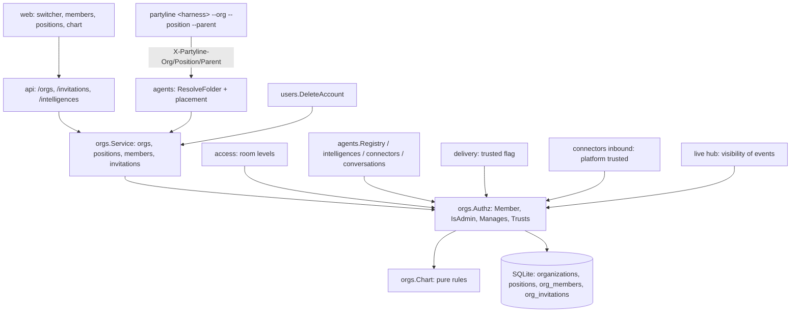

# Organizations and Positions Design

**Spec**: `.specs/features/organizations/spec.md`
**Status**: Draft
**Decisions**: AD-016 to AD-022 in `.specs/STATE.md`. Revised after the owner's answers (2026-10-23): three permissions, deletion follows ownership, self-deletion, machines become internal, chats per organization; guests are the responsibility of their inviter (inviter chain).

---

## Architecture Overview

Organizations become the only source of sharing. A new package `internal/orgs` owns the model:
- organizations, positions, memberships and invitations;
- the org chart (`Chart`);
- the `manages(A, B, X)` rule;
- an `Authz` facade that every other service asks.

`internal/access` keeps its room-level API (`RoomLevel`, `UserRoomLevel`, `AgentRoomLevel`), but
its sources become room membership, organization permission and the chart. Grants, visibility
presets and `SetVisibility`/`Sharing` are removed, together with the `grants` table (AD-016).



### Approaches considered

| Approach | Summary | Verdict |
| --- | --- | --- |
| **A. Org model replaces grants (recommended)** | New `internal/orgs` package; every authorization asks `orgs.Authz`; grants and presets are removed | Chosen: one rule (spec Assumption "Sharing"), explicit checks per endpoint, no second source of truth |
| B. Materialize grants from memberships | Keep `access` and `grants`; write grant rows whenever membership or positions change | Rejected: positions do not map to `use`/`manage` levels, two sources drift, and the upgrade would still need every new rule |
| C. Authorization in SQL | Recursive CTEs inside each list/get query | Rejected: two kinds of recursion (position ancestry and the creator chain), hard to test condition by condition (L-042), and the chart page needs the same computation in Go anyway |

---

## Code Reuse Analysis

### Existing Components to Leverage

| Component | Location | How to Use |
| --- | --- | --- |
| Migration runner + Go hooks | `internal/store/store.go:109` (`hooks`) | `0019_organizations` hook backfills the upgrade in the migration transaction (AD-012) |
| Backfill pattern | `internal/store/intelligences_backfill.go` | Same raw-SQL hook style, IDs from `store.NewID` |
| Handle rules | `internal/handles` | Organization slug normalization and first-free suffix (`a-z0-9-`, 1-40) |
| Account creation | `internal/users/invites.go:208` `insertAccount` | Creates the personal organization in the same transaction |
| AI resolution | `internal/agents/folder.go:192` `ResolveFolder`, `:324` `createFolderAgent` | Placement (org, creator, position) when an AI is created |
| Header parsing | `internal/agents/folder.go:53` `FolderIDFromHeader` | Reads the three new optional headers |
| AI deletion | `internal/agents/registry.go:331` `Delete` | Deletion of an AI in its home org (check swapped to `CanDelete`, POS-05) |
| Session end | `internal/agents/presence.go:171` `Kick` | Manager ends a live session with close 4002 (`CloseTakenOver`) |
| Delivery trust | `internal/delivery/rules.go:42` `Trusted` + call sites (`dispatcher.go:149`, `gateway.go:590`, `pending.go`, `agent_handlers.go:496`) | Replaced by a trust oracle with the same call sites |
| Platform trust | `internal/connectors/inbound.go:208` | Sender's linked user must manage the operator |
| Audit log | `internal/audit` | New `org.*` actions |
| Retention ticker | `internal/rooms/retention.go` | Expires invitations older than 14 days |
| Auth matrix harness | `internal/api/authmatrix_test.go` | Replaced by an org-role matrix (admin, manager, member, outsider, instance admin) |
| Web primitives | `web/src/components/ui/*`, `member-picker.tsx`, `delete-ai-dialog.tsx`, `secret-once-dialog.tsx` | Invite dialog, actions, confirmation dialogs |
| Web test helpers | `web/src/test/{render,fetch,fixtures}.ts*` | `mockApi`, `renderRoute`, new `makeOrg*` fixtures |

### Integration Points

| System | Integration Method |
| --- | --- |
| `access` room levels | Group: `post` for room members, `manage` for the group's creator and the org's admins. DM: `post` for participants, `view` for the managers of an AI participant in its home org (AD-016) |
| Agents gateway | `FolderID` gains `Org`, `Position`, `Parent`; placement runs only where an AI is created or started |
| Delivery | `delivery.Trust` interface; one memo per dispatch loads each home org's chart once |
| Live hub | `events.GrantsChanged` becomes `events.OrgChanged{OrgID}` and `events.AccessChanged{Kind, ID}`. Presence and connector status are filtered through `Authz` |
| CLI / channel | Launcher flags → internal env → headers on the WebSocket and REST calls. Welcome frame gains `organization`, `position`, `managers` |

---

## Data Model

### Migration `0019_organizations.sql` (schema)

The next free number is `0019`; `main` ends at `0018_connection_proxy.sql`. No referenced table is
rebuilt (AD-012). New references come as `ADD COLUMN` with a NULL default.

```sql
CREATE TABLE organizations (
    id            TEXT PRIMARY KEY,
    name          TEXT NOT NULL,                    -- 1-100 characters (ORG-01)
    slug          TEXT NOT NULL COLLATE NOCASE,     -- a-z0-9-, 1-40; what --org takes
    avatar_sha256 TEXT NOT NULL DEFAULT '',
    created_by    TEXT NOT NULL DEFAULT '',         -- intelligence id; history only
    created_at    INTEGER NOT NULL,
    updated_at    INTEGER NOT NULL
);
CREATE UNIQUE INDEX organizations_slug ON organizations (slug);

CREATE TABLE positions (
    id         TEXT PRIMARY KEY,
    org_id     TEXT NOT NULL REFERENCES organizations (id) ON DELETE CASCADE,
    name       TEXT NOT NULL COLLATE NOCASE,        -- 1-60 characters (POS-01)
    parent_id  TEXT REFERENCES positions (id) ON DELETE SET NULL,
    created_at INTEGER NOT NULL
);
CREATE UNIQUE INDEX positions_name ON positions (org_id, name);   -- --position <name> is unambiguous
CREATE INDEX positions_parent ON positions (parent_id);

CREATE TABLE org_members (
    org_id      TEXT NOT NULL REFERENCES organizations (id) ON DELETE CASCADE,
    iid         TEXT NOT NULL REFERENCES intelligences (id) ON DELETE CASCADE,
    permission  TEXT NOT NULL CHECK (permission IN ('admin', 'member', 'guest')),
    position_id TEXT REFERENCES positions (id) ON DELETE SET NULL,
    inviter_iid TEXT REFERENCES intelligences (id) ON DELETE SET NULL, -- a guest's inviter (Guests, OMEM-01); NULL otherwise
    joined_at   INTEGER NOT NULL,
    PRIMARY KEY (org_id, iid)                       -- one membership, so at most one position (OMEM-03)
);
CREATE INDEX org_members_iid ON org_members (iid);
CREATE INDEX org_members_inviter ON org_members (org_id, inviter_iid) WHERE inviter_iid IS NOT NULL;
CREATE INDEX org_members_position ON org_members (position_id);

CREATE TABLE org_invitations (
    id          TEXT PRIMARY KEY,
    org_id      TEXT NOT NULL REFERENCES organizations (id) ON DELETE CASCADE,
    invitee_iid TEXT NOT NULL REFERENCES intelligences (id) ON DELETE CASCADE,
    permission  TEXT NOT NULL CHECK (permission IN ('admin', 'member', 'guest')),
    position_id TEXT REFERENCES positions (id) ON DELETE SET NULL,
    invited_by  TEXT NOT NULL,
    created_at  INTEGER NOT NULL,
    expires_at  INTEGER NOT NULL,                   -- created_at + 14 days (OMEM-07)
    UNIQUE (org_id, invitee_iid)                    -- inviting again updates the pending row
);
CREATE INDEX org_invitations_invitee ON org_invitations (invitee_iid);

-- Ownership (ORG-02). NULL only for DMs (rooms) and for rows written before the hook runs.
ALTER TABLE agents     ADD COLUMN org_id TEXT REFERENCES organizations (id);       -- home org
ALTER TABLE agents     ADD COLUMN creator_iid TEXT REFERENCES intelligences (id) ON DELETE SET NULL;
ALTER TABLE rooms      ADD COLUMN org_id TEXT REFERENCES organizations (id);       -- NULL for a DM
ALTER TABLE rooms      ADD COLUMN creator_iid TEXT REFERENCES intelligences (id) ON DELETE SET NULL;
ALTER TABLE connectors ADD COLUMN org_id TEXT REFERENCES organizations (id);
ALTER TABLE users      ADD COLUMN default_org_id TEXT REFERENCES organizations (id) ON DELETE SET NULL;
CREATE INDEX agents_org ON agents (org_id);
CREATE INDEX rooms_org ON rooms (org_id) WHERE org_id IS NOT NULL;
CREATE INDEX connectors_org ON connectors (org_id);
```

Notes:
- `agents.org_id`, `rooms.org_id` and `connectors.org_id` have no `ON DELETE` action. Deleting an
  organization that still owns anything fails at the database level as well as in the service
  (ORG-06 belt and braces).
- `agents.owner_id` keeps its meaning as the **host user**: the user whose computer runs the AI and
  whose agent token authenticates it. It stays part of the identity key (owner, machine, folder)
  of AD-010. The machine is kept only internally, to tell the same folder on two computers apart
  (spec Assumption "Machines", AD-022). It no longer grants anything (AD-019).
- `machines.label` becomes a dead column: machine renaming is removed (AD-022).
- `rooms.owner_id` and `connectors.owner_id` become dead foreign-key anchors (they cannot be
  dropped, AD-012). They are re-pointed before an account is deleted, because their
  `ON DELETE CASCADE` would otherwise delete organization-owned groups and connections (AD-019).

### Go hook `0019_organizations` (OUPG-01, one transaction)

It runs in the migration transaction right after the SQL (AD-012, MIG-05) and uses raw SQL only:
1. **Personal organizations.** For each user, ordered by `created_at`, it creates an organization.
   - `name`: the display name, else the username, cut to 100 characters.
   - `slug`: the first free slug derived from the username.
   - A root position "Admin".
   - A membership `admin` holding "Admin".
   - `users.default_org_id` set to it.
   Disabled users are included.
2. **AIs.** `agents.org_id` is the owner's organization and `creator_iid` is `owner_id`. Each AI
   gets a membership `member` with no position, so the user manages them as their creator
   (POS-03).
3. **Groups.** `rooms` of kind `group` get `org_id` from the owner's organization and
   `creator_iid = owner_id`. DMs keep `org_id` NULL (ORG-02).
4. **Connections.** `connectors.org_id` comes from the owner's organization. The operator is an AI
   of the same owner, so ORG-07 holds.
5. **Grants.** Each grant with a user subject (not `*`) gives that user an `INSERT OR IGNORE`
   membership `member` with no position in the organization of the resource's owner. Room grants
   at `post` or `manage` also give an `INSERT OR IGNORE` room membership as `user`. Grants to
   everyone (`*`) are not converted: public visibility ends (AD-016).
6. **Group members.** Every user or AI member of a group that is not yet a member of the group's
   organization joins it as `member` with no position. This keeps the invariant "a group's members
   are members of its organization" and the spec's "Group memberships stay".
7. **Grants table.** `DELETE FROM grants`. The table itself is dropped by `0020_drop_grants.sql`,
   which ships with the code removal. Both migrations then apply in the same upgrade transaction.

History (messages, cursors, attachments, people) is untouched. A failure anywhere rolls back every
pending migration (MIG-05). A test injects a failure in the hook and checks that no organization
table or column is left behind.

### Go types (`internal/orgs`)

```go
type Permission string // "admin" | "member" | "guest"

type Member struct {
    IID        string
    Permission Permission
    PositionID string // "" = no position
    CreatorIID string // agents.creator_iid; "" for users
    InviterIID string // org_members.inviter_iid: a guest's inviter; "" otherwise
}

type Position struct {
    ID, Name, ParentID string // ParentID "" = root
}

// Chart is one organization's snapshot: immutable and safe to share within one operation.
type Chart struct {
    OrgID     string
    Positions map[string]Position
    Members   map[string]Member
}
```

---

## manages(A, B, X): rule and cost

**Rule (POS-03, AD-017).** `Chart.Manages(a, b)` is true exactly when:
1. `a != b`, and both are members of X. Management never crosses organizations, and a creator who
   left X no longer manages anyone there.
2. If B holds position `pb`, A holds position `pa` **strictly above** `pb`: `pa` is a proper
   ancestor of `pb` through `parent_id`.
3. If B holds no position, then either A is B's creator, or A manages B's creator in X.
   - When the creator holds a position, this is exactly the spec text ("A's position is above B's
     creator's position").
   - When the creator holds no position either, the rule follows the creator chain upward. This is
     the spec Assumption's "sits directly under its creator" applied transitively (refinement R3).
   - A visited set stops cycles. Creators are fixed at creation, but merges re-point them.
   - The depth is at most the number of members.
4. **Guests (spec Assumption "Guests").** If B is a `guest`, A also manages B when A is B's inviter,
   or A manages B's inviter in X. The recursion walks the inviter chain: a guest invited by a guest
   is reached by the first guest's inviter, by everyone up the chain, and by whoever manages any of
   them. It stops at an inviter that is no longer a member, or NULL; the same visited set applies.
   - For an AI started with `--parent`, the inviter is the starter (its creator), so rules 3 and 4
     agree.
   - A guest that holds a position is also managed through rule 2.

Consequences that need no extra code:
- A root position holder has nobody strictly above, so nobody in X manages them. Only an `admin`
  can delete them (POS-05).
- Positionless users (they have no creator) are managed by nobody. Admins can still delete (that
  is, remove) them or give them a position.

**Deletion rule (POS-05).** `Chart.CanDelete(a, b)` is true exactly when `a != b`, both are
members, and either `a` is an `admin` of X, or `b` is a `guest` of X and `Manages(a, b)`. With
rule 4, this covers "B's inviter, an identity up B's inviter chain, or an identity that manages one
of them".
Management alone therefore lets a manager edit, end and move a subordinate (POS-04), but delete
only guests. What a deletion does follows ownership (POS-06, AD-019):
- an AI whose home organization is X is deleted for good (`Registry.Delete`);
- a person, or an AI whose home is another organization, is removed from X only (OMEM-06). Their
  account and other memberships stay.

No path deletes another identity's account, and deleting a person never touches any AI.

**Derived queries:**
- `Chart.ManagersOf(b)`: every A with `Manages(A, b)`, nearest first. Used by the channel notice.
- `Chart.ManagedBy(a)`: the set A manages. Used by the chart page's action flags in one pass.

**Where it runs: in Go, not as a recursive CTE.**
- `orgs.Load(ctx, q, orgID)` runs two indexed queries: `ListOrgPositions(org_id)` and
  `ListOrgChartMembers(org_id)`, which joins `agents.creator_iid`. It builds the maps.
- Cost: O(P + M) rows per load, where P is the number of positions and M the number of members.
  Typical charts have fewer than 50 positions and fewer than 200 members, which is well under a
  millisecond on SQLite in-process.
- `Manages` costs O(depth) after the load.
- `Load` takes a `*db.Queries`, so it runs inside write transactions as well. The cycle check of
  POS-02 and the `last_admin` check of OMEM-05 read the chart in the same transaction that
  changes it.

**Caching.** There is no cross-request cache, so authorization is never stale.
- Each operation that asks more than once uses `Authz.Session()`, a memo keyed by org id. One
  delivery dispatch, one chart page and one list request each load an organization's chart at
  most once.
- If profiling ever shows load cost on the delivery path, the follow-up is a version-checked cache
  (`organizations.chart_version` bumped in every chart-changing transaction). It is not built now.

**`Authz` facade:**

```go
func (z *Authz) Chart(ctx context.Context, orgID string) (*Chart, error)
func (z *Authz) Member(ctx context.Context, orgID, iid string) (Member, bool, error)
func (z *Authz) RequireMember(ctx context.Context, orgID, iid string) error  // access.ErrNotFound when not a member
func (z *Authz) RequireAdmin(ctx context.Context, orgID, iid string) error   // ErrNotFound for outsiders, ErrForbidden for members
func (z *Authz) Manages(ctx context.Context, actor, target, orgID string) (bool, error)
func (z *Authz) ManagesAnywhere(ctx context.Context, actor, target string) (bool, error) // any shared org
func (z *Authz) CanDelete(ctx context.Context, actor, target, orgID string) (bool, error) // POS-05
func (z *Authz) Trusts(ctx context.Context, authorIID, agentID string) (bool, error)     // home org of agentID (POS-10)
func (z *Authz) SharesOrg(ctx context.Context, a, b string) (bool, error)
func (z *Authz) Session() *Session // memoized view with the same methods
```

**Actor identity.** The new `authn.Principal.IID()` returns `AgentID` for an agent principal and
`UserID` for a user.
- An AI acts as itself: it creates groups in its own organizations, sees what it shares an org with
  and manages what is below it.
- It no longer borrows its owner's rights. This is how AGRP-01 and DM-04 were written before
  ("its owner can see"); the change is recorded in AD-016.

---

## Authorization Model

The rules are summarized here; every route group is listed in the matrix below.

| Resource | View | Act / post | Manage |
| --- | --- | --- | --- |
| Organization | members of all three permissions, guests included (they see the members and the chart, CHART-02) | `member` and `admin` create groups; a `guest` cannot (OMEM-04). Any member or guest invites **guests** (no position), without limit on count or chain depth; it becomes the guest's inviter | `admin`: name, slug, avatar, positions, invitations with any permission or position, permissions, connections, deleting the organization (OMEM-04) |
| Group (room `group`) | room members; the org's admins (manage implies view) | room members (guests included) | the group's creator and the org's admins |
| DM | participants; managers of an AI participant in its home org (view only; replaces AD-013) | participants | nobody (DM-02 unchanged) |
| AI | members of any org it belongs to; its host user | members DM it; only the operator sends through a connection (CID-03) | its managers in any shared org: edit profile and settings, end session, move below their own position (POS-04). Delete in X per `CanDelete`; it is a hard delete only in its home org (POS-05, POS-06). The AI edits its own profile |
| Person (user) | every user of the instance (directory, unchanged) | — | managers in any shared org: edit profile, move (POS-04). Delete in X per `CanDelete` removes the person from X only (POS-06). Only the user deletes their own account |
| Connection | members of its org (operator, status, queue count; never text, CID-23) | the operator AI sends | the org's `admin` (ORG-03, OMEM-04) |
| People (history) | members of the connection's org, plus users who can view a conversation where the person wrote | — | nobody (history only, CID-21) |
| Pairing a chat identity | members of the connection's org. For kinds whose caller picks sender ids (webhook), admins only (AD-008 amended) | — | — |

Instance admins keep no implicit access (AD-005 → AD-016). They are outsiders unless they are
members.
Outsiders get **404** on anything they cannot see (ACL-03 convention). Members who can see but
not act get **403**. The spec names 403 explicitly for creation in an organization the creator does
not belong to (ORG-03, ORG-05) and for starting with a position that is not allowed (POS-07).

### Authorization matrix per route group

Roles:
- **Out**: not a member. Includes an instance admin without membership.
- **M**: `member` with no relation to the target.
- **G**: `guest` with no relation to the target. It is treated as M everywhere except group creation (403).
- **Inv**: the target guest's inviter, or anyone up its inviter chain. This is a case of Mgr (rule 4).
- **Mgr**: manages the target (POS-03).
- **A**: org `admin`.
- **Self**: the target itself.

A dash means "same as the column to its left".

**Organizations** (`internal/api/orgs_handlers.go`)

| Route | Out | M | Mgr | A |
| --- | --- | --- | --- | --- |
| `GET /api/v1/orgs` | 200, own memberships only | — | — | — |
| `POST /api/v1/orgs` | 201 for any active user (ORG-01); agent tokens are not allowed (path rule) | — | — | — |
| `GET /api/v1/orgs/{org}` | 404 | 200 | 200 | 200 |
| `PATCH /api/v1/orgs/{org}` (name, slug) | 404 | 403 | 403 | 200 |
| `PUT\|DELETE /api/v1/orgs/{org}/avatar` | 404 | 403 | 403 | 200 / 204 |
| `DELETE /api/v1/orgs/{org}` | 404 | 403 | 403 | 204, or 409 `organization_not_empty` (ORG-06) |

**Members** (`org_members_handlers.go`)

| Route | Out | M | Mgr | A | Self |
| --- | --- | --- | --- | --- | --- |
| `GET /orgs/{org}/members` | 404 | 200 | 200 | 200 | 200 |
| `PATCH /orgs/{org}/members/{iid}` `permission` | 404 | 403 | 403 | 200; 409 `last_admin` (OMEM-05) | 403 unless A |
| `PATCH /orgs/{org}/members/{iid}` `position_id` | 404 | 403 | 200 to a position strictly below the manager's own; null or anything else 403 | 200 for any position or null | 403 unless A |
| `DELETE /orgs/{org}/members/{iid}` ("delete in X") | 404 | 403 | 204 when the target is a `guest` (Mgr includes Inv), else 403 (POS-05) | 204 for any target; 409 `last_admin` | 204 (leave); 409 `last_admin`; 409 `home_organization` when an AI leaves its home org |

The effect of `DELETE /orgs/{org}/members/{iid}` follows ownership: an AI whose home is the org is
deleted for good, and anything else is removed from the org only (POS-06).

**Positions** (`positions_handlers.go`)

| Route | Out | M | Mgr | A |
| --- | --- | --- | --- | --- |
| `POST /orgs/{org}/positions` | 404 | 403 | 403 | 201; 422 for a name outside 1-60 or a parent from another org; 409 `conflict` for a duplicate name |
| `PATCH /orgs/{org}/positions/{id}` | 404 | 403 | 403 | 200; 409 `position_cycle` (POS-02) |
| `DELETE /orgs/{org}/positions/{id}` | 404 | 403 | 403 | 204 (POS-09) |
| `GET /orgs/{org}/chart` | 404 (CHART-02) | 200 (guests included) | 200 | 200, with action flags per target (CHART-03) |

**Invitations** (`org_invitations_handlers.go`)

| Route | Out | M / G | A | Invitee user / Mgr of invitee AI |
| --- | --- | --- | --- | --- |
| `POST /orgs/{org}/invitations` | 404 | 201 for `permission: guest` without a position; 403 for any other permission or with a position (OMEM-04) | 201 for any permission and position | — |
| (both columns) | | 409 `already_member`; 429 `rate_limited` above 30 per hour per org; 404 `contact_not_found` for an unknown handle | | |
| `GET /orgs/{org}/invitations`, `DELETE …/{id}` | 404 | 403 | 200 / 204 | — |
| `GET /api/v1/invitations` | own, plus those of the AIs the caller manages in their home org | — | — | — |
| `POST /api/v1/invitations/{id}/accept\|decline` | 404 for anyone else | — | — | 200; 410 `gone` once expired (OMEM-07) |

**Account settings**

| Route | Rule |
| --- | --- |
| `PUT /api/v1/me/default-org` | the caller must be a member; otherwise 403 |
| `DELETE /api/v1/me` `{password}` | the user deletes their own account (POS-06); a wrong password is 422 with field `password` (as `POST /me/password` does for `current_password`); 409 `last_instance_admin` |
| `GET /api/v1/agent/orgs` (agent token) | the token user's organizations and their positions; used by `partyline orgs` |

**Intelligences** (`intelligences_handlers.go`, `agents_handlers.go`)

| Route | Out (cannot see) | Can see, not Mgr | Mgr (any shared org) | Self |
| --- | --- | --- | --- | --- |
| `PATCH /intelligences/{id}`, avatar | 404 | 403 (POS-05) | 200 | 200 |
| `DELETE /agents/{id}/session` | 404 | 403 | 204 (`Kick` with 4002) | — |
| `GET /agents`, `GET /agents/{id}` | 404 | 200 | 200 | — |
| `PATCH /agents/{id}` | 404 | 403 | 200 | — |
| `DELETE /agents/{id}` (delete in its home org) | 404 | 403 | 204 when `CanDelete` holds in the home org (admin there, or a manager of a guest AI); else 403 | — |
| `PUT /api/v1/machines/{hostname}`, `GET /api/v1/agent/contacts/tree` | removed (404): machines are internal (AD-022) | | | |
| `POST /agents/{id}/merge` | 404 | 403 | 200 when the caller manages both and both share a home org | — |
| `/agents/{id}/sharing` | removed (404, `retired_routes_test`) | | | |

**Groups and DMs** (`rooms_handlers.go`, `conversations_handlers.go`)

| Route | Not visible | Room member | Group creator / org A |
| --- | --- | --- | --- |
| `POST /api/v1/groups` `{org_id}` | 403 when not a member of `org_id` (ORG-03), and 403 for a `guest` (OMEM-04) | — | 201 for an org `member` or `admin` |
| `GET /api/v1/conversations` | each item carries `org_ids`: a group's org, or for a DM the orgs that both participants belong to | — | — |
| `GET /rooms/{id}`, messages, files, read | 404 | 200 | 200 |
| `POST /rooms/{id}/messages`, react | 404 | 201 | 201 (`manage` ranks above `post`, as today) |
| `PATCH\|DELETE /rooms/{id}`, member add, remove and settings | 404 | 403 | 200. Adding a non-member of the org is refused: 422 `members_refused`, reason `not_org_member` |
| DM routes | unchanged (DM-08 sources replaced as in the table above) | | |
| `/rooms/{id}/sharing` | removed (404) | | |

**Connections** (`connectors_handlers.go`, `chats_handlers.go`, `identities_handlers.go`)

| Route | Out | M | A |
| --- | --- | --- | --- |
| `POST /connectors` `{org_id}` | 403 (ORG-03) | 403 (ORG-03: connections need `admin`) | 201 |
| `GET /connectors` | own orgs' connections only | — | — |
| `GET /connectors/{id}`, chats | 404 | 200 | 200 |
| `PATCH\|DELETE /connectors/{id}`, operator, enable | 404 | 403 | 200; an operator outside the org is 422 `operator_id` (ORG-07) |
| pairing code for a connector | 404 | 201 (webhook kind: 403) | 201 |
| `/connectors/{id}/sharing` | removed (404) | | |

**Agent routes** (`/api/v1/agent/*`): the actor is the AI.

| Route | Rule |
| --- | --- |
| `POST /agent/groups` (`create_group`) | optional `org` (slug or id), default the AI's home org; the AI must be a `member` or `admin` there (403; a guest AI is refused) |
| `POST /agent/dms` / `send_message to` | target visible to the AI: shares an org with it, or is a user; otherwise 404 `contact_not_found` |
| connection sends | operator only (CID-03, unchanged) |
| WebSocket / any route that resolves the folder | placement rules below |

Each new sentinel error gets a test that observes its status (L-017): `organization_not_empty`,
`last_admin`, `position_cycle`, `home_organization`, `already_member`,
`organization_mismatch`, `organization_required`, `position_unknown` and `last_instance_admin`.
The `forbidden` cases that the spec names get one test each: a guest creating a group, and a
manager deleting a `member`.
Negative tests isolate the guard under test (L-018). For example, the `last_admin` test uses a
target the actor otherwise may change.

---

## Placement of a new AI (ORG-04, ORG-05, POS-07, POS-08)

`FolderID` gains three optional fields read by `FolderIDFromHeader`:
- `Org`: header `X-Partyline-Org`, a slug or id.
- `Position`: header `X-Partyline-Position`, percent-encoded with `url.PathEscape`.
- `Parent`: header `X-Partyline-Parent`, an `@handle` or id.

`agents.place(ctx, q, hostUserID, id)` runs inside `linkOrCreate`'s transaction, only when an AI
is **created**:
1. **Creator (POS-08).**
   - When `Parent` names an identity the token holder may act for, that identity is the creator.
     The token holder may act for themselves, or for an AI hosted on their machines
     (`agents.owner_id = host`): the same principle that lets a tools-only process act as the
     folder's AI.
   - Otherwise the creator is the host user. An unknown or foreign parent falls back silently, as
     the spec says. The welcome notice names the recorded creator.
2. **Home organization (ORG-04).**
   - `Org` when given: an unknown slug is 422 `organization_required`, field `org`.
   - Otherwise the creator's default:
     - for a user: `users.default_org_id`, else their oldest admin membership, else their oldest
       membership;
     - for an AI creator: its home org.
   - No organization at all is 422 `organization_required`.
3. **ORG-05.** A creator who is not a member of the home org gets 403 `forbidden`, and nothing is
   created.
4. **Position (POS-07).**
   - `Position` names a position of the home org (case-insensitive); an unknown name is 422
     `position_unknown`.
   - It is allowed when the creator's position is strictly above it, or when the creator is an
     `admin` there. Otherwise 403 `forbidden`, and nothing is created.
   - Without `Position`, the AI has no position.
5. **Permission (ORG-04).** The AI joins as `member` when its creator is a user, and as `guest`
   when its creator is an AI (a valid `--parent`), with `inviter_iid` = that AI. A start whose
   `--parent` falls back to the host user joins as `member`.
6. The AI row is written with `org_id` and `creator_iid`, together with an `org_members` row
   (permission, position) and an audit entry `org.member_join` with `by: start`.

**An AI that already exists** keeps its home organization and its creator (refinements R5 and R6):
- An explicit `Org` naming another organization is 409 `organization_mismatch`, and the message
  names the home org. Moving AIs is out of scope.
- `Parent` is ignored.
- A `Position` different from the current one moves the AI when the creator rule of step 1 holds
  for the starter, and the starter manages the AI or is an `admin`, plus the POS-07 check.
  Otherwise 403.

These checks run on the live WebSocket and on tools-only calls alike: both resolve the folder, and
either may be the first contact. The adoption of v0.3 identities (MIG-02) is unchanged; an adopted
AI already has its organization from the upgrade.

---

## Trust for live delivery (POS-10, AD-018)

```go
// delivery.Trust answers whether author's message is trusted by the recipient AI.
type Trust interface {
    Trusts(ctx context.Context, authorIID, agentID string) (bool, error)
}
```

- **Room messages.** `Trusted(msg.AuthorUserID, agent.OwnerID)` is replaced at the five call sites
  by `trust.Trusts(ctx, msg.AuthorIID, agentID)`: `dispatcher.go`, `wants.go` (delivery mode
  `trusted`), `gateway.go` backlog, `pending.go`, and history in `agent_handlers.go`.
  - It is `Authz.Session().Trusts`. It loads the recipient's home-org chart once per dispatch and
    answers `Chart.Manages(author, agent)`.
  - It is computed at delivery time, so a demotion takes effect on the next message, as owner
    trust did.
  - `author_iid` is the AI itself for AI posts. The old `author_user_id` resolved an AI's post to
    its owner, which is why the owner's AIs were trusted.
  - Sibling AIs that do not manage each other are therefore no longer trusted. This is the spec's
    intent ("replaces the owner and the owner's AIs").
- **Room instructions and room text** (`gateway.go:520`, `agent_handlers.go:409/411`):
  `instructions_trusted` is true when `InstructionsBy` manages the AI in its home org.
- **Platform events** (`inbound.go:208`): the sender resolves through the connection to a user
  (AD-008). The event is trusted when that user manages the operator AI in its home org. As
  before:
  - it is computed and stored at enqueue time;
  - `from_self` is never trusted (AD-014 and AD-015 unchanged).
- **Never trusted.** Unknown authors, persons, system messages, and authors in other
  organizations (management never crosses organizations).

A benchmark-style test dispatches to 20 AIs of 3 home orgs and asserts that each chart loads once
per dispatch, by counting `Load` calls through a test hook.

---

## Deletion (POS-05, POS-06, OUPG-02, AD-019)

**Delete in an organization.** `DELETE /orgs/{org}/members/{iid}` and `DELETE /agents/{id}` (the
latter means "in its home org") are the only ways to delete another identity. Both check
`Authz.CanDelete(actor, target, org)` (POS-05), then act by ownership (POS-06):
- **An AI whose home organization is X**: `Registry.Delete`. Memberships everywhere go, connection
  operators are cleared (OMEM-08), and the live session is kicked with 4001 after commit.
- **Anything else** (a person, or an AI of another organization): `orgs.Remove`. The target leaves
  X's groups and its position there (OMEM-06), and nothing else changes.

Positionless members created by a deleted AI keep their membership. Their `creator_iid` becomes
NULL, so only admins (and their positions, if any) reach them afterwards.

**Self-deletion of an account.** `DELETE /api/v1/me` with the current password (POS-06 "A user
MAY delete their own account"). Users were never deleted before; only disabled.
`users.DeleteAccount(ctx, userID)` is new and runs in one transaction:
1. **Refusals.** A wrong password is 422 (field `password`). The last active instance admin gets
   409 `last_instance_admin`, because that instance admin is needed for OUPG-02.
2. **OUPG-02.** For each organization where the user is the only `admin`, the heir becomes an
   `admin` with no position (a new membership, or an upgraded one). The heir is the oldest active
   instance admin other than the user. Audited as `org.admin_inherited`.
3. **Dead anchors.** `rooms.owner_id` and `connectors.owner_id` equal to the user are re-pointed to
   the heir, so their `ON DELETE CASCADE` cannot delete groups and connections that organizations
   own.
4. **Hosted AIs stay.** Deleting a person never touches AIs (owner's answer). The AIs hosted on the
   user's computers keep their organizations, memberships, positions and history:
   - `agents.owner_id` is re-pointed to the heir;
   - `folder` is set to `''`, so the AI becomes an unlinked identity: offline, with no folder key
     that could collide or be claimed;
   - the live sessions are kicked with 4001 after commit, because their tokens die with the
     account.
   Their admins, or managers if the AI is a guest, delete them when they are no longer wanted.
5. **Delete.** `DELETE FROM users WHERE id = ?`. Sessions, tokens, identities, machines and
   pairing codes cascade. The intelligence trigger deletes the intelligence, which cascades org
   memberships, invitations and DMs. `creator_iid` references become NULL.
6. **After commit.** `SessionsRevoked{UserDisabled:true}` closes sockets and tokens.
   `OrgChanged` is published for each organization involved. The audit records `user.delete`.

---

## CLI and channel

**`partyline login`** never asks about organizations: a login links the computer to the user (spec
Assumption "Machines").
After saving the token it prints one line: `New AIs join <org name> (<slug>); pass --org or change
your default in Settings.` The org comes from `GET /api/v1/agent/orgs`. If that call fails, the
line is skipped.

**`partyline <harness> [--org slug] [--position "Lead developer"] [--parent @lead] [--as] [--take-over] …`**
- `launcherFlags` strips the three new leading flags, in both `--x v` and `--x=v` forms, like
  `--as`.
- The user-facing env vars `PARTYLINE_ORG`, `PARTYLINE_POSITION` and `PARTYLINE_PARENT` are read
  when the flag is absent.
- The launcher **consumes** these values. It unsets the user-facing names in the harness
  environment and passes the values on as `PARTYLINE_LAUNCH_ORG`, `PARTYLINE_LAUNCH_POSITION` and
  `PARTYLINE_LAUNCH_PARENT`. These are added to `launcherVars` (`procenv.go`) so Codex-style
  harnesses still see them, and the launcher never reads them as input.
- This matters for nested launches. A "Lead developer" AI that runs `partyline claude --position
  Worktrees` inside its own shell would otherwise inherit its own `PARTYLINE_POSITION` (see Risks & Concerns).
- `channel.Identity.setHeaders` sends the three headers on the WebSocket and on every REST call,
  only when set.

**`partyline agents`** no longer prints a machine › folder tree (AD-022). It lists the AIs hosted
by the token user, grouped by organization: name, @handle, folder (with `~` for the home folder),
app and online state. It reads `GET /api/v1/agent/agents`, which gains `organization`.
`GET /api/v1/agent/contacts/tree` is retired.

**`partyline orgs`** lists the token user's organizations: slug, name, permission, position, and
a marker for the default. `partyline orgs <slug>` prints that organization's position tree, so
`--position` names can be discovered. Both use `GET /api/v1/agent/orgs`. The default itself is
changed in the web Settings, because it is a user setting and agent tokens stay limited to
`/api/v1/agent/` (AD-020).

**Welcome frame and channel notice.**
- `dto.AgentWelcomeFrame` gains:
  - `organization` (`{id, name, slug}`);
  - `position` (a name, `""` for none);
  - `managers`: `[]IntelligenceRef`, nearest first, at most 10, from `Chart.ManagersOf`.
- `owner` stays, filled with the host user and marked deprecated. v0.5 CLIs keep printing it.
- `identityText` becomes:

  > You are Worker 1 (@w1), an AI of Acme (acme), position Worktrees. Messages marked
  > trusted="true" come from the identities that manage you: Lead (@lead), Alice (@alice).
  > You operate: …

  With no managers: "No one manages you in Acme, so no message is marked trusted."
- `instructions.go` `trustRules`: trusted="true" means "an identity that manages you in your
  organization (it holds a position above yours, or created you)". `conversationTools` says
  "intelligences you share an organization with, and the users of this instance".
- `create_group` gains an optional `organization` argument (slug), defaulting to the AI's home org.

**Ending a session.** A manager ends an AI's live session with close code 4002 (`taken_over`) and
the reason "ended by @handle".
- v0.5 CLIs already stop on 4002 without reconnecting (`link.go:533`), so the end is effective for
  them too.
- New CLIs print the reason.

---

## Machines become internal (AD-022)

The owner removed machines as a visible concept. A login links a computer to the user, and the
server keeps the hostname only inside the AI identity key, to tell the same folder on two computers
apart:
- **Removed:** `PUT /api/v1/machines/{hostname}` and `intelligences.SetMachineLabel` (TREE-04);
  the machine › folder tree of the contacts DTO (`OwnAIs.Machines`, TREE-01..03); the
  `machine`/`machine_label` fields of the AI profile; `GET /api/v1/agent/contacts/tree`; the
  `partyline agents` machine tree.
- **Kept:** the `machines` table (the home folder still renders `~` in folder labels, TREE-02's
  label rule), `X-Partyline-Machine`, and the device approval page, which is how a login links a
  computer.
- `machines.label` becomes a dead column (AD-012).

---

## Web

The routes are file-based (TanStack Router). New files are under `web/src/routes/_app/orgs/`.

| Page / component | Content | ACs |
| --- | --- | --- |
| `components/org-switcher.tsx` in `AppSidebar`'s header (and `MobileBar`) | Lists my organizations with avatar, permission and an **unread count**, plus "+ New organization". The unread count sums the unread counts of the conversations tagged with that org (`org_ids`); a DM shared by two orgs counts in both. The selection is kept per viewer in `localStorage` (`pl.org`, wrapped in try/catch) | ORG-01, CHART-02 |
| Sidebar (`MessengerPanel`) | Shows the selected organization's groups, plus each DM whose other party is also a member of that organization (owner-confirmed). A DM whose other party shares no organization with the viewer is listed under the viewer's default organization (spec assumption) | ORG-02 |
| `orgs/index.tsx` | My organizations; create dialog (name 1-100); **pending invitations** for me and for AIs I manage, with accept and decline. An invitation that carries a position, or the `guest` permission, says what it grants: "Identities above <position> will manage you." plus, for a guest, "and may remove you from <org>." | ORG-01, OMEM-01, OMEM-02, OMEM-07 |
| `orgs/$orgId/settings.tsx` | Name, slug, avatar (admin); "Leave"; "Delete organization", which shows the `organization_not_empty` message with counts | OMEM-04, ORG-06, OMEM-05 |
| `orgs/$orgId/members.tsx` | Members table: identity, kind, permission (admin, member, guest), position, and "invited by" for guests. Per-row actions follow server flags: "Delete" for an AI of this org, "Remove from <org>" for anyone else. Invite dialog: an admin picks any permission and an optional position; any other member or guest invites as guest only (no permission or position fields). Pending invitations with revoke. `last_admin` and `home_organization` errors are shown inline | OMEM-01..06, POS-05, POS-06 |
| `orgs/$orgId/positions.tsx` | Admin editor: a nested list with add child, rename, a parent select that excludes the subtree, and delete. The delete confirmation explains POS-09. `position_cycle` is shown inline. Non-admins are redirected to the chart | POS-01, POS-02, POS-09 |
| `orgs/$orgId/chart.tsx` | `role="tree"` with `treeitem`, `aria-expanded`, `aria-level` and a roving tabindex (arrow keys, Home/End, Enter). Each holder shows avatar, name, @handle, a person/AI badge, the online dot, and an admin or guest badge. Positionless guests appear under their inviter (CHART-02), other positionless members under their creator, else under "Unassigned". The actions "delete" (an AI of this org), "remove" (anyone else) and "move" appear only where the server flags allow; "edit positions" only for admins. At 360 px, indentation is capped at 4 levels and names truncate, with no horizontal scroll | CHART-01..04 |
| `connectors/$connectorId.tsx` (and index) | Shows the owning organization. Admins edit; others are read-only. The operator picker lists the org's AIs only. The sharing dialog is removed. The list is filtered by the switcher | ORG-03, ORG-07, OMEM-04 |
| `components/new-group-dialog.tsx` | Organization select (default: the switcher's; orgs where I am a guest are not offered); the member picker offers that org's members | ORG-03, OMEM-04 |
| `contacts.$id.tsx` | Memberships (org, permission, position). For managers: "End session" (AI), "Edit", and per organization "Delete" or "Remove from <org>" where the profile's flags allow (POS-05, POS-06). The machine row is removed; the folder stays | POS-04, POS-05, POS-06 |
| `components/profile-panel.tsx` (messenger-polish PRF-03) | The same memberships after the details, read-only: organization, "Home organization" tag, permission and position (`components/membership-summary.tsx`, shared with the page). No machine and no sharing; "Delete", "Remove from <org>", "End session" and the editor stay on the page, one action away | OMEM-03 |
| `contacts.index.tsx` | AIs grouped by organization; the machine › folder tree (`machine-group.tsx`) and machine renaming are removed (AD-022) | OMEM-03 |
| `settings.tsx` | "Default organization for new AIs" select (`PUT /me/default-org`); "Delete my account" with the password and a statement that AIs and organizations stay (POS-06, OUPG-02) | ORG-04, POS-06 |
| Removed | `machine-group.tsx` and the machine label editor; `sharing-dialog.tsx`, `room-visibility.tsx`, `useSharing`/`useUpdateSharing`, the i18n keys `sharing.*` and `rooms.visibility.*` | — |

Every new string goes into both `en.ts` and `pt-BR.ts`. Pages are tested through the route that
passes the permission, not only the leaf component (L-007).

---

## Backward compatibility for v0.5 CLIs

| v0.5 behaviour | After this feature |
| --- | --- |
| Sends no org, position or parent headers | Defaults apply: the creator is the host user, the home org is the user's default (else personal), no position. Old CLIs keep starting sessions |
| Tools-only processes create AIs too | Same placement path; the same defaults |
| `create_group` without `organization` | The AI's home org |
| Reads `owner` in the welcome frame | Still filled (the host user); the new fields are additive and ignored |
| Instructions say trusted = owner | The wording is stale, but the flag is computed by the server under the new rule. Release notes say so |
| Close 4002 stops the channel | Reused for "session ended by a manager" |
| Calls `/api/v1/agent/session`, `/agent/whoami`, `/agent/agents` | Unchanged. `/agent/agents` lists the AIs hosted by the token user and gains `organization` |
| `partyline agents` of v0.5 calls `/agent/contacts/tree` | Retired: v0.5 prints "not found"; the new CLI groups by organization |
| Web sharing routes | Removed. Only the embedded web app (same version) called them. `docs/api.md` notes the removal |

The server needs no version check: every new header is optional (AD-020).

---

## Error Handling Strategy

| Error Scenario | Handling | User Impact |
| --- | --- | --- |
| Deleting an org that still owns AIs, connections or groups | `organization_not_empty` 409, with counts in `details` | Settings shows what to delete first |
| Removing or demoting the last admin, or the last admin leaving | `last_admin` 409 | Inline message |
| A parent change that creates a cycle | `position_cycle` 409, checked in the same transaction | Inline in the positions editor |
| An AI leaving its home org | `home_organization` 409 | "Ask an admin to delete it" |
| A guest creating a group, or a manager deleting a `member` | `forbidden` 403 (OMEM-04, POS-05) | The action is not offered in the web; the API refuses |
| Inviting an existing member | `already_member` 409 | Inline |
| More than 30 invitations in an hour | `rate_limited` 429, counted from audit entries (durable across restarts) | Toast |
| Accepting an expired invitation | `gone` 410 | The invitation disappears from the inbox |
| Starting with an unknown `--org` | `organization_required` 422, field `org` | The CLI prints the message and lists `partyline orgs` |
| Starting with an unknown `--position` | `position_unknown` 422 | The CLI suggests `partyline orgs <slug>` |
| Starting in an org the creator is not a member of | `forbidden` 403 (ORG-05) | The CLI prints the refusal and exits non-zero |
| Starting with a position that is not allowed | `forbidden` 403 (POS-07) | Same |
| `--org` differs from an existing AI's home org | `organization_mismatch` 409 | The message names the home org |
| The last instance admin deleting their account | `last_instance_admin` 409 | Inline |
| A wrong password on self-deletion | 422, field `password` | Inline |
| Not managing the target | `forbidden` 403 (POS-05); 404 when the target is not visible | — |

---

## Test Strategy per requirement

| Requirement | Test (location) | Type |
| --- | --- | --- |
| ORG-01 | Create an org: creator is `admin` holding the root "Admin"; names of 0, 1, 100 and 101 characters, plus a multi-byte name of 100 code points (L-023) (`internal/orgs/service_test.go`, `internal/api/orgs_test.go`) | integration + e2e |
| ORG-02 | Every AI, connection and group has exactly one org; a DM has none (store invariant test after upgrade and after creation) | integration |
| ORG-03 | Group in an org of which the caller is a member → 201; not a member → 403; connection by a member → 403, by an admin → 201 (`groups_test.go`, `connectors_handlers_test.go`) | e2e |
| ORG-04 | First start with `--org` → that org; without it → the default; with an AI parent → the parent's home org; started by a user → `member`, by an AI (`--parent`) → `guest`, by a parent that falls back → `member`; an existing AI with a different `--org` → 409 (`internal/api/agent_placement_test.go`) | e2e |
| ORG-05 | Start in a foreign org → 403 and no AI row (`agent_placement_test.go`) | e2e |
| ORG-06 | Delete an org with one AI, one connection or one group → 409 in each case on its own (L-018); empty → 204 | e2e |
| ORG-07 | Operator from another org → 422 `operator_id`; from the same org → 200 | e2e |
| OMEM-01..02 | Invite by handle → pending; accept → member with that permission and position; a member and a guest each invite a guest → 201 with themselves as inviter; a three-level guest chain is recorded; an AI invitee is accepted by its manager and refused (404) for a non-manager; inviting again updates the row | e2e |
| OMEM-03 | One identity in two orgs with different permissions and positions | integration |
| OMEM-04 | Matrix: each admin-only action by a member → 403 (one case per action); a member inviting as `member`, and a guest inviting with a position → 403; a guest creating a group → 403 while a member → 201 | e2e |
| OMEM-05 | Demote, remove and leave of the last admin → 409; with a second admin → OK | integration + e2e |
| OMEM-06 | Removal drops the member's group memberships of that org only and its position; the org's AIs stay | e2e |
| OMEM-07 | Fake clock: 14 d − 1 ms accept works, at 14 d → 410, and the ticker deletes the row (L-016) | integration |
| OMEM-08 | Operator AI deleted → connection without operator, status "choose the AI…" | e2e |
| POS-01 | Name bounds of 1 and 60 (61 refused); a parent from another org → 422 | e2e |
| POS-02 | A→B→C, setting A's parent to C → 409 and nothing changes; setting A's parent to itself → 409 | integration |
| POS-03 | Pure `Chart` table tests: each condition alone excludes (L-042); peer, above, two above, positionless with a creator, creator's superior, transitive creator chain, a creator who left, cross-org | unit |
| POS-04 | A manager edits the profile, ends the session (the socket closes with 4002) and moves a subordinate between positions below its own; a move to its own level or to none → 403 | e2e |
| POS-05 | Delete matrix: admin deletes a member → 204; a guest's inviter → 204; the inviter's inviter (chain) → 204; the manager of an inviter → 204; a manager deletes a member below → 403; a peer deletes a guest it did not invite → 403; an invisible target → 404 (each guard isolated, L-018) | e2e |
| POS-06 | Deleting an AI of the org → gone everywhere; deleting a person → removed from that org only (still a member elsewhere, can log in); deleting an AI of another org → removed only; self-deletion with the password → account, sessions and tokens gone (401), hosted AIs kept as unlinked identities in their orgs, groups and connections kept (owner re-pointed) | e2e |
| POS-07 | `--position` below the creator → held; same level → 403; an admin creator at any position → held; unknown → 422 | e2e |
| POS-08 | `--parent @lead` hosted on the same user → creator is the parent; a parent hosted by someone else → creator is the host user | e2e |
| POS-09 | Deleting a middle position moves its holders and children to its parent; deleting a root leaves them with no position and the children become roots | integration |
| POS-10 | Trusted from a manager; untrusted from a sibling AI of the same user, from a peer, from a subordinate and from an outsider; platform sender linked to a manager → trusted, linked to a peer → not; room instructions likewise (`delivery_trust_test.go`) | e2e |
| CHART-01 | The API returns the tree with holders and fields; positionless members appear under their creator or Unassigned; the web renders it | e2e + web unit |
| CHART-02 | Outsider → 404 (API); a guest → 200; guests appear under their inviter; the web route shows not found to an outsider | e2e + web unit |
| CHART-03 | Flags per target for an admin, a manager and a member; the web shows actions only where flagged (through the page, L-007) | e2e + web unit |
| CHART-04 | `vitest-axe` with no violations; keyboard navigation test; Playwright at 360 px asserts `scrollWidth <= clientWidth` (L-009) | web unit + Playwright |
| OUPG-01 | v0.5 database fixture (`v03_fixture` upgraded to 0018) → upgrade → personal orgs, resources moved, grantees as members, room members inside the org, history counts unchanged; an injected hook failure rolls back everything (`organizations_backfill_test.go`, `api/upgrade_test.go`) | integration + e2e |
| OUPG-02 | The last admin deletes their own account → the instance admin becomes admin; with another admin → no change | e2e |

---

## Risks & Concerns

| Concern | Location (file:line) | Impact | Mitigation |
| --- | --- | --- | --- |
| `ON DELETE CASCADE` from `rooms.owner_id` and `connectors.owner_id` to users | `internal/store/migrations/0001_init.sql:64,90` | Deleting an account would delete organization-owned groups and connections | `DeleteAccount` re-points both columns to the heir first; a test deletes a creator and checks the group survives (AD-019) |
| Users were never deleted, so cascades are untested | `internal/users/invites.go:237` (disable only) | Unknown rows left behind (grants, invitations) | `DeleteAccount` test asserts the row count of every table with a `user_id` or `iid` column for the deleted id |
| 57 test files rely on sharing or grants | e.g. `internal/api/rooms_handlers_test.go`, `internal/access/access_test.go` | Mass test breakage | Each Phase 5 task rewrites the grant-based cases of its own package to org membership in the same commit; the sharing routes stay alive (inert) until Phase 10 |
| Env inheritance in nested launches | `internal/cli/launcher.go:174-196`, `procenv.go:18` | A child session inherits the parent's `--position` and is refused | Launcher consumes and unsets the user-facing vars, passes internal `PARTYLINE_LAUNCH_*`; CLI test runs a nested launch |
| Deleting a home AI with live subordinates | spec POS-06 | Positionless members it created lose their creator and fall out of reach of their former managers | `creator_iid` becomes NULL; admins still reach them; the chart lists them under "Unassigned" |
| Unlinked AIs after a self-deletion | `internal/agents/folder.go` (adoption) | An heir's unlinked AIs could be adopted by a folder of the heir with the same handle (MIG-02) | Adoption (MIG-02) only considers unlinked AIs whose `creator_iid` is the host user; re-pointed AIs have a NULL creator and are never adopted; tested |
| Trust change for sibling AIs | `internal/delivery/rules.go:42` | After the upgrade, a user's AIs stop trusting each other | Spec intent; release notes; the upgrade e2e test pins it |
| Generated-file conflicts across parallel worktrees | `web/src/lib/api/types.gen.ts`, `internal/store/db` | Merge conflicts | Merge rule: never hand-merge generated files; run `make generate` after the merge and commit with the merge |
| Live hub keyed on `GrantsChanged` | `internal/live/hub.go:331` | Stale UI after membership changes | `OrgChanged` re-evaluates the viewer's rooms, AIs and connections; live test |
| Hot path loads the chart per recipient | `internal/delivery/dispatcher.go:149` | Extra queries per message | One memo per dispatch; the load-count test |
| Slug collisions on upgrade | `internal/handles` | Upgrade failure | First-free suffix like handles; a fixture with usernames `bob` and `Bob_` |

---

## Tech Decisions (feature-local)

| Decision | Choice | Rationale |
| --- | --- | --- |
| Organization address | Unique `slug` (from the name or username) next to the id; `--org` takes either | The CLI needs a typeable name; refinement R1 |
| Position names | Unique per organization, case-insensitive | `--position <name>` must be unambiguous; refinement R2 |
| Invitations | One pending row per (org, invitee); answered or expired rows are deleted and audited | "Inviting again updates the pending invitation" |
| Rate limit | Count of `org.invite` audit entries in the last hour, per organization, guest invitations included | Durable across restarts. The spec's "without limit" for guest invitations is read as no cap on the number of guests or the chain depth; the sweep's 30 per hour still throttles bursts |
| Group management | The creator and the org's admins | Replaces the room `manage` grant |
| Member move by a manager | Only to positions strictly below the manager's own; clearing a position is admin-only | POS-04 "move between positions below A's" |
| AI and its home org | An AI cannot leave its home org (409 `home_organization`, owner's answer to Q3); deleting it there is a hard delete | ORG-02 exactly one owning org |
| Chart DTO | Server-computed `can_delete` (POS-05), `delete_effect` (`delete` for an AI of this org, `remove` otherwise) and `can_move` per member | CHART-03 in one place; the web shows flags only |
| Self-deletion confirmation | The current password | Same proof as a password change |

## Spec refinements and open questions

Refinements adopted (the spec stays as approved; each is recorded in an AD):
- **R1.** Organizations have a slug.
- **R2.** Position names are unique per organization.
- **R3.** Positionless members follow their creator chain transitively.
- **R4.** Every new account gets a personal organization, not only on upgrade (AD-021).
- **R5.** An existing AI keeps its home org: a different `--org` is 409 `organization_mismatch`.
- **R6.** `--parent` counts at creation only; `--position` on a later start moves the AI under the
  same rule.
- **R7.** An AI's DMs are readable by its managers in its home org, not by every member (AD-016,
  replacing AD-013).
- **R9.** Clearing a member's position is admin-only; a manager moves only between positions below
  its own (POS-04 wording).
- **R10.** Self-deletion keeps the AIs hosted on the user's computers as unlinked identities owned
  by the heir (AD-019), because deleting a person never touches AIs.
- **R8.** Grants to everyone and `view`-only room grants become org membership only; the reader
  loses the read-only view of that room.

The owner's answers (2026-10-23) settled the earlier Q1-Q4: deletion follows ownership and never
deletes another identity's account (Q1, Q2); an AI cannot leave its home org (Q3); users may
delete their own account (Q4).

The owner then refined guests (inviter chain) and settled the gaps:
- **G1** (a DM whose other party shares no organization) is listed under the viewer's default
  organization, now a spec assumption;
- **G2** is resolved: CHART-03 now says "delete only where POS-05 allows".

No question is open.
