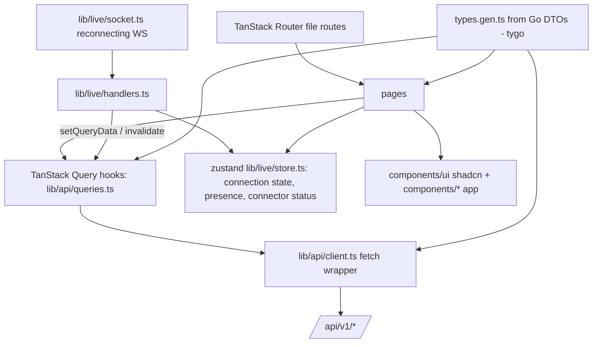

# Web App Design

**Spec**: `.specs/features/web-app/spec.md`
**Status**: Approved
**Architecture**: see `.specs/features/core-platform/design.md`

---

## Architecture Overview



Server state lives in TanStack Query. Live events patch the query cache (messages, presence, statuses). zustand holds only client/live state: socket status, presence map, theme, locale, command palette open. Forms use react-hook-form + zod; validation constants come from `types.gen.ts` (tygo emits Go constants: `UsernamePattern`, `PasswordMinLength`, `MaxTextLength`).

## Layout

```
web/
  index.html, vite.config.ts, tsconfig*.json, components.json (shadcn), biome.json, vitest.config.ts, playwright.config.ts
  src/main.tsx                     QueryClient, RouterProvider, ThemeProvider, I18nProvider, Toaster
  src/routes/                      file routes (generated routeTree.gen.ts)
    __root.tsx                     error boundary, devtools in dev
    setup.tsx  login.tsx  invite.$token.tsx
    _app.tsx                       auth guard (beforeLoad: GET /me), sidebar shell, live socket lifecycle, command palette
    _app/index.tsx                 dashboard: online agents, connector health, recent activity, quick actions
    _app/rooms/index.tsx           room list + create
    _app/rooms/$roomId.tsx         timeline + composer + members panel + settings sheet
    _app/agents.tsx                agents table + connect wizard + sharing
    _app/connectors/index.tsx      connectors list + add (schema form)
    _app/connectors/$connectorId.tsx  status, chats, refresh, sharing, route chat to agent
    _app/identities.tsx            linked identities + pairing dialog
    _app/tokens.tsx  _app/settings.tsx (profile, password, sessions, theme, language)
    _app/admin/users.tsx  _app/admin/invites.tsx  _app/admin/audit.tsx
  src/lib/api/client.ts            api<T>(method, path, body?) → T | throws ApiError{status, code, fields}
  src/lib/api/types.gen.ts         generated (do not edit)
  src/lib/api/queries.ts           query keys factory + hooks (useRooms, useRoomMessages (infinite), usePostMessage, …)
  src/lib/live/socket.ts           connect/backoff (1 s → 30 s), lastSeq tracking, `lagged` → invalidate
  src/lib/live/handlers.ts         event type → cache patch (pure functions, unit tested)
  src/lib/live/store.ts            zustand
  src/lib/i18n/{en,pt-BR}.ts       flat dictionaries; `useT()`; typed keys from `en`
  src/lib/schemas.ts               zod schemas for forms (built from generated constants)
  src/components/ui/*              shadcn (button, card, dialog, sheet, dropdown-menu, command, input, textarea, select, switch, badge, avatar, tooltip, table, tabs, skeleton, sonner, scroll-area, separator, sidebar, form, label, alert, popover, radio-group, toggle-group)
  src/components/                  app components:
    message-item.tsx, message-timeline.tsx, composer.tsx, member-list.tsx, member-picker.tsx,
    sharing-dialog.tsx, schema-form.tsx, status-dot.tsx, copy-field.tsx, secret-once-dialog.tsx,
    app-sidebar.tsx, command-menu.tsx, theme-toggle.tsx, empty-state.tsx, markdown.tsx
  e2e/smoke.spec.ts                Playwright: setup → login → room → post → live in 2nd context
```

## Components

### MessageTimeline / MessageItem (UI-04, UI-05, UI-09)
- Infinite query (`before_seq`), virtualized with `@tanstack/react-virtual` for long rooms; sticks to bottom when already at bottom.
- MessageItem: author icon by kind (Bot = agent, MessageCircle = chat with platform badge, User = user, Info = system), name, relative time with absolute tooltip, `trusted`/`untrusted` badge for chat senders, quoted reply preview, attachments (images inline with `loading="lazy"`, others as file chips), outbox status chips (pending/sent/failed).
- Markdown via `react-markdown` + `remark-gfm`, `skipHtml`, links `rel="noopener noreferrer" target="_blank"`.

### Composer (UI-07)
- Textarea autosize, Enter sends, Shift+Enter newline, max length from `MaxTextLength`, file attach (multipart), recipients selector (chat members) defaulting to "all with outbound on".

### SharingDialog (UI-11)
- RadioGroup private/shared/public; shared → user combobox + level select; public → view/post; summary "who can access".

### SchemaForm (UI-16)
- Maps `dto.ConnectorField.type` → input (`secret` → password with reveal, `bool` → Switch, `string_list` → tag input, `url` → url input); zod schema built at runtime from fields.

### Live (UI-06, UI-17, UI-15, UI-18)
- `socket.ts` exposes `status: connecting|open|closed`; `_app.tsx` banner when not open > 2 s.
- On reopen: invalidate rooms list and fetch open room messages `after_seq=lastSeq`.

## Data Models

All from `types.gen.ts`: `Me`, `User`, `Room`, `RoomMember`, `Message`, `Attachment`, `Agent`, `Connector`, `ConnectorKind`, `ConnectorField`, `Chat`, `Identity`, `Token`, `Invite`, `AuditEntry`, `Sharing`, `LiveEvent` (discriminated union by `type`).

## Error Handling Strategy

| Error Scenario | Handling | User Impact |
| --- | --- | --- |
| 401 | client redirects to `/login?redirect=<path>` (UI-02) | Re-login, return |
| 403 on admin route | 403 page (UI-21) | Clear message |
| 422 | field errors mapped into react-hook-form | Inline errors |
| Network/5xx | sonner toast with retry for mutations | Non-blocking |

## Risks & Concerns

| Concern | Location | Impact | Mitigation |
| --- | --- | --- | --- |
| XSS through agent/chat text | markdown.tsx | Session theft | No raw HTML, CSP from server (SEC-01), attachments served as download except safe images |
| Generated types drift | types.gen.ts | Runtime mismatches | `make generate` + CI `git diff --exit-code` |
| Bundle size (shadcn + router + markdown) | build | Slow first load | Route code splitting (autoCodeSplitting), markdown lazy-loaded |

## Tech Decisions

| Decision | Choice | Rationale |
| --- | --- | --- |
| Lint/format | Biome | One fast tool for both |
| Unit tests | Vitest + Testing Library + happy-dom | Vite-native |
| E2E | Playwright (chromium) against the built binary | Real server, real WS |
| Icons | lucide-react | shadcn default |
| Toasts | sonner | shadcn default |
| Virtualization | @tanstack/react-virtual | Same ecosystem |
