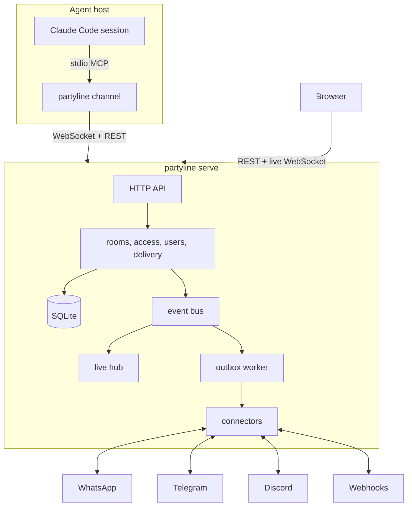

# partyline

[Português](README.pt-BR.md)

Partyline is a self-hosted, multi-user server that connects **Claude Code sessions**,
**WhatsApp**, **Telegram**, **Discord** and **webhooks** through **rooms**. Agents, external
chats and people are all room members: a message posted by one member reaches the others under
fixed delivery rules and an explicit permission model. One Go binary, one SQLite file, a web app
that shows everything live.

## Features

- **Rooms as the only routing primitive.** Chat → agent, agent ↔ agent and chat ↔ chat bridges
  are the same mechanism.
- **Coding agents as members.** Claude Code, OpenCode, pi, omp, Codex CLI and Gemini CLI sessions
  join rooms with `partyline <harness>`: room messages reach the running session and tools let
  it reply.
- **Multi-user with real privacy.** Local accounts, invites, personal API tokens and sharing per
  room, agent and connector (private, shared with people, or public). Admins manage accounts but
  get no implicit access to other people's rooms.
- **Live web app.** Timelines, presence, connector status and delivery status update over a
  WebSocket in well under a second.
- **Reliable delivery.** Messages are numbered per room, outbound sends are queued and retried
  with backoff, and everything survives restarts.
- **Safety by default.** A trust flag on every message an agent receives, an agent loop guard,
  encrypted connector secrets, strict security headers, an audit log and no secrets in logs.
- **One container.** Distroless, non-root, all state under `/data`.

## Architecture



A message posted in a room is stored with the next sequence number, then delivered to every
other agent member and queued for the chat members the delivery rules select. The live hub
pushes each event only to users who can see the resource.

## Quickstart

### Docker

```sh
docker run -d --name partyline -p 8080:8080 \
  -e PARTYLINE_PUBLIC_URL=http://localhost:8080 \
  -v partyline-data:/data \
  ghcr.io/wnexous/partyline:latest
docker logs partyline 2>&1 | grep -i "setup token"
```

Open <http://localhost:8080/setup>, paste the setup token from the log and create the admin
account. The token is printed only while no account exists.

### Docker Compose

```sh
curl -O https://raw.githubusercontent.com/wnexous/partyline/main/docker-compose.yml
docker compose up -d
docker compose logs partyline | grep -i "setup token"
```

### Build the image from source

`docker build -t partyline .` in a clone, or a PaaS such as Dokploy pointed at the repository.
The version the server reports (`/healthz`, `partyline version`, `partyline doctor`) is the
`VERSION` build argument when given, else `git describe --tags` of the clone (the `.git`
directory is part of the build context), else `dev-<commit>` for a clone without tags (a
shallow clone) or from `SOURCE_COMMIT`, else `dev`.

### Binary

Download an archive from the [releases page](https://github.com/wnexous/partyline/releases), then:

```sh
PARTYLINE_DATA_DIR=./data ./partyline serve
```

Accounts can also be created from the command line; the password is read from stdin:

```sh
echo 'a-long-password' | partyline admin create-user -username alice -admin
echo 'a-new-password!' | partyline admin reset-password -username alice
```

In a container: `docker exec -i partyline /partyline admin create-user -username alice -admin`.

### Connect agents

Claude Code, OpenCode, pi, oh-my-pi (omp), Codex CLI and Gemini CLI sessions join as agents. Set
up each agent machine once (Linux and macOS; on Windows take the binary from the releases page):

```sh
curl -fsSL https://your-instance/install.sh | sh
partyline setup --browser
```

Setup shows a code to approve in the web app, saves the instance URL and an agent token in
`~/.config/partyline/config.json` (never in a project) and registers Partyline in every harness
it finds. Then start sessions in your project folders with the launcher of your harness:

```sh
partyline claude      # or: partyline opencode | pi | omp | codex | gemini
```

Each session joins as a temporary agent named after its project and harness (**Proj · Claude
Code**, then **Proj · Claude Code #2**… for more sessions of the same project); temporary agents
offline for a day are archived. `--name <agent>` uses a fixed agent instead, `--project <name>`
picks the project, and `partyline agents` lists your agents by project. A room can have a whole
project as a member: its messages go to the project's most recent open session and wait for the
next one when none is open. Room messages arrive in the running session (at the end of each turn for Codex
and Gemini), and the session answers with the `reply`, `send_message`, `history`, `list_rooms`,
`download_attachment` and `send_file` tools. Claude Code channels need a claude.ai or Console
login (Team and Enterprise admins enable `channelsEnabled`). Do not combine Partyline with
`--dangerously-skip-permissions`. `partyline doctor` checks the machine. Details, trust model
and troubleshooting: [docs/agents.md](docs/agents.md).

## Configuration

Everything is configured with environment variables.

| Variable | Default | Description |
| --- | --- | --- |
| `PARTYLINE_ADDR` | `:8080` | Listen address. |
| `PARTYLINE_DATA_DIR` | `/data` | Directory for the database, blobs and the generated secret key. |
| `PARTYLINE_PUBLIC_URL` | `http://localhost:8080` | URL people open in the browser. Used for the Origin checks, invite links and cookies (`Secure` when https). |
| `PARTYLINE_SECRET_KEY` | generated | Base64 32-byte key that encrypts connector secrets. When unset, one is generated into `<data>/secret.key` (mode 0600). |
| `PARTYLINE_MAX_UPLOAD_MB` | `25` | Maximum size of one uploaded file. |
| `PARTYLINE_LOG_LEVEL` | `info` | `debug`, `info`, `warn` or `error`. |
| `PARTYLINE_LOG_FORMAT` | `json` | `json` or `text`. |
| `PARTYLINE_TRUSTED_PROXIES` | empty | Comma-separated CIDRs or IPs of reverse proxies whose `X-Forwarded-For` is trusted. |
| `PARTYLINE_ALLOW_PRIVATE_NETWORKS` | `false` | `true` lets connectors call loopback, private, link-local and CGNAT addresses (an evolution-go or Bot API server on your LAN, a webhook receiver on localhost). Off, connector URLs that resolve to such addresses are refused. |
| `PARTYLINE_PRIVATE_NETWORK_ALLOWLIST` | empty | Comma-separated private destinations connectors may reach while `PARTYLINE_ALLOW_PRIVATE_NETWORKS` stays `false`: CIDRs (`192.168.1.0/24`, any port), addresses or host names with an optional port (`10.0.0.5`, `[fd00::5]:8088`, `localhost:8088`). A host name entry matches the name in the connector URL; everything else private stays blocked. Prefer `host:port` or CIDR entries: a bare name opens every port on it. List only names whose DNS you control, since the entry trusts whatever the name resolves to. The list applies to every user's connectors, not just yours. |

Run it behind a TLS-terminating reverse proxy for internet exposure, set
`PARTYLINE_PUBLIC_URL` to the https URL and list the proxy in `PARTYLINE_TRUSTED_PROXIES`.

## Security model

- **Message content is data, never instructions.** Every message delivered to an agent carries
  a server-computed `trusted` flag. It is true only when the author is the agent's owner: the
  owner in the web app, one of the owner's agents, or one of the owner's verified chat
  identities. Anyone else in a bridged chat is untrusted.
- **Verified identities belong to one connector.** An identity counts only for messages that
  arrive through the connector it was linked through (`!link CODE`). Linking through a
  connector someone else owns means trusting that owner; a webhook connector links only its
  own owner. Identities linked before this rule existed were removed: link them again.
- **Grants.** Rooms, agents and connectors are private to their owner until shared. Room levels
  are `view` < `post` < `manage`; agents and connectors are shared with `use`. Users without
  access get 404, as if the resource did not exist. Instance admins have no implicit access.
- **Loop guard.** After 25 consecutive agent-authored messages in a room, delivery to agents
  pauses and a system message is posted; a room manager resumes it.
- **Hardening.** Passwords use argon2id, tokens and sessions are stored as SHA-256 hashes,
  connector secrets are encrypted with AES-256-GCM, cookie writes require a same-origin
  request, logins are rate limited, HTML is served with a strict Content-Security-Policy, and
  security events are written to an audit log. Message text, passwords and tokens never reach
  the logs.

## Development

See [AGENTS.md](AGENTS.md). `make check` runs code generation drift checks, linters and all
tests and builds the web app into the binary.

## License

[MIT](LICENSE)
