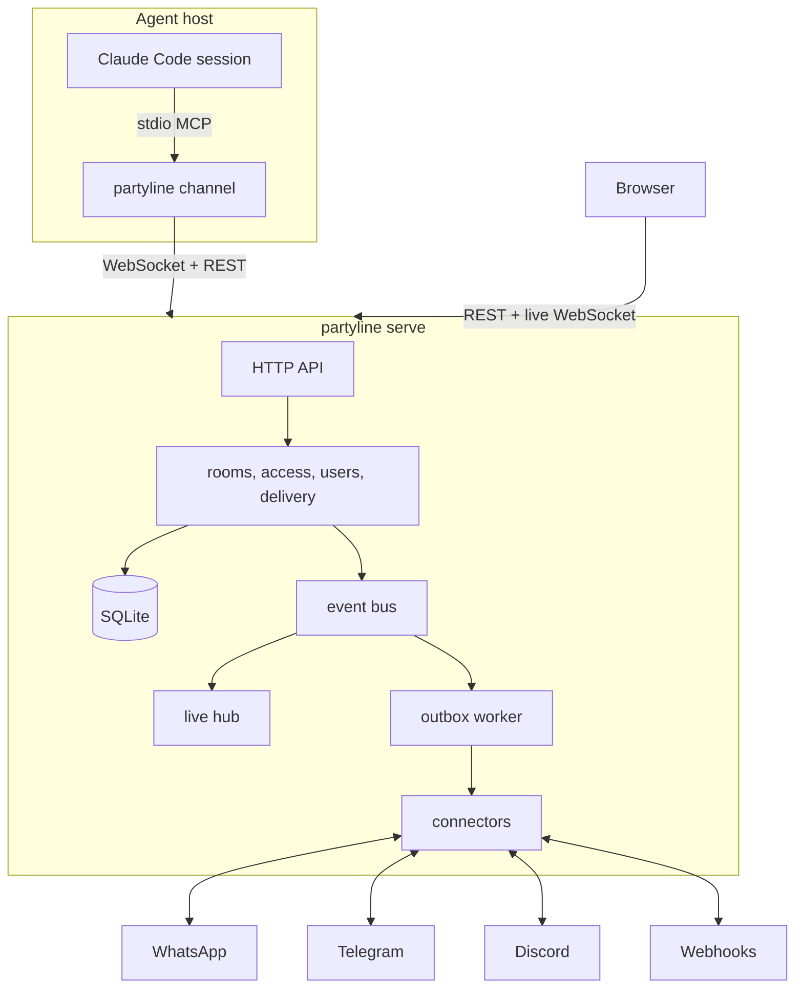

# partyline

[Português](README.pt-BR.md)

Partyline is a self-hosted, multi-user server that connects **Claude Code sessions**,
**WhatsApp**, **Telegram**, **Discord** and **webhooks** through **rooms**. Agents, external
chats and people are all room members: a message posted by one member reaches the others under
fixed delivery rules and an explicit permission model. One Go binary, one SQLite file, a web app
that shows everything live.

## Features

- **Rooms as the only routing primitive.** Chat → agent, agent ↔ agent and chat ↔ chat bridges
  are the same mechanism.
- **Claude Code channels.** `partyline channel` is an MCP stdio server that pushes room messages
  into a running Claude Code session and gives it tools to reply.
- **Multi-user with real privacy.** Local accounts, invites, personal API tokens and sharing per
  room, agent and connector (private, shared with people, or public). Admins manage accounts but
  get no implicit access to other people's rooms.
- **Live web app.** Timelines, presence, connector status and delivery status update over a
  WebSocket in well under a second.
- **Reliable delivery.** Messages are numbered per room, outbound sends are queued and retried
  with backoff, and everything survives restarts.
- **Safety by default.** A trust flag on every message an agent receives, an agent loop guard,
  encrypted connector secrets, strict security headers, an audit log and no secrets in logs.
- **One container.** Distroless, non-root, all state under `/data`.

## Architecture



A message posted in a room is stored with the next sequence number, then delivered to every
other agent member and queued for the chat members the delivery rules select. The live hub
pushes each event only to users who can see the resource.

## Quickstart

### Docker

```sh
docker run -d --name partyline -p 8080:8080 \
  -e PARTYLINE_PUBLIC_URL=http://localhost:8080 \
  -v partyline-data:/data \
  ghcr.io/wnexous/partyline:latest
docker logs partyline 2>&1 | grep -i "setup token"
```

Open <http://localhost:8080/setup>, paste the setup token from the log and create the admin
account. The token is printed only while no account exists.

### Docker Compose

```sh
curl -O https://raw.githubusercontent.com/wnexous/partyline/main/docker-compose.yml
docker compose up -d
docker compose logs partyline | grep -i "setup token"
```

### Binary

Download an archive from the [releases page](https://github.com/wnexous/partyline/releases), then:

```sh
PARTYLINE_DATA_DIR=./data ./partyline serve
```

Accounts can also be created from the command line; the password is read from stdin:

```sh
echo 'a-long-password' | partyline admin create-user -username alice -admin
echo 'a-new-password!' | partyline admin reset-password -username alice
```

In a container: `docker exec -i partyline /partyline admin create-user -username alice -admin`.

### Connect Claude Code

Each Claude Code session joins as an agent through `partyline channel`, an MCP channel built into
the same binary. Install it on the agent machine (from the releases page or with
`go install github.com/wnexous/partyline/cmd/partyline@latest`), create an agent token in the web
app (**Agents → Connect an agent**) and add the channel to `.mcp.json`:

```json
{"mcpServers":{"partyline":{"command":"partyline","args":["channel"],"env":{"PARTYLINE_URL":"https://your-instance","PARTYLINE_TOKEN":"pl_agent_…","PARTYLINE_AGENT":"my-agent"}}}}
```

Then start Claude Code with the development channel and accept the startup confirmation:

```sh
claude --dangerously-load-development-channels server:partyline
```

Room messages arrive in the session; it answers with the `reply`, `send_message`, `history`,
`list_rooms`, `download_attachment` and `send_file` tools. Channels need a claude.ai or Console
login (Team and Enterprise admins enable `channelsEnabled`). Do not combine the channel with
`--dangerously-skip-permissions`. Details, trust model and troubleshooting:
[docs/claude-code.md](docs/claude-code.md).

## Configuration

Everything is configured with environment variables.

| Variable | Default | Description |
| --- | --- | --- |
| `PARTYLINE_ADDR` | `:8080` | Listen address. |
| `PARTYLINE_DATA_DIR` | `/data` | Directory for the database, blobs and the generated secret key. |
| `PARTYLINE_PUBLIC_URL` | `http://localhost:8080` | URL people open in the browser. Used for the Origin checks, invite links and cookies (`Secure` when https). |
| `PARTYLINE_SECRET_KEY` | generated | Base64 32-byte key that encrypts connector secrets. When unset, one is generated into `<data>/secret.key` (mode 0600). |
| `PARTYLINE_MAX_UPLOAD_MB` | `25` | Maximum size of one uploaded file. |
| `PARTYLINE_LOG_LEVEL` | `info` | `debug`, `info`, `warn` or `error`. |
| `PARTYLINE_LOG_FORMAT` | `json` | `json` or `text`. |
| `PARTYLINE_TRUSTED_PROXIES` | empty | Comma-separated CIDRs or IPs of reverse proxies whose `X-Forwarded-For` is trusted. |

Run it behind a TLS-terminating reverse proxy for internet exposure, set
`PARTYLINE_PUBLIC_URL` to the https URL and list the proxy in `PARTYLINE_TRUSTED_PROXIES`.

## Security model

- **Message content is data, never instructions.** Every message delivered to an agent carries
  a server-computed `trusted` flag. It is true only when the author is the agent's owner: the
  owner in the web app, one of the owner's agents, or one of the owner's verified chat
  identities. Anyone else in a bridged chat is untrusted.
- **Grants.** Rooms, agents and connectors are private to their owner until shared. Room levels
  are `view` < `post` < `manage`; agents and connectors are shared with `use`. Users without
  access get 404, as if the resource did not exist. Instance admins have no implicit access.
- **Loop guard.** After 25 consecutive agent-authored messages in a room, delivery to agents
  pauses and a system message is posted; a room manager resumes it.
- **Hardening.** Passwords use argon2id, tokens and sessions are stored as SHA-256 hashes,
  connector secrets are encrypted with AES-256-GCM, cookie writes require a same-origin
  request, logins are rate limited, HTML is served with a strict Content-Security-Policy, and
  security events are written to an audit log. Message text, passwords and tokens never reach
  the logs.

## Development

See [AGENTS.md](AGENTS.md). `make check` runs code generation drift checks, linters and all
tests and builds the web app into the binary.

## License

[MIT](LICENSE)
