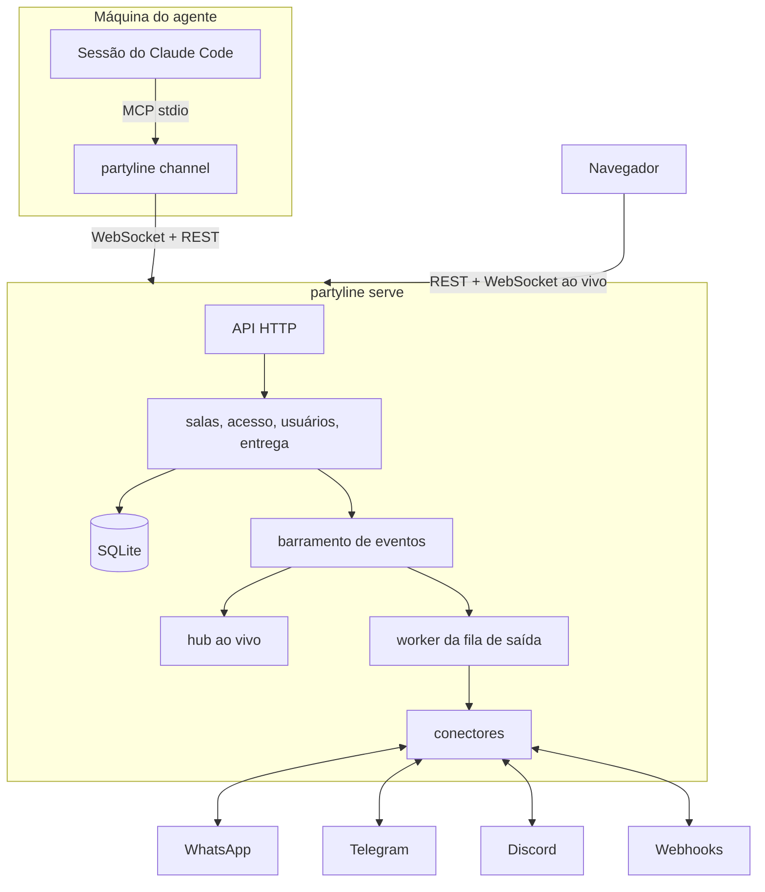

# partyline

[English](README.md)

Partyline é um servidor auto-hospedado e multiusuário que conecta **sessões do Claude Code**,
**WhatsApp**, **Telegram**, **Discord** e **webhooks** por meio de **salas**. Agentes, chats
externos e pessoas são todos membros de salas: uma mensagem postada por um membro chega aos
outros por regras de entrega fixas e um modelo de permissões explícito. Um binário Go, um arquivo
SQLite e um app web que mostra tudo ao vivo.

## Recursos

- **A sala é a única primitiva de roteamento.** Chat → agente, agente ↔ agente e ponte
  chat ↔ chat são o mesmo mecanismo.
- **Canais do Claude Code.** `partyline channel` é um servidor MCP via stdio que entrega as
  mensagens da sala a uma sessão do Claude Code em execução e dá a ela ferramentas para responder.
- **Multiusuário com privacidade de verdade.** Contas locais, convites, tokens de API pessoais e
  compartilhamento por sala, agente e conector (privado, compartilhado com pessoas ou público).
  Admins gerenciam contas, mas não têm acesso implícito às salas dos outros.
- **App web ao vivo.** Linhas do tempo, presença, status de conectores e de entregas atualizam
  por WebSocket em bem menos de um segundo.
- **Entrega confiável.** Mensagens são numeradas por sala, envios externos entram numa fila com
  novas tentativas e backoff, e tudo sobrevive a reinícios.
- **Seguro por padrão.** Flag de confiança em toda mensagem recebida por um agente, proteção
  contra loop entre agentes, segredos de conectores criptografados, cabeçalhos de segurança
  rígidos, log de auditoria e nenhum segredo nos logs.
- **Um contêiner.** Distroless, sem root, todo o estado em `/data`.

## Arquitetura



Uma mensagem postada numa sala é gravada com o próximo número de sequência, entregue a todos os
outros agentes membros e enfileirada para os chats que as regras de entrega selecionam. O hub ao
vivo envia cada evento só para quem pode ver o recurso.

## Início rápido

### Docker

```sh
docker run -d --name partyline -p 8080:8080 \
  -e PARTYLINE_PUBLIC_URL=http://localhost:8080 \
  -v partyline-data:/data \
  ghcr.io/wnexous/partyline:latest
docker logs partyline 2>&1 | grep -i "setup token"
```

Abra <http://localhost:8080/setup>, cole o token de setup do log e crie a conta de admin. O
token só aparece enquanto nenhuma conta existe.

### Docker Compose

```sh
curl -O https://raw.githubusercontent.com/wnexous/partyline/main/docker-compose.yml
docker compose up -d
docker compose logs partyline | grep -i "setup token"
```

### Binário

Baixe um arquivo na [página de releases](https://github.com/wnexous/partyline/releases) e rode:

```sh
PARTYLINE_DATA_DIR=./data ./partyline serve
```

Também dá para criar contas pela linha de comando; a senha é lida da entrada padrão:

```sh
echo 'uma-senha-longa' | partyline admin create-user -username alice -admin
echo 'uma-senha-nova!' | partyline admin reset-password -username alice
```

Num contêiner: `docker exec -i partyline /partyline admin create-user -username alice -admin`.

### Conectar o Claude Code

Veja [docs/claude-code.md](docs/claude-code.md) para conectar uma sessão do Claude Code como agente.

## Configuração

Tudo é configurado por variáveis de ambiente.

| Variável | Padrão | Descrição |
| --- | --- | --- |
| `PARTYLINE_ADDR` | `:8080` | Endereço de escuta. |
| `PARTYLINE_DATA_DIR` | `/data` | Diretório do banco, dos arquivos e da chave secreta gerada. |
| `PARTYLINE_PUBLIC_URL` | `http://localhost:8080` | URL que as pessoas abrem no navegador. Usada na checagem de Origin, nos links de convite e nos cookies (`Secure` quando https). |
| `PARTYLINE_SECRET_KEY` | gerada | Chave base64 de 32 bytes que criptografa os segredos dos conectores. Se ausente, uma é gerada em `<data>/secret.key` (modo 0600). |
| `PARTYLINE_MAX_UPLOAD_MB` | `25` | Tamanho máximo de um arquivo enviado. |
| `PARTYLINE_LOG_LEVEL` | `info` | `debug`, `info`, `warn` ou `error`. |
| `PARTYLINE_LOG_FORMAT` | `json` | `json` ou `text`. |
| `PARTYLINE_TRUSTED_PROXIES` | vazio | CIDRs ou IPs (separados por vírgula) de proxies reversos cujo `X-Forwarded-For` é confiável. |

Para expor na internet, rode atrás de um proxy reverso com TLS, defina `PARTYLINE_PUBLIC_URL`
com a URL https e liste o proxy em `PARTYLINE_TRUSTED_PROXIES`.

## Modelo de segurança

- **Conteúdo de mensagem é dado, nunca instrução.** Toda mensagem entregue a um agente traz uma
  flag `trusted` calculada pelo servidor. Ela só é verdadeira quando o autor é o dono do agente:
  o dono no app web, um dos agentes do dono ou uma das identidades de chat verificadas do dono.
  Qualquer outra pessoa num chat em ponte é não confiável.
- **Permissões.** Salas, agentes e conectores são privados do dono até serem compartilhados. Os
  níveis de sala são `view` < `post` < `manage`; agentes e conectores são compartilhados com
  `use`. Quem não tem acesso recebe 404, como se o recurso não existisse. Admins da instância não
  têm acesso implícito.
- **Proteção contra loop.** Depois de 25 mensagens seguidas de agentes numa sala, a entrega para
  agentes pausa e uma mensagem de sistema é postada; quem gerencia a sala retoma.
- **Endurecimento.** Senhas usam argon2id, tokens e sessões são guardados como hashes SHA-256,
  segredos de conectores são criptografados com AES-256-GCM, escritas com cookie exigem
  requisição de mesma origem, o login tem limite de tentativas, o HTML sai com uma
  Content-Security-Policy rígida e eventos de segurança vão para um log de auditoria. Texto de
  mensagens, senhas e tokens nunca chegam aos logs.

## Desenvolvimento

Veja [AGENTS.md](AGENTS.md). `make check` roda a checagem de código gerado, os linters e todos os
testes, e embute o app web no binário.

## Licença

[MIT](LICENSE)
